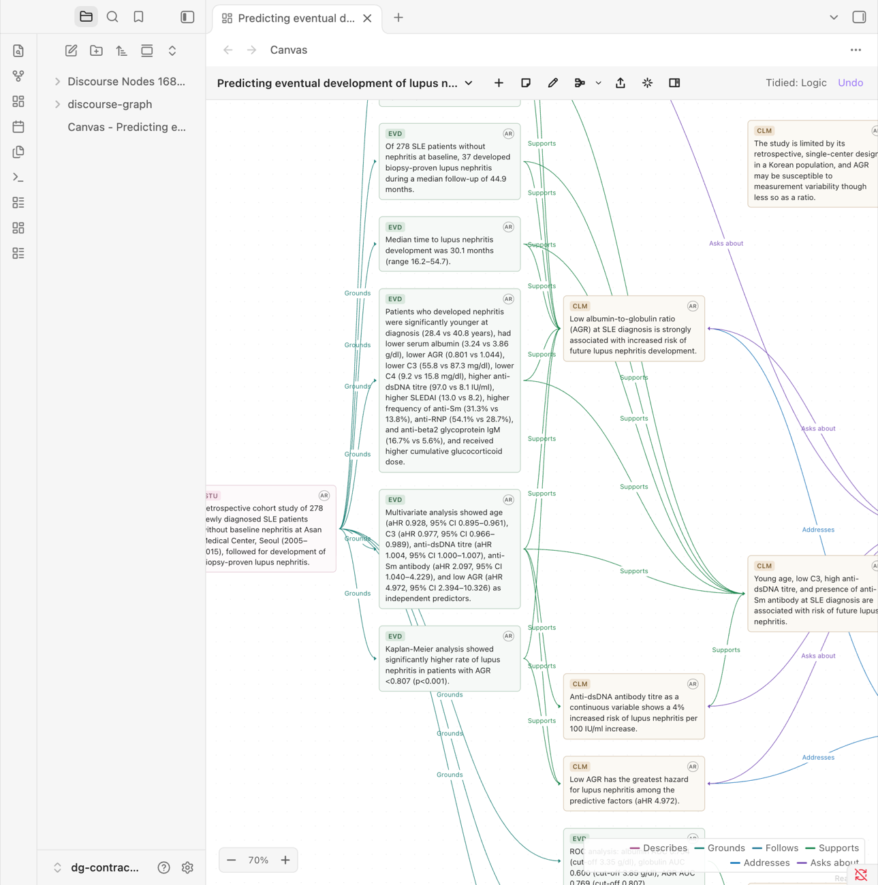
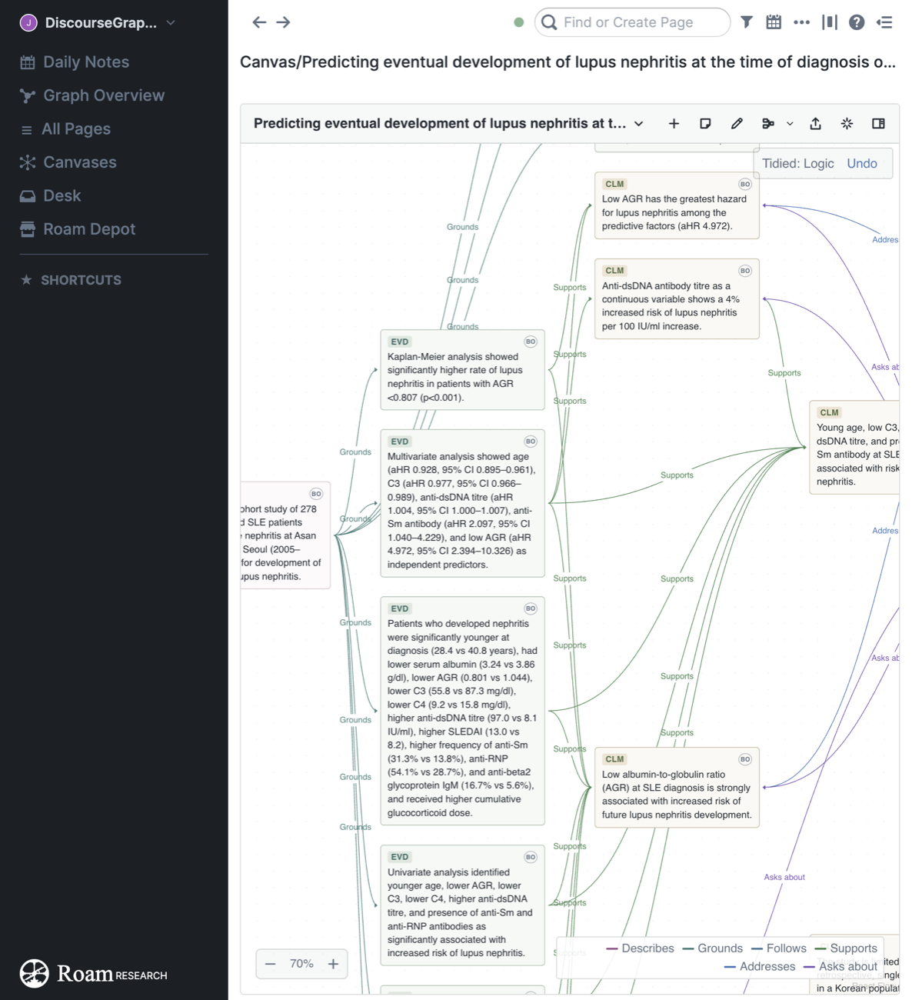
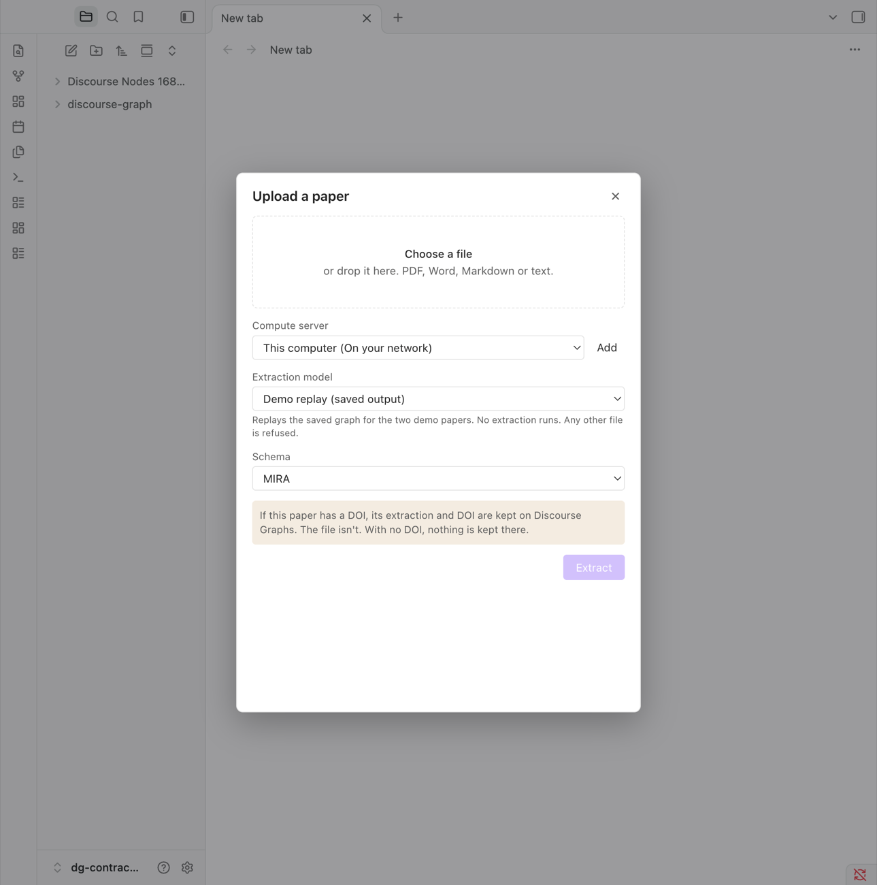
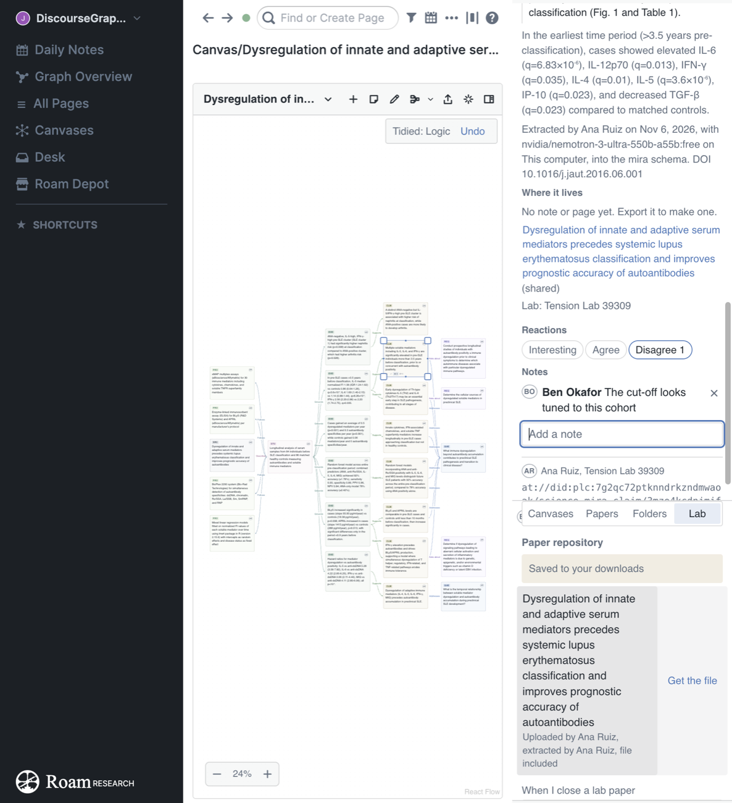
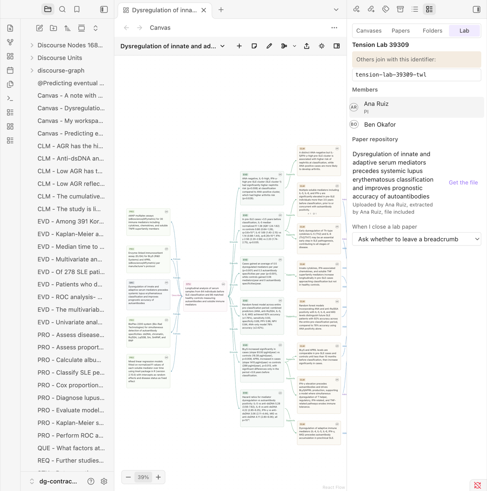
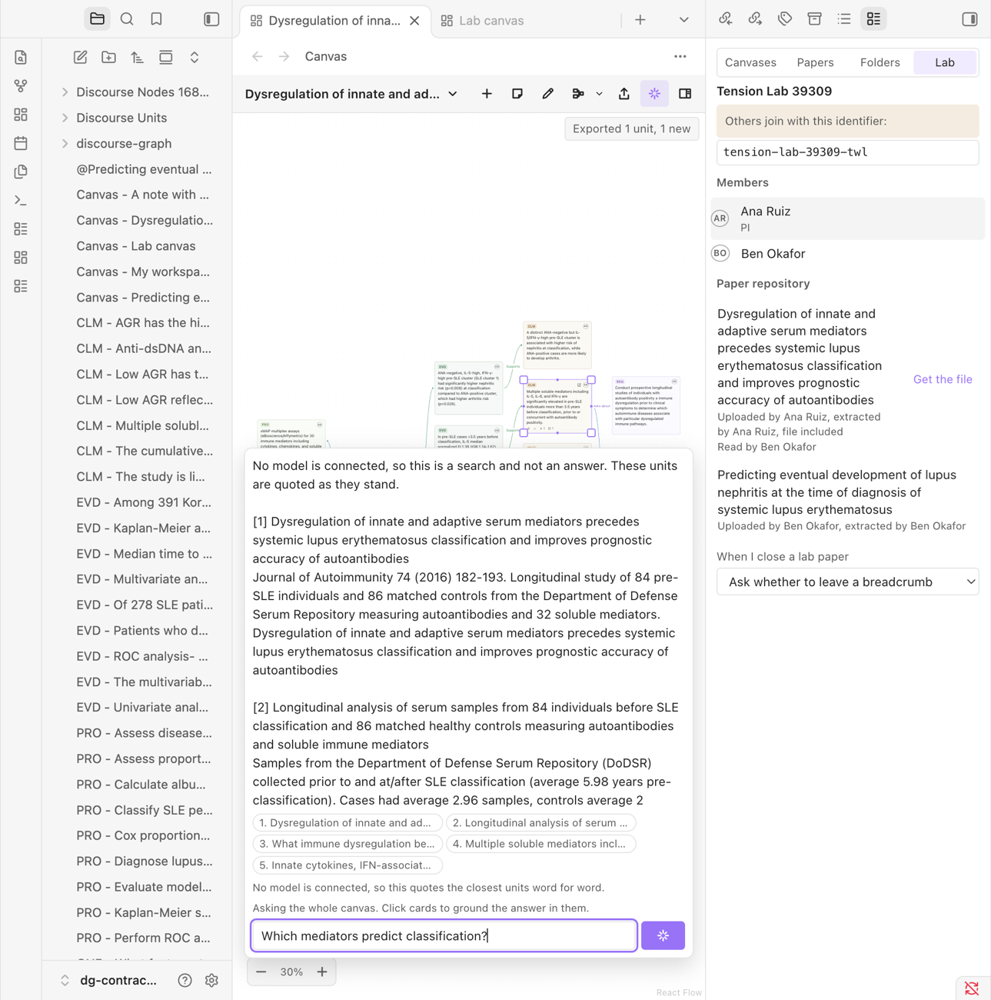
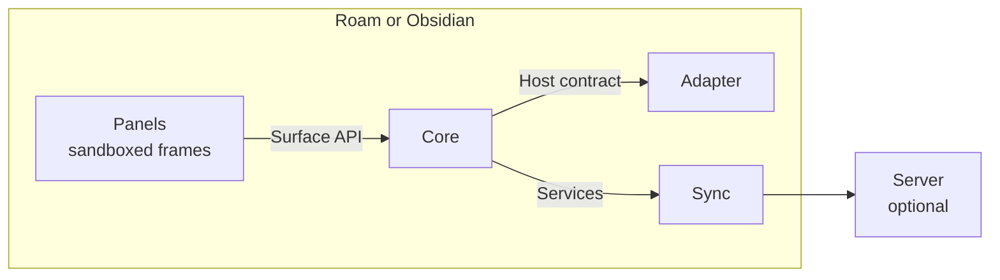

<h1 align="center">Discourse Graphs plugins</h1>

<p align="center">
  One core, one canvas and one set of panels, running inside Roam and Obsidian.<br>
  Your data stays in your notes. Sync, AI, your Zotero library and the scholarly record are there when you ask for them.
</p>

<p align="center">
  <a href="https://github.com/abstractary/discourse-graphs-plugins/actions/workflows/ci.yml"></a>
  
  <a href="LICENSE"></a>
  
</p>

> [!IMPORTANT]
> **This is a demo.** It was built to show the Discourse Graphs team one way the plugins could be structured. It isn't a release, it isn't a replacement for the [current plugins](https://github.com/DiscourseGraphs/discourse-graph), and it covers about 40% of what they do. Use a throwaway vault or graph.

<p align="center">
  
  
</p>

## What it does

**The same tool in both bases.** Canvas, context panel, Library and upload are one set of web panels, rendered inside Roam and Obsidian in the base's own fonts and colors. People in each base can share a mental model, and a feature is built once.

**Papers become canvases.** Upload a PDF, Word, Markdown or text file, then pick where it runs, which model reads it, and which schema it's read into. Its questions, claims and evidence land on a canvas of their own.

**Nothing fills your vault until you ask.** Units stay on the paper's canvas until you export them, whole or a few at a time, to your workspace, your lab's canvas, or a folder.

**Every unit knows where it came from.** Open one to see its paper, DOI, extraction model, the passage it came from, and everywhere it lives now. A card can show the same on its face: its source and whether a person or a model read it, its authors, workspace, date and identifiers.

**It works with your Zotero library.** Find a reference, tick the highlights that matter, and they arrive as a source and units that quote their passages, each with a link back to the page in Zotero. Zotero is only read, and only when you ask. [docs/zotero.md](docs/zotero.md) has the design and what is next.

**People have profiles.** Hover someone's initials for a card, click for their profile. You see your whole history, your lab sees what you did on shared canvases, and anyone else sees counts alone.

**It joins the scholarly record.** Look a paper up in Crossref, DataCite, OpenAlex and PubMed to find its other identifiers and whether it was retracted. Export a canvas as an RO-Crate for Zenodo, WorkflowHub or a lab notebook, and read other tools' crates in. The server signposts each stored graph and takes COAR Notify notifications.

**Labs work together.** Join with an identifier. Once accepted, you get AI and the lab's shared canvases. Shared papers show who uploaded and extracted them, and people can choose to leave a breadcrumb when they've read one.

**Quiet team signals.** Units on shared canvases can carry notes and reactions: interesting, agree, disagree. They sit compactly on the card, never notify anyone, and never stand in for approval.

**Ask your canvas.** Press AI and start typing. Click cards to ground the answer in just those units.

**Tidy that understands arguments.** Nine arrangements, from logical dependency and debate to timeline, people and centrality, with link colors that stay the same across all of them.

<table>
  <tr>
    <td width="50%"></td>
    <td width="50%"></td>
  </tr>
  <tr>
    <td width="50%"></td>
    <td width="50%"></td>
  </tr>
</table>

## Try it

You need [Node 26](https://nodejs.org), and Obsidian or Roam Desktop.

```bash
git clone https://github.com/abstractary/discourse-graphs-plugins.git
```

```bash
cd discourse-graphs-plugins && npm install && npm run build
```

Start the local compute server and a stand-in for the Discourse Graphs service, on ports 8787 and 8788:

```bash
npm run server
```

**In Obsidian:** make a new vault, copy `dist/obsidian/` to `.obsidian/plugins/discourse-graphs-demo/`, then turn on "Discourse Graphs (demo)" under Community plugins.

**In Roam:** make a new offline graph in Roam Desktop, start Roam with its debug port, then load the extension:

```bash
open -a "Roam Research" --args --remote-debugging-port=9333 --remote-allow-origins='*'
```

```bash
node harness/cdp.mjs file dist/roam/extension.js
```

It lasts until Roam reloads. A `{{[[roam/js]]}}` block should also work, but that hasn't been tried.

The first time it loads, it asks whether you're joining a lab. Then try this:

1. Open the command palette and run **Find a canvas**. In the Library, open **Papers** and press **Load demo papers**. This works with no server.
2. Open a paper, and press **Tidy**.
3. Click a card, then open the context panel to see its provenance.
4. Select a few cards and press **Export**.
5. Run **Upload a paper**, choose `demo/papers/lupus-nephritis-prediction.pdf` with **Demo replay**, and press **Extract graph**.
6. To try a lab, run **Join or start a lab** in one app, and join with its identifier from the other.
7. Run **Start walkthrough** for a guided tour of the basics.

### Extraction models

| Model | What it does | Needs |
|---|---|---|
| Demo replay | Replays the saved extraction for the two demo papers | Nothing |
| Sentence split | A rough stand-in that sorts sentences by simple rules | Nothing |
| MIRA (hosted) | Sends the file to the [MIRA extraction app](https://mira-extraction.vercel.app/) | Network access |

AI mode quotes the closest units word for word until a model is connected. To connect one, set `ANTHROPIC_API_KEY` or `OPENROUTER_API_KEY` before starting the server. [server/README.md](server/README.md) has every setting.

### What leaves your machine

- With no server, nothing does.
- Extraction sends the file to the server you pick.
- A paper with a DOI has its extraction and DOI kept on the Discourse Graphs service. The file isn't kept. With no DOI, nothing is kept there.
- Sharing with a lab sends what's on shared canvases, and the original file only if you say so.
- Ask AI with your own key sends your question and the units on that canvas to the provider you chose: Anthropic (`api.anthropic.com`), an OpenAI-compatible address you set (such as `api.openai.com`, `openrouter.ai`, or a model server on your own computer), or Google Gemini (`generativelanguage.googleapis.com`). The key is kept in Obsidian's keychain and is sent only to that provider, or to your lab's server if you choose that route. You need your own account with the provider, which may charge you.
- Reading a PDF or a Jupyter notebook sends nothing.

## How it's built



```text
packages/
  contract/   Records, the three seams, and the conformance suite
  core/       The graph, identity, papers, units, labs, profiles, crates and the Zotero mapping
  layout/     Tidy modes and centrality, as pure functions
  sync/       The only module that touches the network: servers, registries and Zotero
  native/     What's drawn in the base: capture, badges, dialogs, walkthrough
  surfaces/   The panels: canvas, context, Library, reader, runs, profile, upload, From Zotero
plugins/
  obsidian/   The Obsidian adapter
  roam/       The Roam adapter
server/       Reference server: compute, graph store, labs, exchange, AI, landing pages, inbox
harness/      Tests that drive the real apps
lexicons/     AT Protocol schemas
demo/papers/  Two papers and their extractions
```

The boundaries are checked: `npm run check-boundaries` fails if core imports React or anything but sync calls the network, and `npm run dsm` prints the dependency matrix from the real imports and fails on a cycle. [docs/ARCHITECTURE.md](docs/ARCHITECTURE.md) explains each cut.

## How it's tested

| Level | Checks | Covers |
|---|---:|---|
| Unit | 330 | Records, core, papers, labs, layout, sync, cards, lookups, crates, profiles, Zotero |
| Server | 104 | Every route, with fake model servers |
| Conformance | 36 in each app | One host contract, run inside real Obsidian and real Roam |
| Real-app suites | 183 in Obsidian, 184 in Roam | Canvas, capture, badges, Tidy, walkthrough, real data |
| Across both apps | 124 | Upload, export, provenance, labs, sync, reactions, breadcrumbs, AI |

The unit and server counts are from 13 November 2026. That day eight suites also ran in real Obsidian, 219 checks in all: reading three papers, the PDF reader, search, cards and lookups, crates, profiles and Zotero. All passed except one search check, linking a found unit at the cursor, which fails on some runs and passes on others. The other rows are from the first version, and Roam has not been run since.

The real-app suites use real mouse and keyboard input inside real Obsidian and Roam. [docs/testing.md](docs/testing.md) explains how to run them.

## What's next: agent skills and hooks

Skills and hooks are next. The aim is for an agent to work with a discourse graph the same way in either base:

- **Skills** give an agent the same tools a panel has, like finding units, proposing relations and reading a canvas, through a local bridge to core.
- **Hooks** tell it what happened, like a paper being extracted or a relation waiting for a decision.
- **Agents propose, and people decide.** Agent work arrives pending, attributed to the agent and the person who ran it.

Because both plugins share one core, a skill written once works in both. [docs/agent-skills-and-hooks.md](docs/agent-skills-and-hooks.md) goes through how this could work in each base, with the open questions.

## Known limits

- It covers about 40% of what today's plugins do. Queries, for example, aren't here. [docs/COMPARISON.md](docs/COMPARISON.md) has the full picture, row by row.
- The server is a reference for the API, not something to host. It has no TLS, rate limits or way to revoke a token.
- MIRA and real AI models were only tested against fake servers.
- Zotero was only tested against a stand-in built from its documentation. No real Zotero library has been read.
- No real repository inbox, Zenodo deposit or lab notebook has been tried with the crates and announcements.
- A public profile isn't published anywhere. The counts stay on your device.
- Tests ran on macOS, in Obsidian 1.15 and an offline graph in Roam Desktop.
- The Roam plugin has only run in an offline graph.

## Documentation

| Read this | For |
|---|---|
| [User guide](docs/guide/README.md) | How the schema works and how to use every panel, with pictures |
| [Schema reference](docs/guide/schema.md) | Every type, field, link and rule |
| [Cards, identifiers and the scholarly record](docs/scholarly.md) | Card facts, registry lookups, RO-Crate, DataCite, Signposting and COAR Notify, with the dependency matrix |
| [Zotero](docs/zotero.md) | What the existing Zotero plugins teach, the design for a long-lived integration, what is built and what to check first |
| [LLM and MCP spec](docs/llm-and-mcp-spec.md) | Own-key AI as built, and the design for the MCP server and Jupyter |
| [Interface audit](docs/ui-audit.md) | What was found in the Obsidian interface, what was fixed and what is open |
| [Architecture](docs/ARCHITECTURE.md) | Modules, boundaries and why they're where they are |
| [Contract](docs/CONTRACT.md) | Records, identity, the host contract, and settled decisions |
| [Services](docs/services.md) | The server API: compute, graph store, labs, sync, AI |
| [Product](docs/PRODUCT.md) and [Design](docs/DESIGN.md) | Who this is for, and how it looks and behaves |
| [Comparison](docs/COMPARISON.md) | How this measures up against today's plugins |
| [Canvas engines](docs/CANVAS-ENGINES.md) | Why React Flow |
| [Testing](docs/testing.md) | Every suite, and how to run it |

## Contributing

Issues and disagreements are welcome. Start with [CONTRIBUTING.md](CONTRIBUTING.md).

## Acknowledgements

Built on the ideas and research of the [Discourse Graphs](https://discoursegraphs.com) project. The extraction format, reaction design and much of the team interaction model come from MIRA.

## License

[Apache 2.0](LICENSE), matching the Discourse Graphs repository. The demo PDFs belong to their publishers. See [demo/papers/README.md](demo/papers/README.md).
