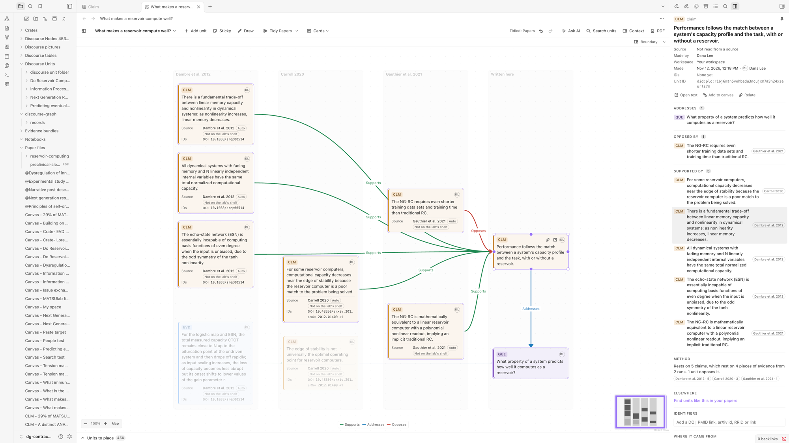
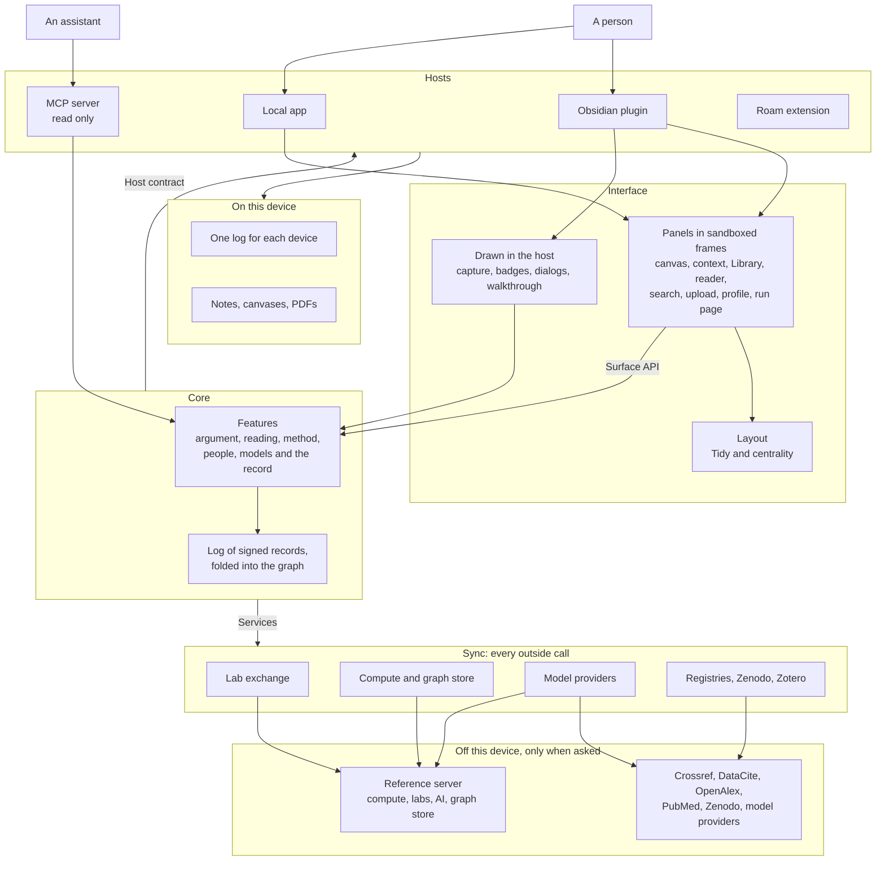

<h1 align="center">Discourse Graphs plugins</h1>

<p align="center">
  Questions, claims and evidence as a graph you can see, trace and share, inside your notes.<br>
  One core, one canvas and one set of panels, behind one host contract. Your data stays in your vault until you send it somewhere.
</p>

<p align="center">
  <a href="https://github.com/abstractary/discourse-graphs-plugins/actions/workflows/ci.yml"></a>
  
  <a href="LICENSE"></a>
  
</p>

> [!IMPORTANT]
> **This is a demo, not a release.** It is an independent implementation, and it is not a replacement for the [official Discourse Graphs plugins](https://github.com/DiscourseGraphs/discourse-graph). Use a throwaway vault.

<p align="center">
  
</p>

## Contents

- [What it does](#what-it-does)
- [Install](#install)
- [A first session](#a-first-session)
- [Hosts](#hosts)
- [Models and keys](#models-and-keys)
- [What leaves your machine](#what-leaves-your-machine)
- [How it is built](#how-it-is-built)
- [Scripts](#scripts)
- [Testing](#testing)
- [Limits](#limits)
- [Documentation](#documentation)
- [Roadmap](#roadmap)
- [Contributing](#contributing)

## What it does

A discourse graph holds one chain: a **question**, the **claims** that answer it, the **evidence** for and against each claim, and the **source** the evidence was read from. This implementation extends the chain to how the evidence was made: the **output** it rests on, the **run** that made the output, and the **protocol** and **code** the run followed. [The schema reference](docs/guide/schema.md) lists every type, field, relation and rule.

### Build an argument

- **A canvas** of cards and typed links, with stickies, freehand drawing, a minimap, a legend, undo and redo, and copy and paste that keeps links.
- **Ten Tidy arrangements**: by logic, for and against, timeline, kinds, people, papers, focus, and three rankings by centrality. Link colours stay the same in all of them.
- **Capture from your notes.** Select text and press a key to make a unit, turn a whole note into one, or tag a line as a candidate and promote it later.
- **Your own types.** A lab renames and adds types on nine fixed kinds, sets a template and a tag for each, and says which types each relation may join. The grammar is saved and read as one file.
- **Relations as note properties**, and a table for each type, so the vault stays legible without the plugin.

### Read

- **A PDF reader** beside the canvas. A highlighted passage becomes a unit that keeps its exact words and its page.
- **Extract graph** reads a whole paper into a canvas of its own. Nothing reaches your workspace until you bring it over.
- **Zotero** as the library: references, highlights and PDFs, read only, with a link back to the page.
- **Search** over titles, passages and notes, with filters for type and credit, and a quick finder.
- **A paper map** that places papers by the links people drew between their units and by citations.

### Record how it was found

- **Runs, protocols, code and outputs** as units. A run says "changed" or "missing" when what it pinned drifts.
- **A Jupyter notebook** becomes code, a run and its outputs, each pinned by a hash.
- **Pictures as evidence.** A dropped image is an output pinned by its bytes.
- **Sign-off.** A unit is marked checked, with how it was checked, against the version that was read. The mark goes stale when the unit changes.

### Work with a lab

- **Labs** with invitations, members, devices, a shared shelf of papers, and shared canvases that sync by themselves.
- **Signed records.** Every change names its author and device.
- **Reactions and notes** on shared units. They never notify anyone.
- **Profiles** with three audiences: you see your history, your lab sees your work on shared canvases, anyone else sees counts.

### Use a model

- **Ask AI** answers from a canvas, grounded in the cards you pick, with your own key, your lab's model, or no model at all.
- **An MCP server** lets an assistant you already use read the graph.
- **People decide.** Whatever a model or an agent writes arrives as a proposal, attributed, and waits for a person.

### Join the scholarly record

- **Lookups** in Crossref, DataCite, OpenAlex and PubMed for a paper's identifiers and whether it was retracted.
- **Research crates**: export and import a canvas with its files as an RO-Crate or an `.eln` file, with an optional Zenodo draft.
- **Signposting and COAR Notify** on the reference server.

The [user guide](docs/guide/README.md) covers every panel, command, key and setting.

## Install

You need [Node 26](https://nodejs.org) and [Obsidian](https://obsidian.md).

```bash
git clone https://github.com/abstractary/discourse-graphs-plugins.git
```

```bash
cd discourse-graphs-plugins && npm install && npm run build
```

Make a new vault, copy `dist/obsidian/` to `.obsidian/plugins/discourse-graphs-demo/` inside it, and turn on **Discourse Graphs (demo)** under Community plugins.

The plugin works with no server. To try extraction on a server, labs and Ask AI, start the reference server and a stand-in for the Discourse Graphs service, on ports 8787 and 8788:

```bash
npm run server
```

## A first session

1. Run **Find a canvas** from the command palette. In the Library, open **Papers** and press **Load demo papers**.
2. Open a paper and press **Tidy**.
3. Click a card and open the context panel to see where it came from.
4. Select a few cards and press **Export**.
5. Run **Upload a paper**, choose `demo/papers/lupus-nephritis-prediction.pdf` with **Demo replay**, and press **Extract graph**.
6. Run **Join or start a lab**. On the Library's **Lab** tab press **Make an invitation**, and paste the line into **Join a lab** in a second vault.
7. Run **Start walkthrough** for a tour of the basics.

## Hosts

The core runs inside a host. Everything a host must do is one [contract](docs/CONTRACT.md), checked by a conformance suite.

| Host | State | Start |
|---|---|---|
| Obsidian plugin | Current | See [Install](#install) |
| Local app | Current. The same panels in a browser, over a vault folder. No editor, capture key or tables | `npm run build:local`, then `npm run local -- --vault <folder>` and open http://localhost:8796 |
| MCP server | Current. Six tools, all read only | `npm run mcp -- --vault <folder>` |
| Roam extension | Builds and passes conformance. It lacks the optional host calls, so it has none of the tables, link properties or local-file features | [docs/testing.md](docs/testing.md) |

[local/README.md](local/README.md) has every flag for the local app, and [docs/mcp.md](docs/mcp.md) has the MCP server's tools and how to connect a client.

## Models and keys

| Use | Choices | Needs |
|---|---|---|
| Extraction | Demo replay, for the two demo papers | Nothing |
| | Sentence split, a rough stand-in | Nothing |
| | MIRA (hosted) | Network access |
| Ask AI | Word-for-word quoting of the closest units | Nothing |
| | Anthropic, any OpenAI-compatible endpoint, or Gemini, with your own key | An account with the provider |
| | Your lab's model, through the lab's server | A lab |

Keys are kept on the device, outside the vault. A lab can limit which servers and providers its work may reach. [docs/ai.md](docs/ai.md) has every setting, and [server/README.md](server/README.md) has the server's environment variables.

## What leaves your machine

With no lab joined, no model set up and no server chosen, nothing does.

- **A lab** is sent what is on the canvases shared with it. A paper's file goes only if you tick it.
- **Extraction** sends the file to the server you pick. If the paper has a DOI, its graph and DOI then go to the Discourse Graphs service, without the file.
- **Ask AI** sends your question and the canvas's units to the provider you chose, or to your lab's server.
- **A lookup, a Zenodo draft and an announcement** each send only when you press the button.
- **Zotero** is read on your own computer.
- Reading a PDF or a Jupyter notebook sends nothing.

[docs/what-leaves-the-device.md](docs/what-leaves-the-device.md) has one row for each destination: what is sent, when, and how to turn it off.

## How it is built



`packages/contract` sits under all of it: the records and their rules, the three seams (Surface API, Host contract, Services), the route table and the conformance suite. [docs/ARCHITECTURE.md](docs/ARCHITECTURE.md) has the same picture file by file, and one change traced end to end.

```text
packages/
  contract/   Records, the three seams, the route table and the conformance suite
  core/       The graph, identity, papers, units, labs, profiles, crates and the Zotero mapping
  layout/     Tidy modes and centrality, as pure functions
  sync/       Everything that calls a server, a registry or Zotero
  native/     What is drawn in the host: capture, badges, dialogs, walkthrough
  surfaces/   The panels: canvas, context, Library, reader, runs, profile, upload, search
plugins/
  obsidian/   The Obsidian adapter
  roam/       The Roam adapter
local/        The local app and the MCP server
server/       Reference server: compute, graph store, labs, exchange, AI, landing pages, inbox
ontology/     The schema as an ontology, with shapes and a validator
lexicons/     AT Protocol schemas
harness/      Tests that drive the real apps, and the simulation of several people
examples/     A worked example, three disciplines, and evidence crates
demo/papers/  Two papers and their saved extractions
```

Three rules hold the cuts in place, and CI checks them:

- Panels reach the core only through the Surface API.
- The core reaches a host only through the Host contract, and a server only through `packages/sync`.
- No module imports from inside another, and there are no cycles between modules.

The data is a log of signed records. A unit's id is `did#tid` and never changes. The graph is what the log adds up to. [docs/ARCHITECTURE.md](docs/ARCHITECTURE.md) explains each part.

## Scripts

| Command | Does |
|---|---|
| `npm run build` | Builds the plugins into `dist/`, without test hooks |
| `npm run build:test` | The same, with the hooks the real-app tests use |
| `npm run build:local` | Builds the local app |
| `npm run local` | Starts the local app |
| `npm run mcp` | Starts the MCP server on stdio |
| `npm run server` | Starts the reference server and the service stand-in |
| `npm test` | Unit tests |
| `npm run test:server` | Server tests, with fake model servers |
| `npm run sim` | The simulation of several people, their devices and one lab server |
| `npm run check-types` | Type check |
| `npm run check-boundaries` | Fails when a package reaches where it may not |
| `npm run check:routes` | Fails when the server or the docs disagree with the route table |
| `npm run gen:routes` | Writes the server's and the docs' copies of the route table |
| `npm run dsm` | Prints the dependency matrix, and fails on a cycle |
| `npm run validate:ontology` | Checks the ontology's shapes against their cases (needs Python with `rdflib` and `pyshacl`) |
| `npm run seed:example` | Writes the worked example into a vault folder |
| `npm run example` | Rebuilds the worked example |
| `npm run coverage` | Sorts the official plugins' host calls by whether the contract covers them (needs a checkout of them) |

## Testing

| Layer | Command | Covers |
|---|---|---|
| Unit | `npm test` | Records, core, papers, labs, layout, sync, cards, lookups, crates, profiles, Zotero |
| Server | `npm run test:server` | Every route |
| Simulation | `npm run sim` | Several people sharing a lab: joining, syncing, removal, signatures, replay |
| Conformance | `harness/` | The host contract, run inside the real app |
| Real app | `harness/` | Canvas, capture, reading, search, crates, profiles and Zotero, with real mouse and keyboard input |

The first three, with the type, boundary, route, cycle and ontology checks, run in CI. The real-app suites are run by hand. [docs/testing.md](docs/testing.md) has every suite and how to run it.

## Limits

- **It is a demo.** It matches 59% of the 95 capabilities of the official plugins, and 83% of the 50 that are on by default in both of them. Queries are one example of what is missing. [docs/COMPARISON.md](docs/COMPARISON.md) has every row.
- **The server is a reference for the API.** It has no TLS, rate limits or way to revoke a token. Do not host it.
- **Real models and MIRA have only been tested against stand-in servers.**
- **Zotero** has been read from a real library. Highlights and group libraries have only been tested against a stand-in.
- **Nothing is published.** No Zenodo deposit, repository inbox or lab notebook has been tried for real, and no unit resolves from outside.
- **The real-app tests** have run on macOS, in Obsidian 1.15.
- **The Roam extension** has only run in an offline graph.

Each reference page ends with its own limits.

## Documentation

| Read this | For |
|---|---|
| [User guide](docs/guide/README.md) | Every panel, command, key and setting, with pictures |
| [Schema reference](docs/guide/schema.md) | Every type, field, relation and rule |
| [Feature map](docs/features.md) | The fourteen feature areas and where each is tracked |
| [Architecture](docs/ARCHITECTURE.md) | The packages, the seams and the rules |
| [Contract](docs/CONTRACT.md) | Records, identity and what a host must offer |
| [Services](docs/services.md) | Every route of the reference server |
| [AI](docs/ai.md) and [MCP](docs/mcp.md) | Models, keys, proposals, and the server for agents |
| [Labs and sync](docs/labs-and-sync.md) | Labs, devices, signatures and merging |
| [Scholarly record](docs/scholarly.md) and [Zotero](docs/zotero.md) | Identifiers, crates, announcements and the library |
| [Roadmap](ROADMAP.md) and [Strategy](docs/strategy.md) | What is planned, and why |

[docs/README.md](docs/README.md) lists every page.

## Roadmap

The plan extends one chain outward from one person: a researcher, then a lab, then the lab's agents, then the public record, then other labs. It connects to six groups of research tools, by a designed surface where a group's products agree and by open standards where they vary. [ROADMAP.md](ROADMAP.md) has the work for each group, and [docs/strategy.md](docs/strategy.md) gives the reasoning.

## Contributing

Issues and disagreements are welcome. Start with [CONTRIBUTING.md](CONTRIBUTING.md), and report a security problem as [SECURITY.md](SECURITY.md) says. Changes are listed in [CHANGELOG.md](CHANGELOG.md).

## Acknowledgements

Built on the ideas and research of the [Discourse Graphs](https://discoursegraphs.com) project. The extraction format, the reaction design and much of the team model come from MIRA.

## License

[Apache 2.0](LICENSE), matching the Discourse Graphs repository. The demo PDFs belong to their publishers. See [demo/papers/README.md](demo/papers/README.md).
