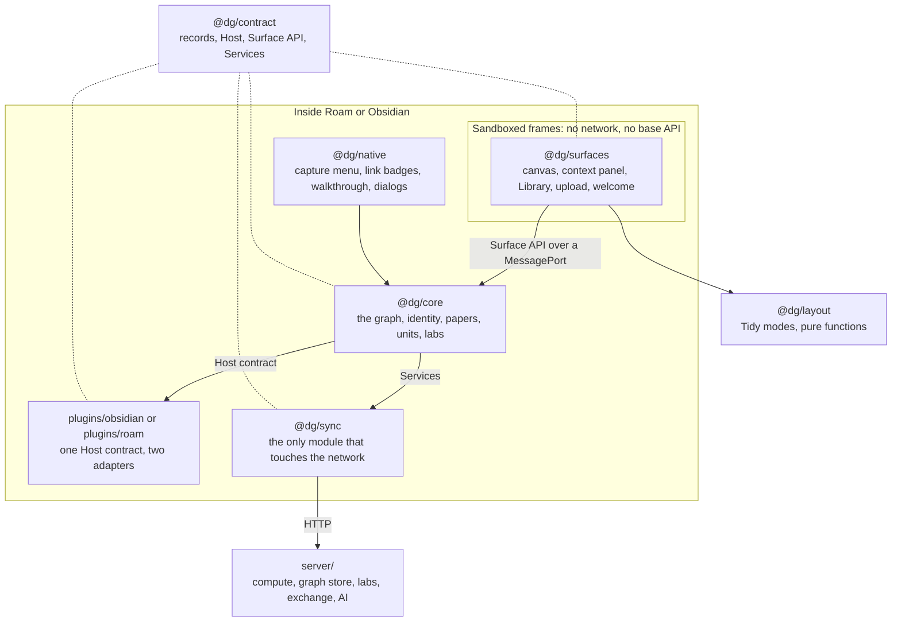

# Architecture

Discourse Graphs runs inside two very different tools. Roam is a hosted graph of blocks. Obsidian is a folder of Markdown files. This project keeps what people see and what the graph means in one place, and keeps each base's own habits in a thin adapter.

## The shape

Three seams hold it together, and each one is a file you can read:

| Seam | File | What crosses it |
|---|---|---|
| Surface API | [`packages/contract/src/surface.ts`](../packages/contract/src/surface.ts) | Everything a panel can ask for, as typed messages |
| Host contract | [`packages/contract/src/host.ts`](../packages/contract/src/host.ts) | Everything core needs from a base |
| Services | [`packages/contract/src/services.ts`](../packages/contract/src/services.ts) | Everything core needs from a server |

## Modules

| Module | Job | May depend on |
|---|---|---|
| `@dg/contract` | Record types, folding, the seams, the conformance suite | Nothing |
| `@dg/layout` | Tidy modes, centrality, crossing measures | `@dg/contract` |
| `@dg/core` | The graph, identity, papers, units, labs | `@dg/contract` |
| `@dg/sync` | Compute servers, lab exchange, the HTTP client | `@dg/contract` |
| `@dg/native` | UI drawn in the base's own page | `@dg/contract`, `@dg/core` |
| `@dg/surfaces` | React panels, one bundle, picked by route | `@dg/contract`, `@dg/layout` |
| `plugins/obsidian`, `plugins/roam` | Adapters and wiring | All of the above except `@dg/surfaces`, which arrives as built HTML |
| `server/` | Reference server | Nothing here, on purpose |

`npm run check-boundaries` fails the build if any module reaches past this table. Core can't import React, the frames can't import a base's API, and only `@dg/sync` calls `fetch`.

`npm run dsm` prints the same table as a design structure matrix, made from the imports in the code. [scholarly.md](scholarly.md#how-the-parts-depend-on-each-other) has it, with a second matrix for the files behind identifiers, lookups, crates and announcements.

## Why each cut is where it is

**Core runs in the plugin, not the frame.** Capture and link badges need the graph while no panel is open, and several panels share it.

**Panels are sandboxed frames.** `sandbox="allow-scripts"` with a content security policy that blocks the network. A panel has one way out, the port it's handed, so the same bundle behaves the same in both bases and can't reach the base's API by accident. It also means a panel can't download a file or call a server itself, which is why those live behind the Surface API.

**Core never touches the network.** `Services` is injected, and a test can pass a fake one. Without services, everything local still works.

**The server sees opaque records.** Each lab member keeps a full local copy. The server is an index and an exchange, so losing it costs freshness, not work. Records carry their author and are merged by revision, so no server decides who wins.

**Records, not notes, are the source of truth.** Assertions never change. Documents are revised, and the highest revision wins. Each base stores them where it stores things: a folder of JSONL files in Obsidian, a page of blocks in Roam. A unit becomes a note or page only when someone exports it, so reading a paper doesn't fill a vault with 30 files.

**Each outside standard has one file that knows it.** RO-Crate, DataCite, COAR Notify and the registries' APIs change on their own schedules. Each is read or written by a single file, behind types in `@dg/contract/scholarly.ts` that import nothing. A new version of a standard is a change to one file.

**Two clients, for two kinds of site.** The lab's server is reached with the base's own `fetch`, which can stream. Registries and publishers' pages are other people's sites, and a page can't read their `Link` headers, so `@dg/sync` takes a second client for them. In Obsidian that is Obsidian's own request.

## Following one paper through

1. The upload panel reads the file and calls `paper.extract`.
2. Core asks `@dg/sync` to extract it on the chosen server, passing status lines to the panel as they arrive.
3. Core turns the graph into records: a paper, a canvas, its units and relations. No notes are written.
4. If the paper has a DOI, its graph and DOI go to the Discourse Graphs service. The file doesn't, and without a DOI nothing goes.
5. If the person chose to share, the outputs (and the file, if they say so) go to the lab's repository, and the canvas is marked shared.
6. `@dg/sync` pushes the shared records. A teammate's plugin pulls them, core folds them in, and their panels redraw.

## Testing at each layer

| Layer | How | Where |
|---|---|---|
| Records, core, layout, sync | Unit tests with an in-memory host and fake services | `test/` |
| Server | Unit and route tests with fake model servers | `server/test/` |
| Both adapters | One conformance suite, run inside the real apps | `packages/contract/src/conformance.ts` |
| Whole flows | Real mouse and keyboard in real Roam and Obsidian | `harness/*-test.mjs` |

See [testing.md](testing.md) for how to run them.

## What's unfinished

This is a demo, and these are the known edges:

- The newest record kinds (papers, folders, reactions, notes) have no AT Protocol lexicons yet. They stay in the local format.
- The server trusts the name a member sends with a breadcrumb or an upload.
- Each lab member's token is a bearer token held in plugin storage.
- Roam has no slot for custom sidebar content, so panels are injected into its sidebar.
- `packages/core/src/index.ts` and `packages/surfaces/src/canvas/App.tsx` are each over 1,000 lines, and both should be split the way papers, units and labs already are.

## Records between people

Added 13 November 2026. The detail and the reasons are in [four-vaults.md](four-vaults.md).

| Concern | Where it lives | The rule |
|---|---|---|
| Which version stands | `foldRecords` in [`contract/records.ts`](../packages/contract/src/records.ts) | Each version names the one it replaces. A version beats what it replaces. Of two made apart, the later stands, except that on a canvas an edit beats a removal, and for memberships and devices a removal beats an edit |
| Who may change what | The same fold | An id carries its author's DID. A unit's words and existence are its author's. A labmate may add facts. Only a lab's custodian changes the lab, its grammar and its memberships |
| Whose word a record is | [`core/signing.ts`](../packages/core/src/signing.ts) | Each version is signed by the device that wrote it. A device's key counts once a trusted device has vouched for it. Checked when records arrive from a lab |
| What a vault sends | `shareable` in [`core/labs.ts`](../packages/core/src/labs.ts) | What is on a shared canvas and what it needs to make sense, including what was taken away. Every version of a card, so "made apart" reads the same everywhere |
| Time and chance | `clock` and `entropy` in [`contract/ids.ts`](../packages/contract/src/ids.ts) | A base leaves them alone. A lab server's time corrects a wrong clock. A simulation replaces both, with seeded keys, and replays byte for byte |
| Reading a log off disk | [`contract/log.ts`](../packages/contract/src/log.ts) | Whole records only. A line a sync tool damaged is skipped and counted, never repaired |
| What a lab sets for everyone | `LabSettings` on the lab's record | Only the PI writes it. Every member holds it |

The simulation that keeps these honest is `node harness/four-vaults.ts`. The planned MCP server is one more signing device with a narrower role: see [mcp.md](mcp.md).

