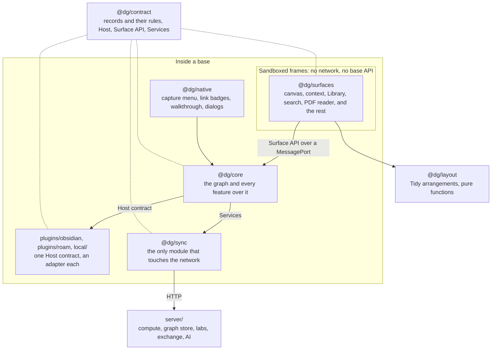

# Architecture

How the code stands after the refactor of 13 November 2026. What that refactor was answering is in [audit-2026-11.md](audit-2026-11.md), and the features it serves are mapped in [features.md](features.md).

Discourse Graphs runs inside other tools. Obsidian, a folder of Markdown files, is the first. This project keeps what people see and what the graph means in one place, and keeps each base's own habits in a thin adapter.

| Base | State |
|---|---|
| Obsidian | The first base. Everything is built and tested here |
| The local app | A small web app over the same vault, with no editor |
| The MCP server | An agent's way to read the same vault, on stdio. It stands on the same vault module as the local app and runs the core in the role `agent` |
| Roam | An adapter that still builds and passes the conformance suite. It has not kept up with what was built since, and the direction since 10 November is that Roam gets an exporter, not a host |
| Logseq | Planned. No code yet |

## The shape



Three seams hold it together, and each one is a file you can read:

| Seam | File | What crosses it |
|---|---|---|
| Surface API | [`packages/contract/src/surface.ts`](../packages/contract/src/surface.ts) | Everything a panel can ask for, as typed messages |
| Host contract | [`packages/contract/src/host.ts`](../packages/contract/src/host.ts) | Everything core needs from a base |
| Services | [`packages/contract/src/services.ts`](../packages/contract/src/services.ts) | Everything core needs from a server |

## Modules

| Module | Job | May depend on |
|---|---|---|
| `@dg/contract` | Records and their rules, the seams, the conformance suite | Nothing |
| `@dg/layout` | Tidy arrangements, centrality, crossing measures | `@dg/contract` |
| `@dg/core` | The graph and every feature over it | `@dg/contract` |
| `@dg/sync` | One file for each outside service | `@dg/contract` |
| `@dg/native` | UI drawn in the base's own page | `@dg/contract`, `@dg/core` |
| `@dg/surfaces` | React panels, one bundle, picked by route | `@dg/contract`, `@dg/layout` |
| `plugins/*`, `local/` | Adapters and wiring. A plugin imports from `@dg/core` only its entry file | All of the above except `@dg/surfaces`, which arrives as built HTML |
| `server/` | Reference server | Nothing here, on purpose |

`npm run check-boundaries` fails if any module reaches past this table. Core can't import React, the frames can't import a base's API, and only `@dg/sync` calls `fetch`. `npm run dsm` prints the same table as a design structure matrix made from the imports in the code, and fails on a cycle. Both run in CI.

## Inside the contract

Records are one import, `@dg/contract/records.ts`, made of five files that each depend only on the ones above:

| File | Holds |
|---|---|
| [`record.ts`](../packages/contract/src/record.ts) | What a record is, how one is made, how one is revised |
| [`json.ts`](../packages/contract/src/json.ts) | JSON written one way only: what records are compared, hashed and signed by |
| [`title.ts`](../packages/contract/src/title.ts) | How a unit's title is written in a base |
| [`validate.ts`](../packages/contract/src/validate.ts) | Whether something is a well-formed record of a kind this version knows |
| [`fold.ts`](../packages/contract/src/fold.ts) | Every record read into one graph, and the rules for whose word stands |

Beside them: [`ids.ts`](../packages/contract/src/ids.ts) (ids, and where time and chance come from), [`log.ts`](../packages/contract/src/log.ts) (reading a device's log off disk), [`urls.ts`](../packages/contract/src/urls.ts) (whether an address is this computer), [`scholarly.ts`](../packages/contract/src/scholarly.ts) (identifiers, works, shelves), [`atproto.ts`](../packages/contract/src/atproto.ts) (the mapping to AT Protocol records).

## Inside the core

`createCore` in [`core/index.ts`](../packages/core/src/index.ts) reads the log, folds it, and builds one `Context`. Every feature is a function of that context.

**A feature has one shape:**

```ts
export const thingFeature = (context: Context, deps: { /* what it needs that isn't on Context */ }) => {
  const handlers: Pick<Handlers, "thing.list" | "thing.create"> = { /* … */ };
  return { handlers /* , and anything other features or the base need from it */ };
};
```

- `handlers` are the calls a panel can make. Their names and types come from the Surface API, so a missing or misnamed one doesn't compile.
- Anything a feature needs beyond the context arrives in `deps`, as one named object.
- Anything it offers beyond handlers is returned beside them, never mixed into them.

| Feature | File | Calls |
|---|---|---|
| A unit by itself: find, make, rename, retype, remove, view | `nodes.ts` | `node.*` |
| Capture from a note, and a renamed note renaming its unit | `capture.ts` | none: used by the base and by `node.create` |
| Canvases: list, open, write, build on | `canvases.ts` | `canvas.*` |
| Relations mirrored into notes as link properties | `mirror.ts` | none: runs after every change |
| Units: folders, reactions, notes, export | `units.ts` | `units.*`, `folder.*`, `unit.react`, `unit.note` |
| Relations | `relations.ts` | `relation.*` |
| Grammar: types, templates, schema files, tables | `grammar.ts` | `grammar.*`, `table.open` |
| Reading PDFs | `reading.ts` | `pdf.*`, `units.available`, `canvas.placeUnits` |
| Papers and extraction | `papers.ts` | `paper.*` |
| Paper map, similar units, search | `papermap.ts`, `similar.ts`, `search.ts` | `papers.*`, `node.similar`, `search.*` |
| Method, runs and notebooks | `method.ts`, `process.ts` | `process.*`, `run.*`, `notebook.*` |
| Pictures, outputs, related units, candidates | `gather.ts` | `image.add`, `unit.image`, `candidate.*` |
| Checks | `checks.ts` | `unit.check`, `unit.uncheck` |
| Proposals from agents | `proposals.ts` | `proposal.*` |
| Labs: invitations, members, settings, what is shared | `labs.ts` | `lab.*`, `canvas.share` |
| Devices | `devices.ts` | `device.*` |
| Signing and checking signatures | `signing.ts`, `identity.ts` | none: used by labs and the write path |
| Ask AI | `ai.ts` | `ai.*` |
| Zotero | `library.ts` | `zotero.*` |
| Published work, announcements, profiles | `works.ts`, `notify.ts`, `profile.ts` | `work.*`, `notify.*`, `profile.*` |
| Crates and publishing | `crate.ts`, `rocrate.ts`, `mira.ts`, `datacite.ts`, `zenodo.ts` | `crate.*`, `deposit.*` |
| Overview and Boundary | `holons.ts` | `holon.*` |
| What a panel asks of the base | `shell.ts` | `panel.*`, `dialog.*`, `link.open`, `server.*` |
| Shared small conversions | `bytes.ts` | none |
| Failures that keep their kind | `refuse.ts` | none |

**What `index.ts` still does** is what only it can: read the log, hold the graph, sign what is written, set up this person's identity and lab, build the context, and wire the features together. It defines no call a panel makes apart from identity and focus.

**How features reach each other.** Two ways, and no third:

- **Deps**, when one feature needs another's function: the canvas feature is handed `social` from the units feature.
- **Offers**, when a feature made early needs something from one made later, or when several need the same thing. A feature puts its part on `context.offers` as it is made (checks, preferences, "a note changed"), and others read it when called. A part not there yet reads as absent, so the order features are made in does not matter. `context.afterChange` is the same idea for "run this after every change".

**Failures keep their kind.** A feature refuses with `refuse(code, message)` from `refuse.ts`, and what a base refused keeps the base's own code. A panel receives `not-found`, `read-only`, `conflict`, `no-target` or `unavailable` and can act on it. Anything thrown without a code arrives as `invalid`.

**Rules every feature keeps:**

- Read a unit's type through `context.typeOf`, or `typeOfNode` and `baseOf` in `process.ts`. They follow a type that gave way to the lab's. Reading `graph.documents` for a type doesn't.
- Read a unit through `context.nodeOf`, which leaves out what was removed. Only code that must send a removal reads past it, and says so.
- Stamp through the contract's creators and `revise`. They use the corrected clock and name the version being replaced.
- Write through `context.put`. It signs.
- Never call the network. Ask `context.services`.

## Why each cut is where it is

**Core runs in the plugin, not the frame.** Capture and link badges need the graph while no panel is open, and several panels share it.

**Panels are sandboxed frames.** `sandbox="allow-scripts"` with a content security policy that blocks the network. A panel has one way out, the port it's handed, so the same bundle behaves the same in every base and can't reach a base's API by accident. It also means a panel can't download a file or call a server itself, which is why those live behind the Surface API.

**Core never touches the network.** `Services` is injected, and a test can pass a fake one. Without services, everything local still works.

**The server passes records along and decides nothing.** Each lab member keeps a full copy. Records carry their author's signature, and the rules for whose version stands are in the fold, on every device. Losing the server costs freshness, not work.

**Records, not notes, are the source of truth.** Assertions never change. Documents are revised: each version names the one it replaces, and of two made apart the later stands. Each base stores them where it stores things: a folder of JSONL files in Obsidian, one file to a device.

**Each outside standard has one file that knows it.** RO-Crate, DataCite, COAR Notify, MIRA, Zotero's API and the registries' APIs change on their own schedules. Each is read or written by a single file. A new version of a standard is a change to one file.

**Time, chance and keys can be handed in.** A base leaves them alone. The simulation replaces all three, which is what lets it replay a run byte for byte.

**Two clients, for two kinds of site.** The lab's server is reached with the base's own `fetch`, which can stream. Registries and publishers' pages are other people's sites, and a page can't read their `Link` headers, so `@dg/sync` takes a second client for them.

## Following one paper through

1. The upload panel reads the file and calls `paper.extract`.
2. Core checks the lab's reach, then asks `@dg/sync` to extract it on the chosen server, passing status lines to the panel as they arrive.
3. Core turns the graph into records: a paper, a canvas, its units and relations. No notes are written.
4. If the person chose to share, the canvas is marked shared.
5. The sync loop signs what isn't signed and sends what is on shared canvases. A labmate's plugin pulls it, checks each signature, folds it in, and their panels redraw.

## Records between people

The detail and the reasons are in [four-vaults.md](four-vaults.md).

| Concern | Where it lives | The rule |
|---|---|---|
| Which version stands | `foldRecords` in [`contract/fold.ts`](../packages/contract/src/fold.ts) | Each version names the one it replaces. A version beats what it replaces. Of two made apart, the later stands, except that on a canvas an edit beats a removal, and for memberships and devices a removal beats an edit |
| Who may change what | The same fold | An id carries its author's DID. A unit's words and existence are its author's. A labmate may add facts. Only a lab's custodian changes the lab, its grammar and its memberships |
| Whose word a record is | [`core/signing.ts`](../packages/core/src/signing.ts) | Each version is signed by the device that wrote it. A device's key counts once a trusted device has vouched for it. Checked when records arrive from a lab |
| What a vault sends | `shareable` in [`core/labs.ts`](../packages/core/src/labs.ts) | What is on a shared canvas and what it needs to make sense, including what was taken away. Every version of a card, so "made apart" reads the same everywhere |
| Time and chance | `clock` and `entropy` in [`contract/ids.ts`](../packages/contract/src/ids.ts) | A base leaves them alone. A lab server's time corrects a wrong clock. A simulation replaces both, with seeded keys, and replays byte for byte |
| Reading a log off disk | [`contract/log.ts`](../packages/contract/src/log.ts) | Whole records only. A line a sync tool damaged is skipped and counted, never repaired |
| What a lab sets for everyone | `LabSettings` on the lab's record | Only the PI writes it. Every member holds it |

The simulation that keeps these honest is `node harness/four-vaults.ts`. The planned MCP server is one more signing device with a narrower role: see [mcp.md](mcp.md).

## Testing at each layer

| Layer | How | Where |
|---|---|---|
| Records, core, layout, sync | Unit tests over the in-memory base, all from `test/support.ts`, waiting on the thing itself and not on the clock | `test/` |
| The MCP server | Its tools over a core in memory, then a real MCP client over stdio against a vault on disk | `test/mcp.test.ts` |
| Server | Unit and route tests with fake model servers | `server/test/` |
| Several people at once | The real core, sync loop and server in one process, with seeded time, ids and keys | `harness/four-vaults.ts`, `npm run sim` |
| An adapter | One conformance suite, run inside the real app | `packages/contract/src/conformance.ts` |
| Whole flows | Real mouse and keyboard in real Obsidian | `harness/*-test.mjs` |

Types, boundaries, the dependency matrix, both unit suites, the simulation and the build run in CI. The real-app tests need Obsidian and run by hand. See [testing.md](testing.md).

## What's unfinished

The audit lists everything. The largest:

- `canvas/App.tsx` is down from 2,300 lines to 1,400, with its writer, add box, ink, tidy, clipboard, linking and menus in files of their own. The toolbar and the canvas menu are still in it.
- The calls a panel can make are named inconsistently: `node.*`, `unit.*` and `units.*` all reach a unit.
- The client and the server each declare the shapes that cross between them.
- The Obsidian plugin's lab sync, walkthrough and test hooks still take the whole core where the rest of it takes the contract's narrower seam.
- The server has no rate limits. It now refuses anything without a record's shape.
- The MCP server reads and does not yet propose, and a paper's text by page is not kept.
- The newest record kinds have no AT Protocol lexicons.
