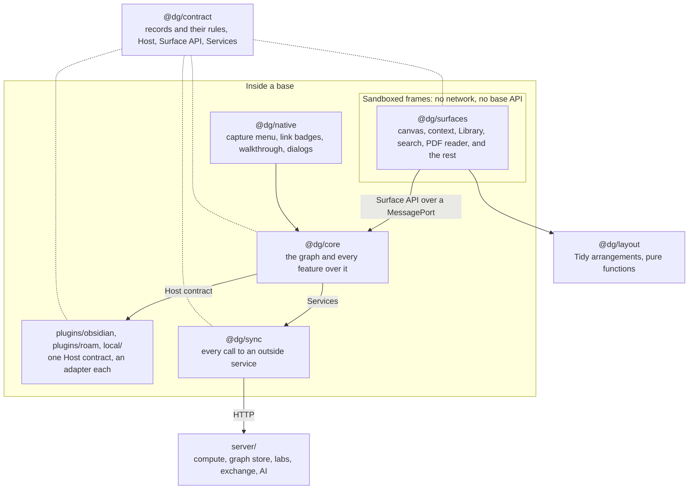

# Architecture

How the code is cut into modules, what each module may depend on, and the rules every part keeps. The features these modules serve are mapped in [features.md](features.md).

Discourse Graphs runs inside other tools, called bases. The project keeps what people see and what the graph means in one place, and keeps each base's own habits in a thin adapter.

## Bases

| Base | Code | State |
|---|---|---|
| Obsidian | `plugins/obsidian/` | The first base. Every feature is built and tested here |
| The local app | `local/src/main.ts` | A web app on `127.0.0.1` over the same vault, with no editor. See [local/README.md](../local/README.md) |
| The MCP server | `local/src/mcp.ts` | An agent's way to read the same vault, over stdio. It uses the same vault module as the local app and runs the core in the role `agent`. See [mcp.md](mcp.md) |
| Roam | `plugins/roam/` | Builds and passes the conformance suite. It leaves out the optional host calls (`readLocalFile`, `openTable`, `listTagged`, `replaceTagged`), and `setLinks` writes nothing, so it has no tables, candidate tags, link mirror or Zotero PDFs |
| Logseq | none | Not built. See [ROADMAP.md](../ROADMAP.md) |

## The shape



Three seams hold it together, and each one is a file you can read:

| Seam | File | What crosses it |
|---|---|---|
| Surface API | [`packages/contract/src/surface.ts`](../packages/contract/src/surface.ts) | Everything a panel can ask for, as typed messages. 166 calls in 36 namespaces |
| Host contract | [`packages/contract/src/host.ts`](../packages/contract/src/host.ts) | Everything core needs from a base. See [CONTRACT.md](CONTRACT.md) |
| Services | [`packages/contract/src/services.ts`](../packages/contract/src/services.ts) | Everything core needs from a server or an outside service. See [services.md](services.md) |

A fourth, narrower file, [`packages/contract/src/core.ts`](../packages/contract/src/core.ts), lists what an adapter's native UI may call on the core (`CoreForAdapter`): capture, link badges, the walkthrough and connecting a panel.

## Modules

The repository is one npm workspace (`packages/*`, `plugins/*`, `server`). Node 26 runs the TypeScript sources directly, so only the plugins and panels have a build step.

| Module | Job | May depend on |
|---|---|---|
| `@dg/contract` | Records and their rules, the seams, the conformance suite, an in-memory host for tests | Nothing |
| `@dg/layout` | Tidy arrangements, centrality, crossing measures | `@dg/contract` |
| `@dg/core` | The graph and every feature over it | `@dg/contract` |
| `@dg/sync` | One file for each outside service | `@dg/contract` |
| `@dg/native` | UI drawn in the base's own page | `@dg/contract`, `@dg/core` |
| `@dg/surfaces` | React panels, one bundle, picked by route | `@dg/contract`, `@dg/layout` |
| `plugins/obsidian`, `plugins/roam` | Adapters and wiring. A plugin imports from `@dg/core` only its entry file, `@dg/core/index.ts` | `@dg/contract`, `@dg/core`, `@dg/native`, `@dg/sync`. `@dg/surfaces` arrives as built HTML |
| `local/` | The local app and the MCP server | `@dg/contract`, `@dg/core`, `@dg/sync` |
| `server/` | Reference server | Nothing here. It takes its route table and wire types as generated copies |

### What is checked

| Command | Fails when |
|---|---|
| `npm run check-boundaries` | A module imports a `@dg/*` package outside its row above. `contract`, `layout`, `core`, `sync` or `local` imports `obsidian`, `react` or `@xyflow/react`. `surfaces` imports `obsidian`. A plugin imports from `@dg/core` anything but `@dg/core/index.ts`. A file reaches three folders up out of its module |
| `npm run dsm` | The module imports form a cycle. It prints two design structure matrices from the real imports: the modules, and the files behind identifiers, lookups, crates, announcements, profiles and Zotero. `node scripts/dsm.mjs` prints the first alone and `node scripts/dsm.mjs scholarly` the second |
| `npm run check:routes` | `server/src/routes.gen.ts`, `server/src/wire.gen.ts` or the route table in [services.md](services.md) differs from `packages/contract/src/routes.ts` and `wire.ts`. `npm run gen:routes` rewrites all three |
| `npm run check-types` | `tsc --noEmit` fails over the root project. It does not cover `server/` |

All four run in CI.

The rule that core never calls the network is kept by construction, not by a script: core is handed `Services` and has no other way out. `@dg/sync` is handed the base's own `fetch` by the plugin that wires it.

## Inside the contract

Records are one import, `@dg/contract/records.ts`, made of five files that each depend only on the ones above:

| File | Holds |
|---|---|
| [`record.ts`](../packages/contract/src/record.ts) | What a record is, how one is made, how one is revised. `FORMAT_VERSION` is 2 |
| [`json.ts`](../packages/contract/src/json.ts) | JSON written one way only: what records are compared, hashed and signed by |
| [`title.ts`](../packages/contract/src/title.ts) | How a unit's title is written in a base |
| [`validate.ts`](../packages/contract/src/validate.ts) | Whether something is a well-formed record of a kind this version knows |
| [`fold.ts`](../packages/contract/src/fold.ts) | Every record read into one graph, and the rules for whose word stands |

Beside them:

| File | Holds |
|---|---|
| [`ids.ts`](../packages/contract/src/ids.ts) | Ids, and where time and chance come from |
| [`log.ts`](../packages/contract/src/log.ts) | Reading a device's log off disk, and resuming part-way |
| [`urls.ts`](../packages/contract/src/urls.ts) | Whether an address is this computer |
| [`scholarly.ts`](../packages/contract/src/scholarly.ts) | Identifiers, published works, library items, notifications |
| [`atproto.ts`](../packages/contract/src/atproto.ts) | The mapping from records to AT Protocol records |
| [`grammar.ts`](../packages/contract/src/grammar.ts) | The words for each base type, starter templates, and how a template is filled |
| [`llm.ts`](../packages/contract/src/llm.ts) | Model providers, the prompt, citations, and the answer given with no model |
| [`words.ts`](../packages/contract/src/words.ts) | Folding text for search and marking matches |
| [`keys.ts`](../packages/contract/src/keys.ts) | The capture menu's choices and their keys |
| [`usage.ts`](../packages/contract/src/usage.ts) | A wrapper that logs which host calls ran, without their arguments |
| [`routes.ts`](../packages/contract/src/routes.ts), [`wire.ts`](../packages/contract/src/wire.ts) | Every server route and every shape that crosses one, declared once |
| [`conformance.ts`](../packages/contract/src/conformance.ts), [`memory-host.ts`](../packages/contract/src/memory-host.ts) | The checks an adapter must pass, and an in-memory host that passes them |

## Inside the core

`createCore` in [`core/index.ts`](../packages/core/src/index.ts) reads the log, folds it, and builds one `Context` ([`context.ts`](../packages/core/src/context.ts)). Every feature is a function of that context.

`createCore` takes `host`, and optionally `services`, `keys` (where signing keys live), `llm` (a way to call a model), `secrets` (a store for a person's model key), `role` (`device`, or `agent` for the MCP server), `agentName`, `demoGraphs` (saved extractions to offer with no server), `titleFormat` and `canvasFormat` (how this base writes a unit's title and a canvas's), and `askBreadcrumb` (how this base asks whether to say a paper was read).

**A feature has one shape:**

```ts
export const thingFeature = (context: Context, deps: { /* what it needs that isn't on Context */ }) => {
  const handlers: Pick<Handlers, "thing.list" | "thing.create"> = { /* … */ };
  return { handlers /* , and anything other features or the base need from it */ };
};
```

- `handlers` are the calls a panel can make. Their names and types come from the Surface API, so a missing or misnamed one doesn't compile.
- Anything a feature needs beyond the context arrives in `deps`, as one named object.
- Anything it offers beyond handlers is returned beside them, never mixed into them.

| Feature | File | Calls |
|---|---|---|
| A unit by itself: find, make, rename, retype, remove, view | `nodes.ts` | `unit.*` |
| Capture from a note, and a renamed note renaming its unit | `capture.ts` | none: used by the base and by `unit.create` |
| Canvases: list, open, write, build on | `canvases.ts` | `canvas.*` |
| Relations mirrored into notes as link properties | `mirror.ts` | none: runs after every change |
| Units: folders, reactions, notes, export | `units.ts` | `unit.export`, `unit.react`, `unit.note`, `unit.removeNote`, `folder.*` |
| Relations | `relations.ts` | `relation.*` |
| Grammar: types, templates, schema files, tables | `grammar.ts` | `grammar.*`, `table.open` |
| Reading PDFs | `reading.ts` | `pdf.*`, `unit.available`, `canvas.placeUnits` |
| Papers and extraction | `papers.ts` | `paper.*` |
| Paper map, similar units, search | `papermap.ts`, `similar.ts`, `search.ts` | `paper.map`, `paper.showMap`, `unit.similar`, `search.*` |
| Method, runs and notebooks | `method.ts`, `process.ts` | `method.*`, `run.*`, `notebook.*`, `evidence.fromOutput` |
| Pictures, outputs, related units, candidates | `gather.ts` | `image.add`, `unit.image`, `unit.related`, `output.observe`, `candidate.*` |
| Checks | `checks.ts` | `unit.check`, `unit.uncheck` |
| Proposals from agents | `proposals.ts` | `proposal.*` |
| Labs: invitations, members, settings, what is shared | `labs.ts` | `lab.*`, `canvas.share` |
| Devices | `devices.ts` | `device.*` |
| Signing and checking signatures | `signing.ts`, `identity.ts` | none: used by labs and the write path |
| Ask AI | `ai.ts` | `ai.*` |
| Zotero | `library.ts` | `zotero.*` |
| Published work, announcements, profiles | `works.ts`, `notify.ts`, `profile.ts` | `work.*`, `notify.*`, `profile.*` |
| Crates and publishing | `crate.ts`, `rocrate.ts`, `mira.ts`, `datacite.ts`, `zenodo.ts`, `zip.ts` | `crate.*`, `deposit.*` |
| Overview and Boundary, a canvas's history, releases and forks, preferences | `overview.ts` | `overview.*`, `canvas.history`, `canvas.release`, `canvas.fork`, `canvas.diff`, `canvas.at`, `canvas.highlight`, `canvas.setWhole`, `canvas.saveWhole`, `library.canvases`, `prefs.*` |
| What a panel asks of the base | `shell.ts` | `panel.open`, `dialog.*`, `base.reveal`, `link.open`, `server.*` |

Files that are not features:

| File | Holds |
|---|---|
| `card.ts` | The five facts every card shows, computed once per unit |
| `jsonld.ts` | The graph written as JSON-LD for the process ontology |
| `shapes.ts` | The process rules, as the app checks them. Twins of the SHACL shapes in `ontology/` |
| `migrate.ts` | Reading a graph the official plugins made |
| `work.ts` | One published work merged from several registries |
| `locks.ts` | One write at a time for things that must not interleave |
| `bytes.ts` | Small conversions between bytes, base64 and hashes |
| `refuse.ts` | Failures that keep their kind |

**What `index.ts` does** is what only it can: read the log, hold the graph, sign what is written, set up this person's identity and lab, build the context, and wire the features together. It defines no call a panel makes apart from identity and focus.

**How features reach each other.** Two ways, and no third:

- **Deps**, when one feature needs another's function: the canvas feature is handed `social` from the units feature.
- **Offers**, when a feature made early needs something from one made later, or when several need the same thing. A feature puts its part on `context.offers` as it is made (checks, preferences, "a note changed"), and others read it when called. A part not there yet reads as absent, so the order features are made in does not matter. `context.afterChange` is the same idea for "run this after every change".

**Failures keep their kind.** A feature refuses with `refuse(code, message)` from `refuse.ts`, and what a base refused keeps the base's own code. The codes are the Host contract's: `not-found`, `invalid`, `conflict`, `no-target`, `read-only` and `unavailable`. A `conflict` can carry the ref of the text it collided with. Anything thrown without a code reaches a panel as `invalid`. Panels show every failed call and act on `not-found`, `unavailable` and `read-only`.

**Rules every feature keeps:**

- Read a unit's type through `context.typeOf`, or `typeOfNode` and `baseOf` in `process.ts`. They follow a type that gave way to the lab's. Reading `graph.documents` for a type doesn't.
- Read a unit through `context.nodeOf`, which leaves out what was removed. Only code that must send a removal reads past it, and says so.
- Stamp through the contract's creators and `revise`. They use the corrected clock and name the version being replaced.
- Write through `context.put`. It signs.
- Never call the network. Ask `context.services`.

**Call names follow one scheme.** A namespace is a noun. `get` reads one and `list` reads many. `show` changes the screen. `accept` and `reject` record a decision. The subject of a call is `id`.

## Inside the panels

`@dg/surfaces` is one React 19 bundle. `main.tsx` reads the route and mounts one panel: canvas, context, Library, search and the quick finder, grammar, upload, welcome, profile, run, papers, From Zotero, overview and boundary. The PDF reader is a second bundle (`pdf/main.tsx`), so pdf.js loads only where a PDF is read.

- **The canvas** is React Flow 12 (`@xyflow/react`). Freehand strokes are drawn with `perfect-freehand`. The stored format is JSON Canvas 1.0 with a `dg` field on each card and edge. Strokes are a Discourse Graphs item and are left out of `.canvas` files.
- **Shared pieces** live in `surfaces/src/shared/`: the call helper (`rpc.ts`), first loads (`load.tsx`), the two-step confirm and hint (`ui.tsx`), people and initials (`people.tsx`), card facts (`facts.tsx`) and the design tokens (`tokens.css`).
- **Transport.** In a base, a panel talks to core over the `MessagePort` it is handed. In the local app, the same calls go as `POST /rpc` to the app's own origin (`shared/http.ts`).
- **Tidy** runs in the panel, from `@dg/layout`, because it needs the measured size of each card. The ten arrangements are `logic`, `debate`, `timeline`, `kinds`, `people`, `sources`, `focus`, `connected`, `bridges` and `load`. The chosen one is stored on the canvas record, since positions are shared.

## The build

| Command | Makes |
|---|---|
| `npm run build` | `dist/obsidian/main.js` and `manifest.json`, `dist/roam/extension.js`, `dist/canvas.html`, `dist/pdf.html`. Sets `DG_RELEASE=1`, which minifies the plugins and leaves the test hooks out |
| `npm run build:test` | The same, with the test hooks in and `dist/panel.html` for the panel checks |
| `npm run build:local` | `dist/local.html`, the local app's page |

[`scripts/build.mjs`](../scripts/build.mjs) uses esbuild, target `es2022`. The panel HTML is inlined into each plugin as a string, with this content security policy: `default-src 'none'; script-src 'unsafe-inline'; style-src 'unsafe-inline'; img-src data: blob:; font-src data:`. The saved graphs in `demo/papers/*.graph.json` are inlined too, so "Load demo papers" works with no server. The Obsidian plugin's id is `discourse-graphs-demo`, it needs Obsidian 1.7.0 or later, and it is desktop only.

## Why each cut is where it is

**Core runs in the plugin, not the frame.** Capture and link badges need the graph while no panel is open, and several panels share it.

**Panels are sandboxed frames.** `sandbox="allow-scripts"` with a content security policy that blocks the network. A panel has one way out, the port it's handed, so the same bundle behaves the same in every base and can't reach a base's API by accident. It also means a panel can't download a file, open a link, submit a form, use `localStorage` or call a server itself, which is why those live behind the Surface API.

**Core never touches the network.** `Services` is injected, and a test can pass a fake one. Without services, everything local still works.

**The server passes records along and decides nothing.** Each lab member keeps a full copy. Records carry their author's signature, and the rules for whose version stands are in the fold, on every device. Losing the server costs freshness, not work.

**Records, not notes, are the source of truth.** Assertions never change. Documents are revised: each version names the one it replaces, and of two made apart the later stands. Each base stores them where it stores things. In Obsidian that is `discourse-graph/records/<device>.jsonl`, one file to a device, appended to and never rewritten.

**Each outside standard has one file that knows it.** RO-Crate, DataCite, COAR Notify, MIRA, Zotero's API and the registries' APIs change on their own schedules. Each is read or written by a single file. A new version of a standard is a change to one file.

**Time, chance and keys can be handed in.** A base leaves them alone. The simulation replaces all three, which is what lets it replay a run byte for byte.

**Two clients, for two kinds of site.** The lab's server is reached with the base's own `fetch`, which can stream. Registries and publishers' pages are other people's sites, and a page can't read their `Link` headers, so `createServices` takes a second client, `outside`, for them. In Obsidian it is Obsidian's own request function.

**Test hooks stay out of a release.** Each plugin's hooks are in its `testing.ts`. Only they take the whole core. Everything else in a plugin, the walkthrough included, takes the narrower `CoreForAdapter`.

## Following one paper through

1. The upload panel reads the file and calls `paper.extract`.
2. Core checks the lab's reach, then asks `@dg/sync` to extract it on the chosen server, passing status lines to the panel as they arrive.
3. Core turns the graph into records: a paper, a canvas, its units and relations. No notes are written.
4. If the person chose to share, the canvas is marked shared.
5. The sync loop signs what isn't signed and sends what is on shared canvases. A labmate's plugin pulls it, checks each signature, folds it in, and their panels redraw.

## Records between people

[labs-and-sync.md](labs-and-sync.md) has the detail.

| Concern | Where it lives | The rule |
|---|---|---|
| Which version stands | `foldRecords` in [`contract/fold.ts`](../packages/contract/src/fold.ts) | Each version names the one it replaces. A version beats what it replaces. Of two made apart, the later stands, except that on a canvas an edit beats a removal, and for memberships and devices a removal beats an edit |
| Who may change what | The same fold | An id carries its author's DID. A unit's words and existence are its author's. A labmate may add facts. Only a lab's custodian changes the lab, its grammar and its memberships. A membership its custodian ended can't be brought back by its member |
| Whose word a record is | [`core/signing.ts`](../packages/core/src/signing.ts) | Each version is signed by the device that wrote it. A device's key counts once a trusted device has vouched for it. Checked when records arrive from a lab |
| What an agent wrote | The same fold | A record signed by a device with the role `agent` is a proposal until a person accepts it |
| What a vault sends | `shareable` in [`core/labs.ts`](../packages/core/src/labs.ts) | What is on a shared canvas and what it needs to make sense, including what was taken away. Every version of a card, so "made apart" reads the same everywhere |
| What stays on the device | `staysLocal` in the contract | Anchors and decisions describe one space, so sync never carries them |
| Time and chance | `clock` and `entropy` in [`contract/ids.ts`](../packages/contract/src/ids.ts) | A base leaves them alone. A lab server's time corrects a wrong clock, and a clock set back never stamps earlier than this device's last stamp. A simulation replaces both, with seeded keys |
| Reading a log off disk | [`contract/log.ts`](../packages/contract/src/log.ts) | Whole records only. A line a sync tool damaged is skipped and counted, never repaired |
| What a lab sets for everyone | `LabSettings` on the lab's record | Only the custodian writes it. Every member holds it |

`npm run sim` runs the simulation that holds these rules: `node harness/four-vaults.ts --strict`.

## Testing at each layer

| Layer | How | Where |
|---|---|---|
| Records, core, layout, sync | Unit tests over the in-memory host, all from `test/support.ts`, waiting on the thing itself and not on the clock | `test/` |
| The MCP server | Its tools over a core in memory, then a real MCP client over stdio against a vault on disk | `test/mcp.test.ts` |
| Server | Unit and route tests with fake model servers | `server/test/` |
| Several people at once | The real core, sync loop and server in one process, with seeded time, ids and keys | `harness/four-vaults.ts`, `npm run sim` |
| The process rules | One wrong graph per rule, through SHACL and through the app's own check | `ontology/tests/cases.json` |
| An adapter | One conformance suite, run inside the real app | `packages/contract/src/conformance.ts` |
| Whole flows | Real mouse and keyboard in real Obsidian | `harness/*-test.mjs` |

Types, boundaries, routes, the dependency matrix, both unit suites, the simulation, the build and the ontology run in CI. The real-app tests need Obsidian and run by hand. See [testing.md](testing.md).

## Limits

- `server/` is not covered by the root type check, and the rows it stores for papers and graphs are not checked against `wire.ts`.
- Class names in the panels are not prefixed by panel. The PDF reader repeats the canvas's toolbar and popover styles.
- The reference server has no rate limits. See [services.md](services.md).
- The MCP server reads and does not propose. A paper's text by page is not kept.
- The record kinds `paper`, `folder`, `folder-item`, `reaction`, `unit-note` and `device` have no AT Protocol lexicon in `lexicons/`.
- A canvas record names the question or claim it is tied to in `whole`. A log that says `holon` for the same field is read under the new name.

What is planned is in [ROADMAP.md](../ROADMAP.md).
