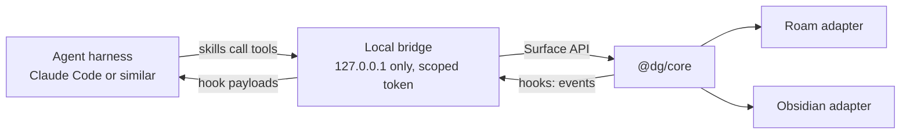

# Next: agent skills and hooks

Skills and hooks are next on the list. Nothing here is built yet. This note sketches how they could work with both plugins, so the shape can be argued with before any code exists.

## The idea

People already do discourse graph work with an agent beside them: reading a paper, proposing claims, checking what supports what. Today that agent can't see the graph. Skills give it a way to act on the graph, and hooks let the graph tell it what just happened.

Because both plugins share one core, an agent should never need to know which base it's in.

## Skills

A skill is a set of instructions plus the tools it may use. Each tool maps to an existing Surface API method, so the agent gets what a panel gets and nothing more:

| Tool | Surface API method |
|---|---|
| Find units | `node.query` |
| Read a unit, with provenance | `node.view` |
| Propose a unit | `node.create` |
| Propose a relation | `relation.assert` |
| Read a canvas | `canvas.open` |
| Place a unit on a canvas | `canvas.place` |
| Read a paper | `paper.extract`, `paper.list` |
| Ask about a canvas | `ai.ask` |

Some skills this makes possible:

- **Read this paper.** Runs an extraction, then checks each claim against its anchor text and flags what looks wrong before anyone exports it.
- **What's new in the lab.** Summarizes shared papers, reactions and notes since a person last looked.
- **Find what's missing.** Looks at a canvas for claims with no evidence and questions with no claims.
- **Prepare a canvas.** Picks a Tidy mode that suits the question and groups related units.

## Hooks

Core already passes every action through one seam, and panels already receive `graph-changed` events. Hooks would extend that with named events:

| Event | When | A skill might |
|---|---|---|
| `paper.extracted` | A paper has its canvas | Check claims against anchors |
| `unit.exported` | A unit gets a note or page | Suggest related units |
| `relation.proposed` | A relation is waiting for a decision | Look for evidence either way |
| `canvas.closed` | Someone leaves a canvas | Offer a short summary |
| `lab.paper-shared` | A paper reaches the repository | Compare it with the lab's existing claims |

Payloads carry ids, not research content. An agent reads what it needs through a tool, so every read is logged and scoped.

## In each base

The agent's view is the same in both. What differs is only how a result appears:

| | Obsidian | Roam |
|---|---|---|
| Bridge lives in | The plugin, in Electron | Needs a companion process, because a web page can't listen on a port |
| A proposed unit appears as | A staged card on the canvas | A staged card on the canvas |
| An accepted unit becomes | A Markdown note with a `dg-id` | A page with a `dg-id` property |
| A summary lands in | A note beside the canvas | A block on the daily page |
| Selection as context | The editor's selection | The focused block |

Roam is the harder half. Its plugin runs in a browser context, so the bridge may need to run the other way: the plugin connects out to a local process, the way lab sync already connects out to a server.

## Rules worth keeping

These follow from what already exists:

- **An agent proposes, and a person decides.** Agent-made relations arrive pending, the same as relations from another lab. There is no path from a skill to a settled claim.
- **Agent work is attributed.** Records already carry `by`. An agent gets its own identity, tied to the person who ran it, so provenance shows "proposed by an agent for Ana Ruiz".
- **Reactions stay human.** Agents don't react, because a reaction is a person's judgment.
- **Scoped by default.** A token is limited to a space, a set of tools, and read or write.
- **Local first.** The bridge binds to `127.0.0.1`, and nothing about it needs a server.

## Open questions

- Should the bridge speak MCP directly, or should a thin MCP server sit in front of the Surface API?
- Where does a Roam bridge run for someone using Roam in a browser?
- How should an agent's identity relate to a person's `did:plc`?
- Which usage events are useful for improving skills, and how do people opt in?
