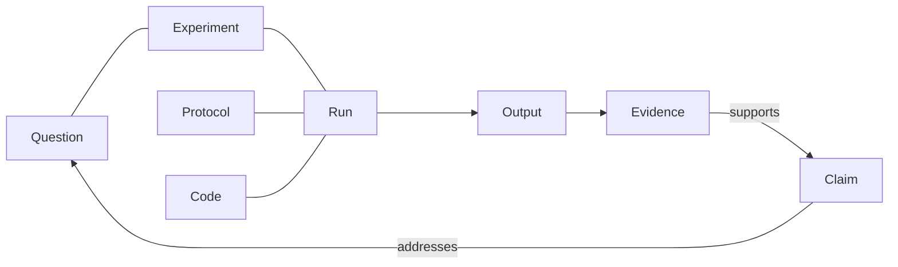

# Discourse Graphs: a guide for new users

This guide explains how the schema works, then walks through the software area by area, with pictures from the Obsidian plugin. The pictures were taken on 12 November 2026 from a test vault holding a real example: the MATSUlab issue-exchange analysis and one paper on lupus.

- New to the idea? Read [The schema in five minutes](#the-schema-in-five-minutes), then [A first session](#a-first-session).
- Want every field and rule? See [schema.md](schema.md).
- Setting up a model for Ask AI? See [Ask AI](#ask-ai).

## What it is

A discourse graph breaks research into small units (a question, a claim, a piece of evidence) and records how they relate: this evidence supports that claim, this claim addresses that question. It also records how each result was produced, so a claim can be traced back to the run, the protocol and the code behind it.

The plugin adds this to your notes. Your notes stay ordinary Markdown files. The graph lives beside them in your vault.

## The schema in five minutes

### Four units of argument

| Unit | Short | What it is | Example |
|---|---|---|---|
| Question | QUE | Something you want to know | How does a shared issue board shape idea exchange in a research lab? |
| Claim | CLM | An answer you are prepared to argue for | 29% of issues were claimed as experiments. |
| Evidence | EVD | One observation, stated so that it could be wrong | 29% of MATSUlab issues (n=445) were claimed as experiments |
| Source | SRC | A paper or document evidence was read from | Lu et al. 2016 |

Evidence says what was seen. A claim says what you take it to mean. Keeping them apart is the point: two people can accept the same evidence and still argue about the claim.

### Four relations between them

| Relation | From | To | Reads as |
|---|---|---|---|
| Supports | Evidence or Claim | Claim | This is a reason to believe it |
| Opposes | Evidence or Claim | Claim | This is a reason to doubt it |
| Addresses | Claim | Question | This is an answer to it |
| Informs | Evidence | Question | This bears on it |

A relation is a statement by a person. When a teammate asserts one about your units, it arrives as **Proposed**, and you accept or reject it.

### Five units of process

These record how a result was made. They differ by what they fix.

| Unit | Short | Fixes | Example |
|---|---|---|---|
| Protocol | PRO | **How** something is done, whoever does it and whenever | Immunostaining, version 2: fix, stain, image |
| Experiment | EXP | **What one investigation compares, and why** | Dose series: low against high, to answer "does dose drive staining?" |
| Run | RUN | **What happened on one occasion** | The run of 1 November, high dose, imaged a day late |
| Code | COD | A notebook or script at one version | `intensity.ipynb` |
| Output | OUT | One thing a run produced | Figure 2 of that notebook |

The three that are easy to confuse:

- **A protocol declares.** It lists steps, materials and the parameters it has. It says nothing about any one day.
- **An experiment chooses.** It names its question, the conditions it compares, and the protocols it uses. (In the formal files it is called a Study. "Experiment" is the default label, and a lab can rename it.)
- **A run records.** It names the condition it carried out, the values its parameters took, who did it and when, and where it departed from the protocol.

One experiment has many runs. One protocol serves many experiments. A run that departs from its protocol records a deviation; it does not change the protocol.

### How the two halves join

Evidence **rests on** outputs. So from any claim you can walk back: the evidence for it, the output that evidence rests on, the run that made the output, and the protocol and code that run used.

### Two kinds of link

- **Arguments** (supports, opposes, addresses, informs) are their own signed records, because other people can dispute them.
- **Provenance links** (this run followed that protocol, this output came from that run) are fields on the unit, because only its author can state them.

### Identity, versions and drift

- **Every unit is credited** to the person who made it, and to their lab if they are in one. Only its author can rename it.
- **An output is identified by its bytes.** Its id is a hash of the file. Two runs that make the same figure make the same hash, and the graph can see that.
- **A link to a version is a pin.** A run pins the protocol and code versions it used. Evidence pins the output it cites.
- **Drift is a pin that no longer matches.** If a protocol is edited after a run followed it, the run still points at what it followed, and the interface says "edited since the run". Nothing is rewritten behind your back.

### Gaps

The software checks the graph against a set of rules and shows what it finds as gaps. Gaps never block you. Examples:

- A claim nothing supports yet.
- Evidence with nothing behind it: no output, run or source.
- A run that belongs to no experiment.
- A claim whose support all comes from one run ("single run").
- The code changed after this run.

The full list is in [schema.md](schema.md#rules).

### Scopes

Everything is private until you share it. Views narrow by scope, each inside the next:

- **Mine:** what you made.
- **Lab:** yours and your lab's.
- **Everyone:** everything this graph holds, including other labs' published work.

A unit is a leaf. It opens as its text and its context, never as a graph of its own. A canvas can hold another canvas.

## A first session

1. **Open a canvas.** Click the Discourse Graphs icon in the left ribbon and choose **New canvas…**.
2. **Add a question.** Press **N** on the canvas, type the question, and choose Question.
3. **Capture a claim from a note.** In any note, select a sentence and press `\`. Choose Claim. The sentence becomes a unit and a link.
4. **Read a paper.** Right-click a PDF and choose **Read in Discourse Graphs**. Select a passage, choose Evidence, and choose your canvas. Or choose **Extract graph** to read the whole paper at once.
5. **Connect them.** Drag from the evidence card's edge to the claim, and choose Supports. Do the same from the claim to the question, with Addresses.
6. **Look at what stands behind it.** Select the claim and open **Context**. The Method section shows the chain and any gaps.

The walkthrough (Settings → Discourse Graphs → Help and privacy → Start) does this on your own graph in about three minutes, and removes its examples afterwards.

## The interface, area by area

### The canvas

A canvas is where you build an argument. Cards are units. Lines are relations, drawn solid for provenance and dashed for arguments.

**The bar, left to right:**

| Group | Control | Does |
|---|---|---|
| Canvas | The canvas's name | Opens the canvas picker, New canvas, Upload a paper, the Library and Export |
| Build | Add node (N) | Finds a unit or makes a new one |
| | Note (T) | A plain sticky note, not part of the graph |
| | Draw (D) | Freehand strokes |
| | Tidy (L) | Arranges the cards. The menu beside it picks how |
| History | Undo, Redo | Each step is a new edit your teammates see, not a rewind |
| Panels | Ask AI | Asks a model about this canvas |
| | Search | Opens unit search |
| | Context | Opens the selected unit's context |
| | PDF | Opens the reader beside the canvas |

Labels drop away as the pane narrows, and the icons stay.

**Tidy** has nine arrangements. Six lay the argument out: Logic, For and against, Timeline, Kinds, People and Focus. Three rank the cards: Most connected, Bridges and Load-bearing.

**The line under the bar** says where the canvas sits (its lab, and the question it is about) and opens the Boundary panel.

**Units to place**, at the bottom (U), is a drawer of the units not on this canvas, grouped by where they are. Drag one on, or select several and place them together.

**On a card:** Enter opens its text. F2 renames it, if it is yours. Delete on a link asks whether to take the link off this canvas or withdraw the relation.

### The canvas picker

Click the canvas's name. Each canvas is drawn as a small picture of its real layout: every card where it sits, coloured by type. Under the title is its kind:

- **Workspace:** built by hand to work out an argument.
- **From a PDF:** made by reading a paper, and holding that paper's units.

### The Library

The Library is a side panel with four tabs: Canvases, Papers, Folders and Lab.

On **Canvases**:

- **Everyone, Lab, Mine** narrows the list by scope. The number beside each is how many canvases it holds.
- The search box finds by title, paper or person.
- **Any kind** filters to canvases read from a PDF, or to workspaces. **Any privacy** filters to private, shared with the lab, or published. **Has gaps** keeps only canvases with something to look at.
- The arrow on a row opens its history, releases and forks. A release pins every unit on the canvas at that moment, so it can be cited.

### Context, and the Method section

Select a card, or open a unit's note, and **Context** shows that unit: its relations (with Accept and Reject on proposals), its text, where it came from, and who made it. A unit read from a paper says whose paper it is, and how the extraction got here.

**Method** shows how it was produced, in the order the work happened:

- For **evidence:** question, experiment, protocol, code, run, outputs, source. A run that a paper reports often names many methods. More than two fold into one line, "8 methods the run followed", which opens when clicked.
- For a **claim:** that chain for each piece of evidence, and what the checks make of them: replicated, single run, one method, method changed, output changed.
- For a **protocol, experiment or run** of yours: **Edit fields** opens the fields that unit has. Lists are typed one to a line.
- For an **output:** **Make evidence from this**.

A step marked **edited since the run** is drift. A step in grey is something a pin names that this graph doesn't hold. Click a step to walk to it, or a run to open its page.

In the picture, the relation at the top is still **Proposed**, because a teammate asserted it. The method chain below shows anyway, because those links are the author's own.

### Reading a PDF

Obsidian's own PDF viewer stays the default. To read into the graph:

- **Read this PDF** (command), or right-click a PDF and choose **Read in Discourse Graphs**, opens that file beside the canvas.
- **Read a PDF…** (command, ribbon menu, or the PDF button on the canvas bar) opens the list of PDFs.
- Drop a PDF on the reader to add it. It is kept in the "Paper files" folder.

Select a passage and a small popup asks two things: what kind of unit, and which canvas. The unit remembers the exact words and the page, so its highlight is found again even if the file is renamed. Highlights you have made are tinted.

### Extract graph: a whole paper at once

Highlighting reads a paper one passage at a time. **Extract graph** reads all of it into questions, claims, evidence, the runs it reports and the methods they followed, on a canvas of its own. There are three ways in, and they do the same thing:

- In the reader, **Extract graph** on the bar.
- Right-click a PDF and choose **Extract graph**, or run **Extract graph from this PDF**.
- **Upload a paper…**, for a file that isn't in the vault yet. The PDF is kept in "Paper files", so its units open at their passages.

**If the paper was already read somewhere else,** nothing is sent anywhere. A saved extraction is a file with the paper's name and `.graph.json` (or MIRA's own `.mira.jsonld`) in place of `.pdf`, such as the ones [MIRA extraction](https://mira-extraction.vercel.app/) saves. Put it beside the PDF, or pick both files together, and Extract graph uses it. The dialog says which file it found, how many units it holds and which model read it. Tick **Read it again on a server instead** to ignore it.

**With no saved extraction,** the dialog asks which server reads the paper, with which model, into which schema.

Asking twice for the same paper opens the canvas you already have. Once a paper has a canvas, the reader's bar shows **Canvas** in place of Extract graph.

### Working across papers

A workspace canvas can hold units from any number of papers. Four things help you read across them:

- **A paper tag on each card,** such as "Carroll 2020". It shows wherever units from different papers sit together: on cards, in search results, and beside related units in Context. On a paper's own canvas the tag is left off, because every card there would say the same thing. Click a card's tag to open its passage in the reader.
- **Tidy → Papers** gives each paper a column, and one more for what you wrote yourself.
- **Rests on,** in a claim's Method section. When other claims support your claim, it follows them down: how many claims, how much evidence, how many runs, and how many units come from each paper. It says so when all of it comes from one paper.
- **Elsewhere,** at the foot of Context. It does nothing until you press **Find units like this in other papers**. Then it lists questions, claims and evidence from other papers that share this unit's rarer words, and says which words. The link button beside each one opens Relate on that pair. These are leads to read, matched on words alone, so expect misses and near-misses. It never states a relation for you.

A relation you state in Context is drawn on every canvas of yours that holds both units.

### Search and the finder

The picture above shows **Search units** on the right. Found words are marked in yellow in every result.

- The three menus filter by type and by who a unit is credited to, and set the order.
- **Titles, Passages, Notes** choose where the words are looked for: a unit's title, the passage it was cut from in a PDF, or the text of its note.
- Click a result to see it in Context. Select several to put them on the canvas together.

**Find a unit** (command) is the quick version: type, then Enter to open, ⌘↵ or Ctrl+↵ to put it on the open canvas, and Alt+↵ to insert a link in your note. Opened from a note's right-click menu as **Link a unit…**, Enter links.

### Ask AI

**Ask AI** on the canvas bar opens a bar over the canvas. Its first line says whose model will answer.

**With no model,** it says so and a question still works: it finds the closest units and quotes them word for word. Nothing is written that the units don't say.

**To use your own key,** click **Use my own key**:

1. **Provider.** Anthropic (Claude), OpenAI-compatible, or Google Gemini. OpenAI-compatible covers OpenAI, OpenRouter, and a model on your own computer such as Ollama or LM Studio. For those, set the address.
2. **API key.** Paste it. It is kept in Obsidian's keychain (Settings → Keychain), which your operating system encrypts. It is never written to your notes, and once saved it is never shown again: only its last four characters.
3. **Model.** Chosen from the list your key can use.
4. **Send questions** (only in a lab). Straight from this device, or through your lab's server.
5. **Test and save** sends one short message and tells you what came back.

The line at the bottom of the form says, in a sentence, where your question and the canvas's units will go.

**To ask:** type a question and press Enter. By default the answer draws on the whole canvas. Click cards first to narrow it to them. Each number in the answer is a unit, and clicking it brings that card into view. **Stop** ends an answer early and keeps what arrived. Escape closes the bar.

An answer is a reading aid. It is not added to the graph.

### Runs and notebooks

**Open runs and notebooks** (command, or the ribbon menu) lists the Jupyter notebooks in your vault and the runs already in the graph.

**Read into the graph** turns a saved notebook into three things: its **code**, the **run** that was saved in it, and one **output** for each figure and table. Reading it again after a rerun adds the new run beside the old one. Reading the same saved run twice adds nothing.

You can also right-click an `.ipynb` file and choose **Read into Discourse Graphs**.

A **run's page** reads top to bottom in the order the work happened:

- **Why:** the experiment, its question, and which condition this run carried out.
- **How:** the protocol it followed, its steps, the parameters, and where this run departed from it.
- **What ran:** the code and its version, the environment, and the notebook's cells.
- **What came out:** each output, with the cell that made it and its hash.
- **What it is used to argue:** the claims that rest on it.

A figure is shown only while the notebook on your device still holds the same bytes. If you rerun the notebook, the old run's page says the notebook has changed and stops showing the new figure as the old run's.

**A run that a paper reports** has no date, code or outputs of its own. Its page says which paper reports it, links to that paper's canvas, and lists every method the paper says it followed. It isn't flagged for having no experiment, because that was never yours to file.

**Make evidence from this**, on an output, asks nothing and makes evidence pinned to those bytes. Rename it to say what the output shows. That sentence is yours to write.

### Settings

Obsidian → Settings → Discourse Graphs.

| Section | What you can set |
|---|---|
| You | Your name. Your lab, with a button to join or start one |
| Ask AI | Whose model answers, and the same fields as the form in the bar |
| In your notes | The key that makes a node from selected text (empty turns it off). Type badges on links. A button to Obsidian's hotkeys, filtered to this plugin |
| Canvas | What Delete does on a link: ask, take it off this canvas, or withdraw the relation |
| Papers and notebooks | Whether reading a notebook also keeps printed text |
| Help and privacy | The walkthrough. The on-device usage log, with Clear. What leaves this device |

### Every command

Each has no default key. Give any of them a hotkey in Obsidian's Hotkeys settings.

| Command | Does |
|---|---|
| Open canvas, New canvas | Opens the last canvas, or makes one |
| Open the Library | The canvas list, papers, folders and lab |
| Open holons, Open holon boundary | The lab-level explorer, and the Boundary panel |
| Search units, Find a unit | The search panel, and the quick finder |
| Open context panel | The selected unit's context |
| Read a PDF…, Read this PDF | The reader's list, or the file in front |
| Extract graph from this PDF | Reads the whole PDF in front into a graph, from a saved extraction beside it or a server you pick |
| Upload a paper | The same, for a file that isn't in the vault yet |
| Open runs and notebooks, Read this notebook into the graph | Runs, and reading the notebook in front |
| Create node from selection, Turn this note into a node | Capture from a note |
| Toggle link badges | Type badges beside links in notes |
| Join or start a lab, Set my name | Identity |
| Start walkthrough, Remove walkthrough examples | The tour |

## What leaves your device

Nothing, until you choose it.

| You do this | This goes | To |
|---|---|---|
| Join a lab and share a canvas | That canvas, its units and their relations | Your lab's server |
| Ask AI with your own key | Your question and the units on that canvas | The model provider you chose. With a model on your own computer, nowhere |
| Ask AI with your lab's model | The same | Your lab's server |
| Extract graph, when no saved extraction sits beside the paper | The paper | The server you pick in the upload dialog |
| Extract graph, with a saved extraction | Nothing | Nowhere |
| Read a PDF or a notebook | Nothing | — |

There is no telemetry. The usage log stays on your device and holds action names only.

## Where things are kept

| Thing | Where |
|---|---|
| Your notes | Your vault, as Markdown, unchanged |
| The graph | `discourse-graph/records/` in your vault: one append-only file per device |
| Canvases | Also mirrored as `.canvas` files Obsidian's own Canvas can open |
| Dropped PDFs | `Paper files/` |
| A model key | Obsidian's keychain, outside the vault |
| Your signing key | The device. It can't yet be backed up |

## Words used here

- **Unit:** one question, claim, piece of evidence, source, protocol, experiment, run, code or output.
- **Card:** a unit shown on a canvas.
- **Staged:** a unit proposed by an extraction or an import that has no note yet.
- **Proposed:** a relation someone else asserted that you haven't accepted.
- **Pin:** a link to one version of something.
- **Drift:** a pin whose target has changed since.
- **Gap:** something a rule noticed. It never blocks you.
- **Scope:** mine, lab or everyone.
- **Release:** a canvas at one moment, with every unit pinned.
