# Discourse Graphs: a guide for new users

This guide explains how the schema works, then walks through the software area by area, with pictures from the Obsidian plugin. The pictures were taken on 12 and 13 November 2026 from a test vault holding a real example: the MATSUlab issue-exchange analysis and one paper on lupus.

- New to the idea? Read [The schema in five minutes](#the-schema-in-five-minutes), then [A first session](#a-first-session).
- Want every field and rule? See [schema.md](schema.md).
- Setting up a model for Ask AI? See [Ask AI](#ask-ai).
- Papers in Zotero? See [From Zotero](#from-zotero).

## What it is

A discourse graph breaks research into small units (a question, a claim, a piece of evidence) and records how they relate: this evidence supports that claim, this claim addresses that question. It also records how each result was produced, so a claim can be traced back to the run, the protocol and the code behind it.

The plugin adds this to your notes. Your notes stay ordinary Markdown files. The graph lives beside them in your vault.

It also meets the tools around it. References and highlights come in from Zotero. A paper's identifiers and retractions come from the open registries. A canvas goes out as a research crate that repositories and lab notebooks read. Each of these happens only when you ask.

## The schema in five minutes

### Four units of argument

| Unit | Short | What it is | Example |
|---|---|---|---|
| Question | QUE | Something you want to know | How does a shared issue board shape idea exchange in a research lab? |
| Claim | CLM | An answer you are prepared to argue for | 29% of issues were claimed as experiments. |
| Evidence | EVD | One observation, stated so that it could be wrong | 29% of MATSUlab issues (n=445) were claimed as experiments |
| Source | SRC | A paper or document evidence was read from | Lu et al. 2016 |

Evidence says what was seen. A claim says what you take it to mean. Keeping them apart is the point: two people can accept the same evidence and still argue about the claim.

### Four relations between them

| Relation | From | To | Reads as |
|---|---|---|---|
| Supports | Evidence or Claim | Claim | This is a reason to believe it |
| Opposes | Evidence or Claim | Claim | This is a reason to doubt it |
| Addresses | Claim | Question | This is an answer to it |
| Informs | Evidence | Question | This bears on it |

A relation is a statement by a person. When a teammate asserts one about your units, it arrives as **Proposed**, and you accept or reject it.

### Five units of process

These record how a result was made. They differ by what they fix.

| Unit | Short | Fixes | Example |
|---|---|---|---|
| Protocol | PRO | **How** something is done, whoever does it and whenever | Immunostaining, version 2: fix, stain, image |
| Experiment | EXP | **What one investigation compares, and why** | Dose series: low against high, to answer "does dose drive staining?" |
| Run | RUN | **What happened on one occasion** | The run of 1 November, high dose, imaged a day late |
| Code | COD | A notebook or script at one version | `intensity.ipynb` |
| Output | OUT | One thing a run produced | Figure 2 of that notebook |

The three that are easy to confuse:

- **A protocol declares.** It lists steps, materials and the parameters it has. It says nothing about any one day.
- **An experiment chooses.** It names its question, the conditions it compares, and the protocols it uses. (In the formal files it is called a Study. "Experiment" is the default label, and a lab can rename it.)
- **A run records.** It names the condition it carried out, the values its parameters took, who did it and when, and where it departed from the protocol.

One experiment has many runs. One protocol serves many experiments. A run that departs from its protocol records a deviation; it does not change the protocol.

### How the two halves join

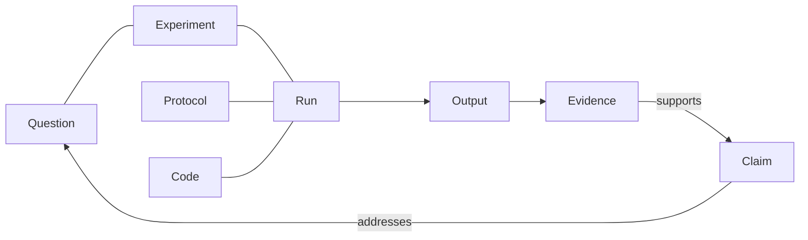

Evidence **rests on** outputs. So from any claim you can walk back: the evidence for it, the output that evidence rests on, the run that made the output, and the protocol and code that run used.

### Two kinds of link

- **Arguments** (supports, opposes, addresses, informs) are their own signed records, because other people can dispute them.
- **Provenance links** (this run followed that protocol, this output came from that run) are fields on the unit, because only its author can state them.

### Identity, versions and drift

- **Every unit is credited** to the person who made it, and to their lab if they are in one. Only its author can rename it.
- **An output is identified by its bytes.** Its id is a hash of the file. Two runs that make the same figure make the same hash, and the graph can see that.
- **A link to a version is a pin.** A run pins the protocol and code versions it used. Evidence pins the output it cites.
- **Drift is a pin that no longer matches.** If a protocol is edited after a run followed it, the run still points at what it followed, and the interface says "edited since the run". Nothing is rewritten behind your back.

### Gaps

The software checks the graph against a set of rules and shows what it finds as gaps. Gaps never block you. Examples:

- A claim nothing supports yet.
- Evidence with nothing behind it: no output, run or source.
- A run that belongs to no experiment.
- A claim whose support all comes from one run ("single run").
- The code changed after this run.

The full list is in [schema.md](schema.md#rules).

### Scopes

Everything is private until you share it. Views narrow by scope, each inside the next:

- **Mine:** what you made.
- **Lab:** yours and your lab's.
- **Everyone:** everything this graph holds, including other labs' published work.

A unit is a leaf. It opens as its text and its context, never as a graph of its own. A canvas can hold another canvas.

## A first session

1. **Open a canvas.** Click the Discourse Graphs icon in the left ribbon and choose **New canvas…**.
2. **Add a question.** Press **N** on the canvas, type the question, and choose Question.
3. **Capture a claim from a note.** In any note, select a sentence and press `\`. Choose Claim. The sentence becomes a unit and a link.
4. **Read a paper.** Right-click a PDF and choose **Read in Discourse Graphs**. Select a passage, choose Evidence, and choose your canvas. Or choose **Extract graph** to read the whole paper at once.
5. **Connect them.** Drag from the evidence card's edge to the claim, and choose Supports. Do the same from the claim to the question, with Addresses.
6. **Look at what stands behind it.** Select the claim and open **Context**. The Method section shows the chain and any gaps.

The walkthrough (Settings → Discourse Graphs → Help and privacy → Start) does this on your own graph in about three minutes, and removes its examples afterwards.

## The interface, area by area

### The canvas

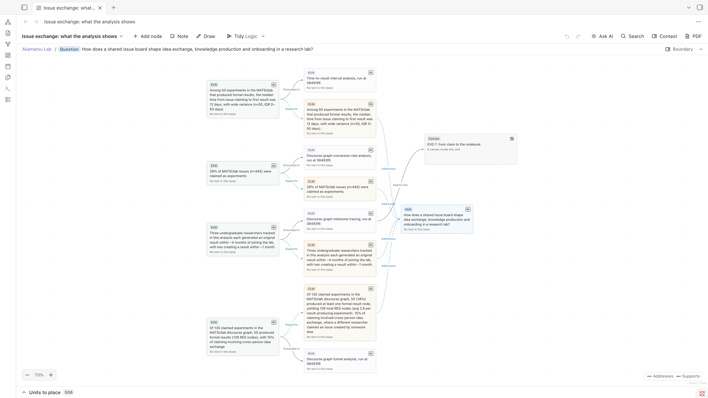

A canvas is where you build an argument. Cards are units. Lines are relations, drawn solid for provenance and dashed for arguments.

**The bar, left to right:**

| Group | Control | Does |
|---|---|---|
| Canvas | The canvas's name | Opens the canvas picker, New canvas, Upload a paper, the Library and Export |
| Build | Add unit (N) | Finds a unit or makes a new one |
| | Note (T) | A plain sticky note, not part of the graph |
| | Draw (D) | Freehand strokes |
| | Tidy (L) | Arranges the cards. The menu beside it picks how |
| | Cards | Chooses what every card shows under its title |
| History | Undo, Redo | Each step is a new edit your teammates see, not a rewind |
| Panels | Ask AI | Asks a model about this canvas |
| | Search | Opens unit search |
| | Context | Opens the selected unit's context |
| | PDF | Opens the reader beside the canvas |

Labels drop away as the pane narrows, and the icons stay.

**Tidy** has nine arrangements. Six lay the argument out: Logic, For and against, Timeline, Kinds, People and Focus. Three rank the cards: Most connected, Bridges and Load-bearing.

**The line under the bar** says where the canvas sits (its lab, and the question it is about) and opens the Boundary panel. The Boundary panel is about the question, claim or evidence you have selected, and says so at its head. With nothing selected it is about the question the canvas is tied to, if any.

**Units to place**, at the bottom (U), is a drawer of the units not on this canvas, grouped by where they are. Drag one on, or select several and place them together.

**What a card shows.** The **Cards** list switches five facts on or off for every card at once: the source it was read from, its authors, the workspace it was written in (yours, your lab's or someone else's), the date it was made, and its identifiers. The list stays open while you switch things, and your choice is remembered on this device.

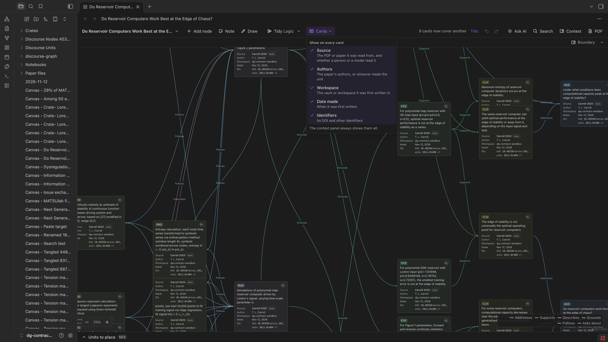

- **Source** names the paper or PDF in a few words, then says how the unit was read: **Auto** when a model read it, **By hand** when a person highlighted or wrote it, **Imported** when it arrived in a file. A source that a registry lists as retracted says **Retracted**.
- **Authors** are the paper's. A unit that wasn't read from a paper says **Made by** and names whoever made it.
- **Date made** shows the day and the time.
- **IDs** shows up to two identifiers, and how many more there are.

A click on a card selects it and nothing else. Once a card is selected, its source opens the passage in the reader, and an identifier opens where it resolves. Cards grow when they show more. If some then cover others, the bar says how many and offers **Tidy**.

**Initials** in a card's corner say who made it. Hover them for a small card about that person. Click them for their profile.

**A note** (the plain sticky kind) shows who wrote it and when, under its text.

**On a card:** Enter opens its text. F2 renames it, if it is yours. Delete on a link asks whether to take the link off this canvas or withdraw the relation.

### The canvas picker

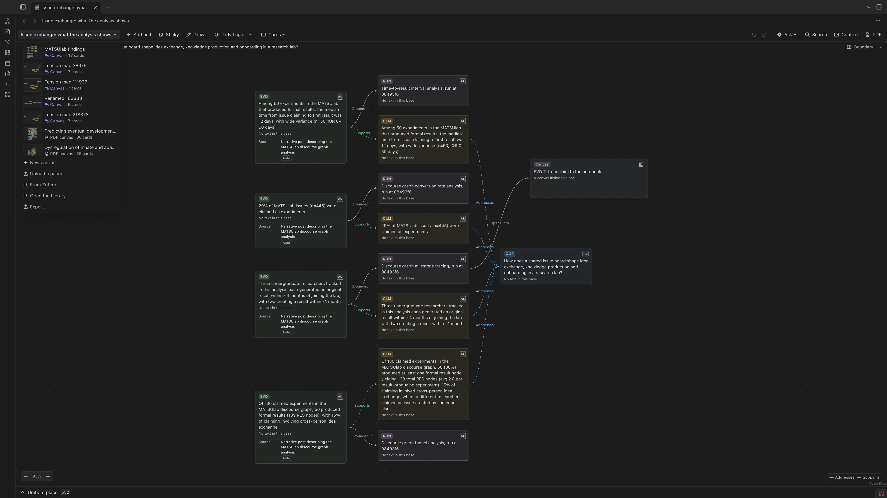

Click the canvas's name. Each canvas is drawn as a small picture of its real layout: every card where it sits, coloured by type. Under the title is its kind:

- **Canvas:** laid out by people to work out an argument, drawing on any papers.
- **PDF canvas:** one reading of one paper, as the model drew it.

### PDF canvases can be polished, and hold only their paper

A PDF canvas is the paper, not your argument about it. A line under its bar says which file it is, which model read it and when. Everything on it comes from that paper.

You can polish it:

- **Reword** a card (F2 or double-click) or change its type. The card's source row then says "Auto, reworded", and the Context panel keeps the model's wording under the title with **Put the model's words back**.
- **Highlight** opens the paper's PDF. A highlight saved from there joins the PDF canvas as a card marked "By hand".
- Link two of its cards, take a wrong card off, move and tidy.

You can't add anything that isn't from the paper: a unit typed from nothing, a unit or highlight from another paper, a sticky or a drawing. Trying to offers **Build on it**, which makes a canvas in your workspace with the same cards, pointing at the same units. That one takes anything.

**The PDF button** on a canvas opens the PDF most of its cards came from. On a PDF canvas that is its own paper. The reader's title lists the others.

### The Library

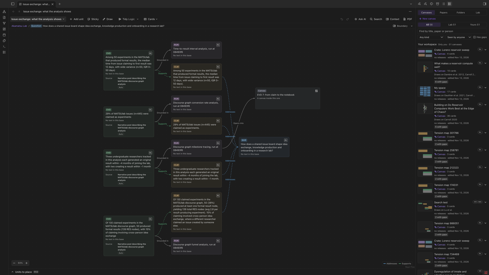

The Library is a side panel with four tabs: Canvases, Papers, Folders and Lab.

On **Canvases**:

- Canvases are grouped by the **workspace** they live in: yours, which only you see, then your lab's. A workspace is a place with members. A lab is a workspace with one PI.
- A canvas row says what it **draws on** (the papers most of its cards were read from) and shows the initials of **who did most on it**, most first.
- **All, Lab, Yours** narrows the list. The number beside each is how many canvases it holds.
- The search box finds by title, paper or person.
- **Any kind** filters to PDF canvases or to canvases. **Seen by anyone** filters to only you, your lab, or published. **Has gaps** keeps only canvases with something to look at.
- The arrow on a row opens its history, releases and forks. On a canvas in your workspace it also offers **Work on it with others…**, which names your lab and its members before moving the canvas to the lab's workspace. A release pins every unit on the canvas at that moment, so it can be cited.

### Context, and the Method section

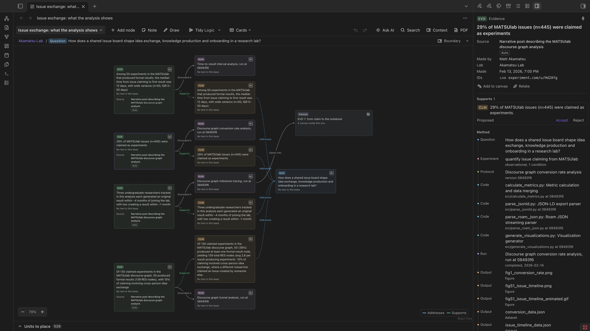

Select a card, or open a unit's note, and **Context** shows that unit: its relations (with Accept and Reject on proposals), its text, where it came from, and who made it.

Under the title are the same five facts a card can show, in the same order and the same type, and here all five always show. The source opens the passage. An identifier opens where it resolves. A unit read from a paper names the paper's authors, and "Where it came from" further down says how the extraction got here.

**Method** shows how it was produced, in the order the work happened:

- For **evidence:** question, experiment, protocol, code, run, outputs, source. A run that a paper reports often names many methods. More than two fold into one line, "8 methods the run followed", which opens when clicked.
- For a **claim:** that chain for each piece of evidence, and what the checks make of them: replicated, single run, one method, method changed, output changed.
- For a **protocol, experiment or run** of yours: **Edit fields** opens the fields that unit has. Lists are typed one to a line.
- For an **output:** **Make evidence from this**.

A step marked **edited since the run** is drift. A step in grey is something a pin names that this graph doesn't hold. Click a step to walk to it, or a run to open its page.

In the picture, the relation at the top is still **Proposed**, because a teammate asserted it. The method chain below shows anyway, because those links are the author's own.

### Published work, and identifiers

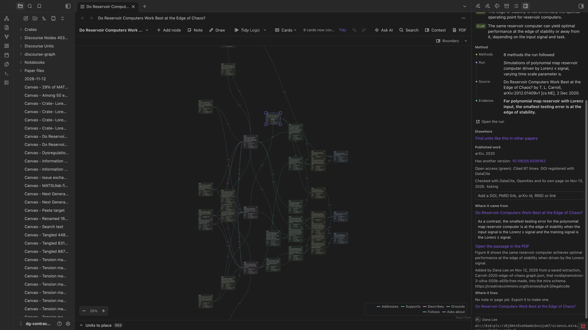

A unit read from a paper has a **Published work** section in Context. **Look it up** asks the open registries about the paper: Crossref or DataCite (whichever registered its DOI), OpenAlex, PubMed, and the paper's own page. Only the paper's identifiers and title are sent. Nothing is asked until you click.

What comes back is kept with the paper and shows on every unit read from it:

- its other identifiers, such as a PMID, an arXiv id and an OpenAlex id
- where and when it was published
- whether it is open access, and how often it has been cited
- **whether it has been retracted or corrected**, which also shows on the card
- another version of the same work, such as the journal article behind a preprint

The line under them says which registries answered, and when. A registry that didn't answer is listed with the reason.

**Add an identifier** takes whatever you paste for a unit of your own: a DOI, a PubMed link, an arXiv id, an ORCID iD, an RRID for an antibody or a cell line, or any link.

When a paper's page says it takes announcements, **Announce this unit to the paper's repository** shows you exactly what would be sent and where. It is sent only if you press **Send**. It needs a lab, because replies come back to your lab's server.

### Research crates

A research crate ([RO-Crate](https://www.researchobject.org/ro-crate/)) is one archive that describes itself: what is in it, who made it, what it was read from, and how each run was carried out. Repositories such as Zenodo and WorkflowHub read it, and so do lab notebooks.

**To make one:** open the canvas's name, choose **Export**, and under Where pick **A research crate (RO-Crate)**.

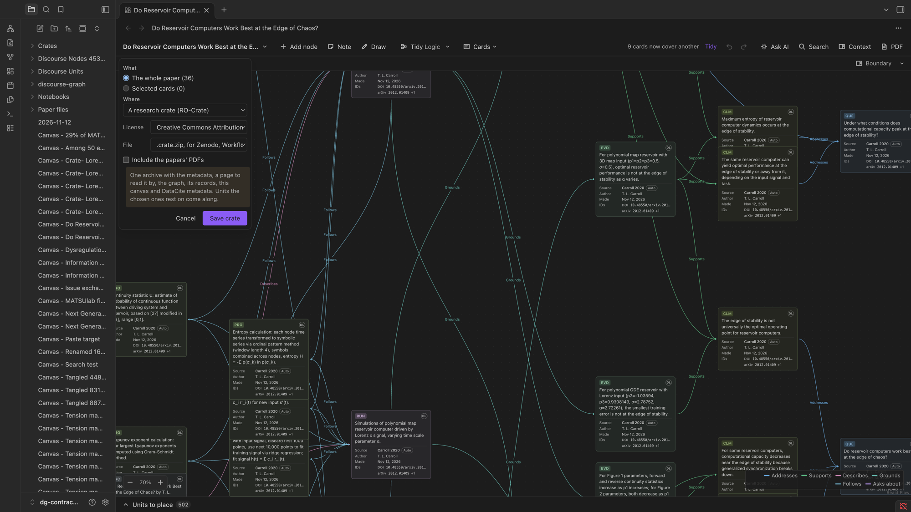

| Choice | What it means |
|---|---|
| License | How others may reuse the crate. Left unchosen, the crate says that none was chosen |
| File | `.crate.zip` for repositories and RO-Crate tools. `.eln` for eLabFTW, RSpace and other lab notebooks |
| Include the papers' PDFs | Off unless you tick it. Only include a paper you may pass on |

The archive is saved in your vault under Paper files. It holds the description, a page to read it by, the graph, this canvas, and metadata for a repository that will give it a DOI. Units that the chosen ones rest on come along, so the crate explains itself.

**To read one:** put the `.crate.zip`, `.eln` or `ro-crate-metadata.json` in your vault, right-click it and choose **Import this research crate**. A crate made here comes back exactly as it was. Someone else's becomes sources, code, runs and outputs on a new canvas, each marked Imported, with each run keeping what it used and what it made.

### Profiles

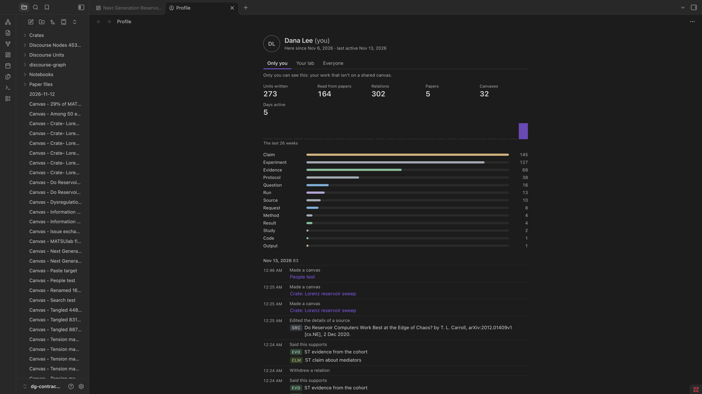

Everyone who has made something in your graph has a profile. Open your own from the ribbon menu or **Open my profile**. Open anyone's by clicking their initials, wherever they show.

A profile has up to three tabs, and each says who can see it:

| Tab | Who sees it | What it shows |
|---|---|---|
| **Only you** | You | Everything you did that isn't on a shared canvas: a history by day, and counts |
| **Your lab** | Everyone in your lab | What you did on what the lab shares: the same history and counts, for that work alone |
| **Everyone** | Anyone | Counts alone: units written, units read from papers, relations, papers, canvases, days active, and a chart of the last 26 weeks. No titles and no text |

On someone else's profile you see only the tabs you are allowed: a labmate's lab work and counts, a stranger's counts.

The history is read from the record of what was done, so nothing extra is tracked to make it. A paper read with Extract graph is one line ("Read a paper into 36 units"), not thirty-six. Units you wrote are counted apart from units a model read for you. Click a line to open the unit it is about.

Nothing is published. The Everyone tab shows what a public profile would hold, and today it stays on your device.

### Labs

Library, then the **Lab** tab.

- **Start a lab** and you are its PI.
- **Invite someone:** press **Make an invitation** and send them the line. It works once, for a week. They paste it into **Join a lab** and are in at once. Someone with only the lab's identifier can ask to join, and you accept them.
- **What the lab sets for everyone** is yours to choose as PI, and every member gets it: the lab's shelf of papers (a Zotero group, or the lab's own repository), the model servers the lab offers, and how far a paper's text may travel to be read by a model.
- **The lab's grammar** is the PI's. Members use it, and can add types of their own beside it.
- **Remove a member** from the list of members. They get nothing more from the lab and keep their own work.
- **Your devices:** open the vault on a second computer and it asks to sign as you. On a computer you already use, the Lab tab lists it under **Your devices**. Press **Let it in**. Until then the new one shares nothing. Remove a lost device from the same list.
- **If you are removed,** your own work and grammar stay. What the others shared is put away, and its notes go to the trash. It all comes back if you are invited again.
- **A paper's shelf** tells you who can open its PDF. "Lab shelf" means everyone in the lab. "Not on the lab's shelf" means only you. "Tomas's copy" means it is in Tomas's own library, and you can find it by its DOI.

### Zotero as your PDF library

In Settings, under Papers and notebooks, **Use Zotero as your PDF library** makes Zotero the place your papers are.

- **Read a PDF…** lists Zotero's PDFs first, under **In Zotero**, each named for its reference: "Seoane 2019". What is only in this vault follows under its own heading.
- A paper opens from where Zotero keeps it. Nothing is copied into the vault, and nothing is written to Zotero.
- A highlight you make, or a whole paper you extract, belongs to that reference. Its source carries the DOI and other identifiers Zotero holds.
- If the vault holds its own copy of a paper Zotero has, the paper is listed once, as Zotero's, and what you read from the copy is found there.
- When Zotero is closed, the list says so and shows what the vault holds. The settings line says whether Zotero is answering and how many PDFs it has.
- The small **Z** mark beside a source anywhere in the app means it is in your Zotero library. On a selected card, in the Context panel and in the reader, pressing it shows the item in Zotero.
- In the reader, **N in Zotero** means you have highlights on this PDF in Zotero that aren't units yet. It opens From Zotero at that reference with them ticked.

A PDF you add here while Zotero is your library is kept in the vault only. Add it to Zotero to keep it in your library.

### From Zotero

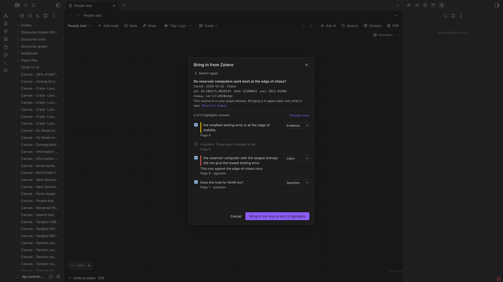

If your papers are in Zotero, you don't retype them. Open a canvas's name and choose **From Zotero…**, or run **Bring in from Zotero…**.

1. Search your library by title, author or year.
2. Pick a reference. It becomes a **Source**, with its DOI and other identifiers. If the paper is in your graph already, it joins that source and adds nothing twice.
3. Its highlights are listed in reading order. Tick the ones to bring. Each becomes a unit that quotes its passage and knows its page. A highlight is Evidence unless you say otherwise, and one you tagged `dg/claim` or `question` in Zotero keeps that type.
4. **Bring in** puts them on the canvas.

In Context, a highlight has **Open the passage in Zotero**, and a source has **Show it in Zotero**. A comment you wrote beside a highlight comes along.

Zotero has to be open, with "Allow other applications on this computer to communicate with Zotero" ticked under its Settings, Advanced. Your library is only read, never changed, and only when you ask here. Pictures and drawings aren't brought in yet.

This was built from Zotero's documentation and tested against a stand-in, not a real Zotero. [zotero.md](../zotero.md) says what to check first.

### Reading a PDF

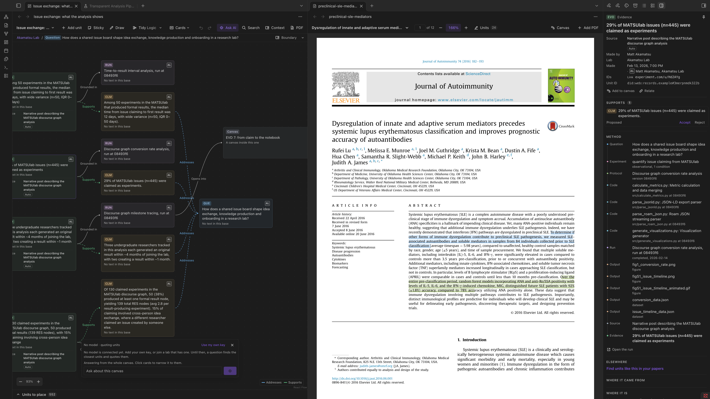

Obsidian's own PDF viewer stays the default. To read into the graph:

- **Read this PDF** (command), or right-click a PDF and choose **Read in Discourse Graphs**, opens that file beside the canvas.
- **Read a PDF…** (command, ribbon menu, or the PDF button on the canvas bar) opens the list of PDFs.
- Drop a PDF on the reader to add it. It is kept in the "Paper files" folder.

Select a passage and a small popup asks two things: what kind of unit, and which canvas. The unit remembers the exact words and the page, so its highlight is found again even if the file is renamed. Highlights you have made are tinted.

### Extract graph: a whole paper at once

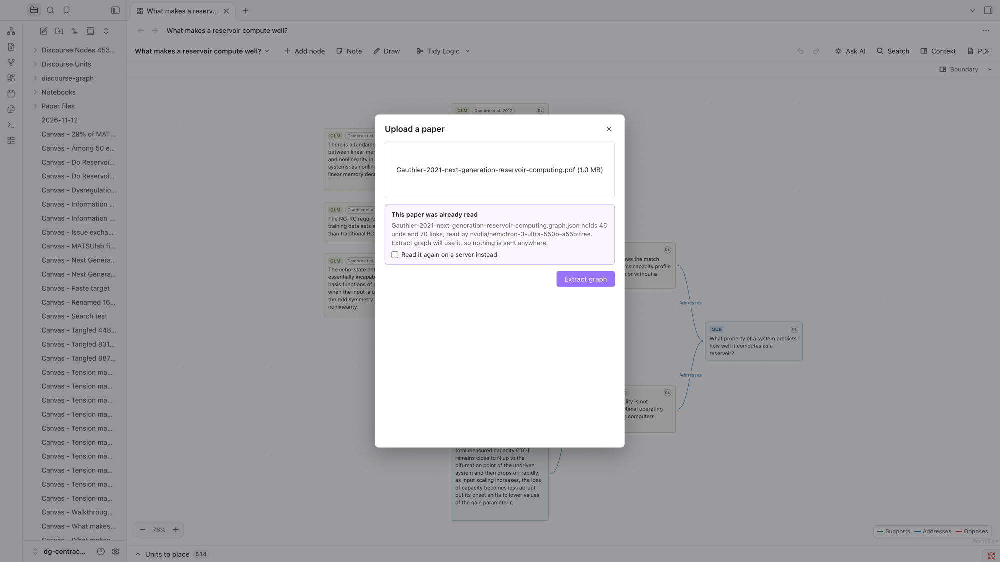

Highlighting reads a paper one passage at a time. **Extract graph** reads all of it into questions, claims, evidence, the runs it reports and the methods they followed, on a canvas of its own. There are three ways in, and they do the same thing:

- In the reader, **Extract graph** on the bar.
- Right-click a PDF and choose **Extract graph**, or run **Extract graph from this PDF**.
- **Upload a paper…**, for a file that isn't in the vault yet. The PDF is kept in "Paper files", so its units open at their passages.

**If the paper was already read somewhere else,** nothing is sent anywhere. A saved extraction is a file with the paper's name and `.graph.json` (or MIRA's own `.mira.jsonld`) in place of `.pdf`, such as the ones [MIRA extraction](https://mira-extraction.vercel.app/) saves. Put it beside the PDF, or pick both files together, and Extract graph uses it. The dialog says which file it found, how many units it holds and which model read it. Tick **Read it again on a server instead** to ignore it.

**With no saved extraction,** the dialog asks which server reads the paper, with which model, into which schema.

Asking twice for the same paper opens the canvas you already have. Once a paper has a canvas, the reader's bar shows **Canvas** in place of Extract graph.

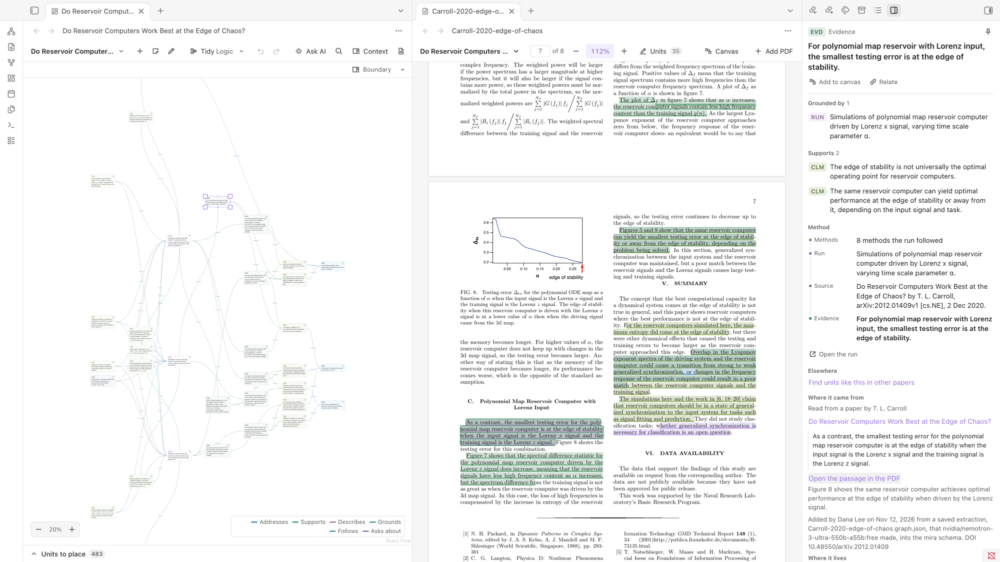

### Working across papers

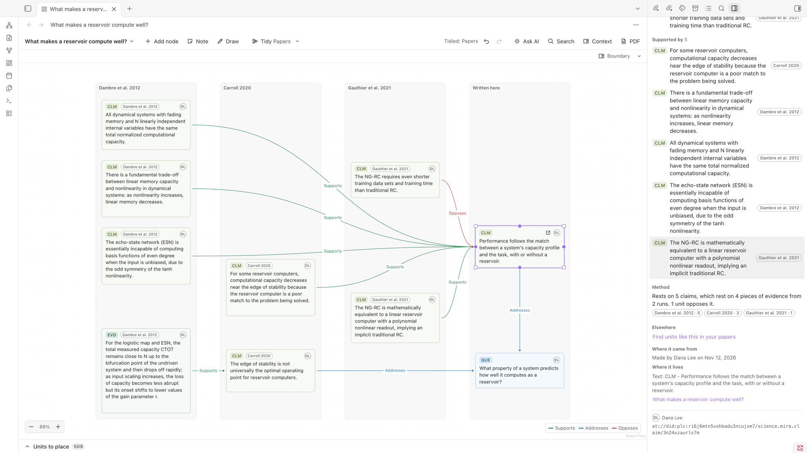

A canvas can hold units from any number of papers. Four things help you read across them:

- **A paper tag on each card,** such as "Carroll 2020". It shows wherever units from different papers sit together: on cards, in search results, and beside related units in Context. On a paper's own canvas the tag is left off, because every card there would say the same thing. Click a card's tag to open its passage in the reader.
- **Tidy → Papers** gives each paper a column, and one more for what you wrote yourself.
- **Rests on,** in a claim's Method section. When other claims support your claim, it follows them down: how many claims, how much evidence, how many runs, and how many units come from each paper. It says so when all of it comes from one paper.
- **Elsewhere,** at the foot of Context. It does nothing until you press **Find units like this in other papers**. Then it lists questions, claims and evidence from other papers that share this unit's rarer words, and says which words. The link button beside each one opens Relate on that pair. These are leads to read, matched on words alone, so expect misses and near-misses. It never states a relation for you.

A relation you state in Context is drawn on every canvas of yours that holds both units.

### Search and the finder

The picture above shows **Search units** on the right. Found words are marked in yellow in every result.

- The three menus filter by type and by who a unit is credited to, and set the order.
- **Titles, Passages, Notes** choose where the words are looked for: a unit's title, the passage it was cut from in a PDF, or the text of its note.
- Click a result to see it in Context. Select several to put them on the canvas together.

**Find a unit** (command) is the quick version: type, then Enter to open, ⌘↵ or Ctrl+↵ to put it on the open canvas, and Alt+↵ to insert a link in your note. Opened from a note's right-click menu as **Link a unit…**, Enter links.

### Ask AI

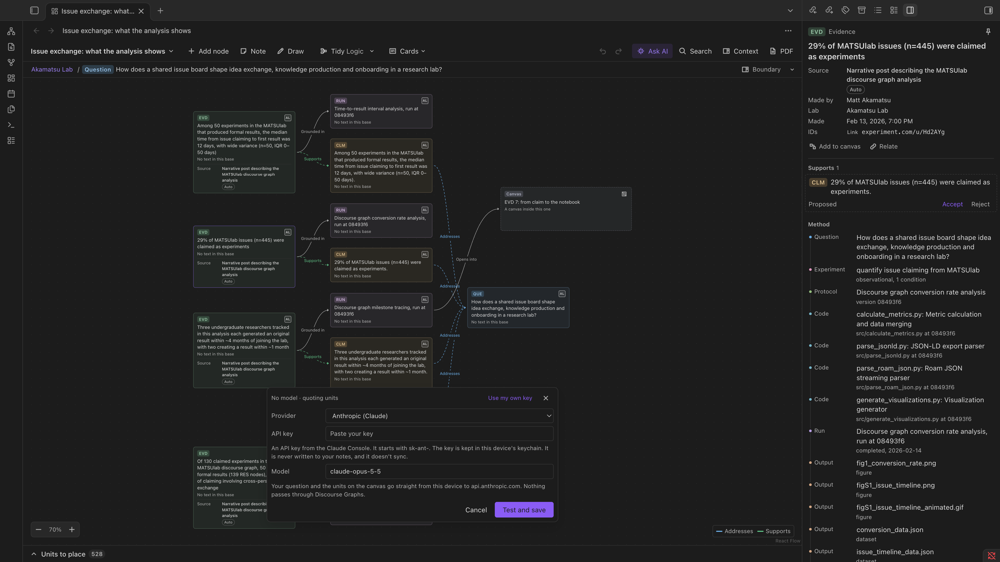

**Ask AI** on the canvas bar opens a bar over the canvas. Its first line says whose model will answer.

**With no model,** it says so and a question still works: it finds the closest units and quotes them word for word. Nothing is written that the units don't say.

**To use your own key,** click **Use my own key**:

1. **Provider.** Anthropic (Claude), OpenAI-compatible, or Google Gemini. OpenAI-compatible covers OpenAI, OpenRouter, and a model on your own computer such as Ollama or LM Studio. For those, set the address.
2. **API key.** Paste it. It is kept in Obsidian's keychain (Settings → Keychain), which your operating system encrypts. It is never written to your notes, and once saved it is never shown again: only its last four characters.
3. **Model.** Chosen from the list your key can use.
4. **Send questions** (only in a lab). Straight from this device, or through your lab's server.
5. **Test and save** sends one short message and tells you what came back.

The line at the bottom of the form says, in a sentence, where your question and the canvas's units will go.

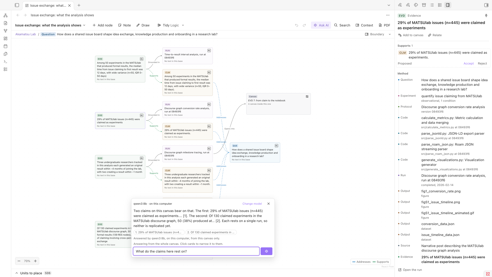

**To ask:** type a question and press Enter. By default the answer draws on the whole canvas. Click cards first to narrow it to them. Each number in the answer is a unit, and clicking it brings that card into view. **Stop** ends an answer early and keeps what arrived. Escape closes the bar.

An answer is a reading aid. It is not added to the graph.

### Runs and notebooks

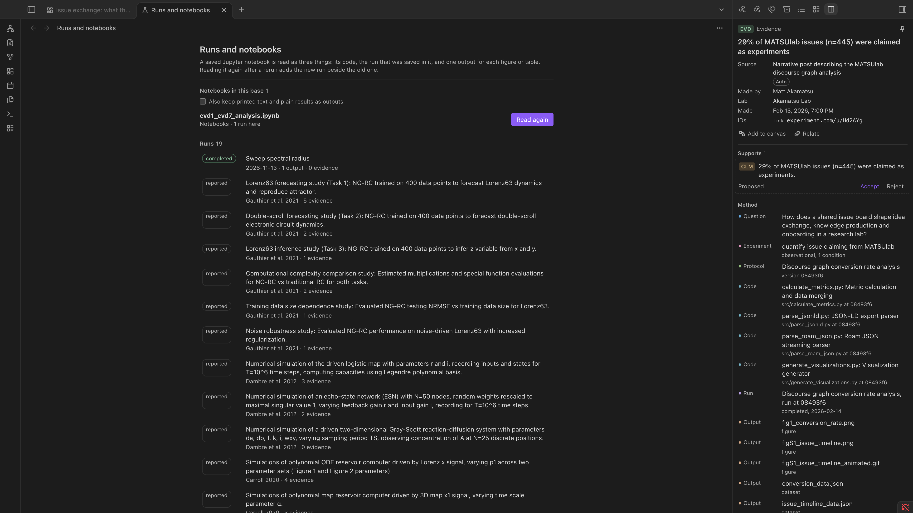

**Open runs and notebooks** (command, or the ribbon menu) lists the Jupyter notebooks in your vault and the runs already in the graph.

**Read into the graph** turns a saved notebook into three things: its **code**, the **run** that was saved in it, and one **output** for each figure and table. Reading it again after a rerun adds the new run beside the old one. Reading the same saved run twice adds nothing.

You can also right-click an `.ipynb` file and choose **Read into Discourse Graphs**.

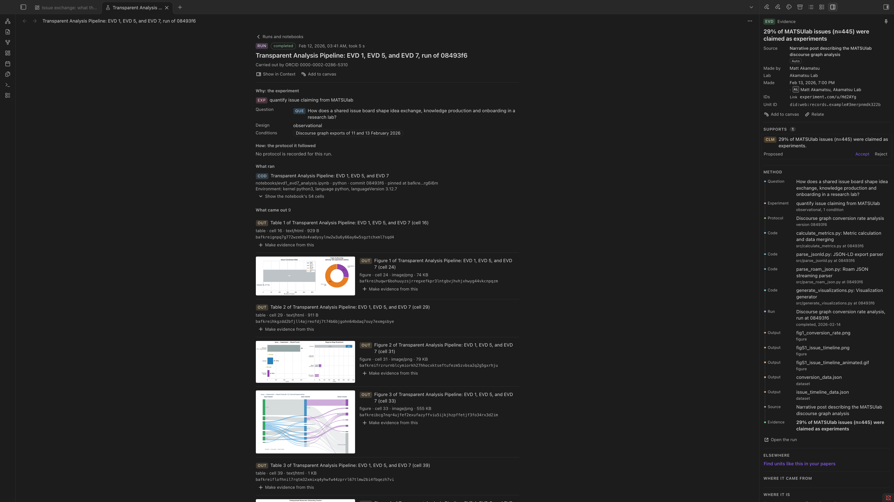

A **run's page** reads top to bottom in the order the work happened:

- **Why:** the experiment, its question, and which condition this run carried out.
- **How:** the protocol it followed, its steps, the parameters, and where this run departed from it.
- **What ran:** the code and its version, the environment, and the notebook's cells.
- **What came out:** each output, with the cell that made it and its hash.
- **What it is used to argue:** the claims that rest on it.

A figure is shown only while the notebook on your device still holds the same bytes. If you rerun the notebook, the old run's page says the notebook has changed and stops showing the new figure as the old run's.

**A run that a paper reports** has no date, code or outputs of its own. Its page says which paper reports it, links to that paper's canvas, and lists every method the paper says it followed. It isn't flagged for having no experiment, because that was never yours to file.

**Make evidence from this**, on an output, asks nothing and makes evidence pinned to those bytes. Rename it to say what the output shows. That sentence is yours to write.

### Sign-off

At the foot of the Context panel, **Checked** shows who has checked a unit. **Sign this unit** on your own unit, or **Mark as checked** on someone else's, asks how you checked it and takes an optional note. **Needs work…** sends a teammate's unit back with a reason.

- A checked unit shows a check mark on its card. If the unit is changed afterwards, the mark greys and the panel says it was made on an earlier version. Check it again to mark the new one.
- A mark is yours to take back, with the × beside it.
- A table of a type has a **Checked** column, so a PI can list what is checked, changed or sent back.
- An exported crate names who checked each finding, and a `.eln` file carries a run's sign-offs as comments.

### Pictures as evidence

Drop a picture on a canvas, or paste one. It is kept in the folder `Discourse pictures` under its own name, and becomes an Output with its card on the canvas.

- **Say what it shows**, on the card, takes a sentence and makes Evidence that rests on the picture. The evidence lands beside it.
- **The picture is pinned by a hash of its bytes.** The same picture added twice is one unit. If the file is changed later, its card says so and doesn't show the new file as the result.
- A crate exported from the canvas packs the picture, checked the same way.

PNG, JPEG, GIF, WebP, SVG and TIFF, up to 20 MB each.

### What a card is related to

Select a card and press the link button at its top. It lists everything the unit is related to, in its own words ("Supported by", "Addresses"), with what isn't on this canvas first. **Add** brings one in beside the card with its link drawn. **Add all** brings in every one that isn't there.

### Candidates

Give a type a **candidate tag** in Types and relations, such as `clm-candidate` for Claim. Then tag a line while you write, in a daily note or anywhere:

`- Load sets the assembly rate #clm-candidate`

Search shows how many lines are tagged. Open that list and press **Make it a Claim**: the line becomes a unit with a note from the type's template, and the line is replaced by a link to it. Nothing becomes a unit until you press.

### Commands and keys

Every canvas action is an Obsidian command, so it is in the command palette and can be bound to any key in Obsidian's Hotkeys: add a unit, tidy, fit to view, choose what cards show, ask AI, export, undo and redo. They are offered while a canvas is in front. Dialogs are Obsidian's own, so Escape closes them from anywhere inside.

### Types and relations

**Types and relations…** is in the command palette, the ribbon menu, a canvas's menu and Settings. It is where a lab sets its own words.

- **A type** has a name, a kind of unit, an abbreviation, the pattern its note is titled by, and a template. The kind is one of nine: question, claim, evidence, source, study, protocol, run, code or output. The kind is what other tools read, so "Hypothesis" as a claim still travels as a claim. A lab can add as many types as it likes on those nine, and can't add a tenth kind.
- **A template** is what a new note of that type starts with. `{title}`, `{date}`, `{author}` and `{type}` are filled in. **Start from the usual headings** gives the headings a lab notebook would use for that kind: a run starts with what was done, departures from the protocol, observations and files.
- **A relation** has its wording both ways, such as Supports and Supported by, and the pairs of types it may join. A relation is only offered between the types it lists.
- **Remove…** takes a type or relation out of use. It is refused while units or links still have it, and it says how many.
- **Open its table** makes a table of every unit of that type, with Obsidian's own Bases, in the folder `Discourse tables`. Each unit's note carries its type, the day it was made, who made it, a run's status and its paper as properties (`dg-type`, `dg-made`, `dg-by`, `dg-status`, `dg-source`), so the table can sort and filter by them. A table you rearrange stays as you left it.
- **Save as a schema file** writes every type, relation, allowed pair and template to `discourse-graphs-schema.json`, by name. **Read a schema file…** adds what is missing from such a file and changes nothing that is already here. It also reads the schema file the official Discourse Graphs plugin for Obsidian exports.

### Removing things

- **A canvas:** its menu, then **Remove this canvas…**. Only its maker can, and a paper's own canvas stays. The units on it and their links are untouched, and its note goes to Obsidian's trash.
- **A unit you made:** the foot of the Context panel, then **Remove this unit…**. It leaves every canvas and its note goes to the trash.

### Settings

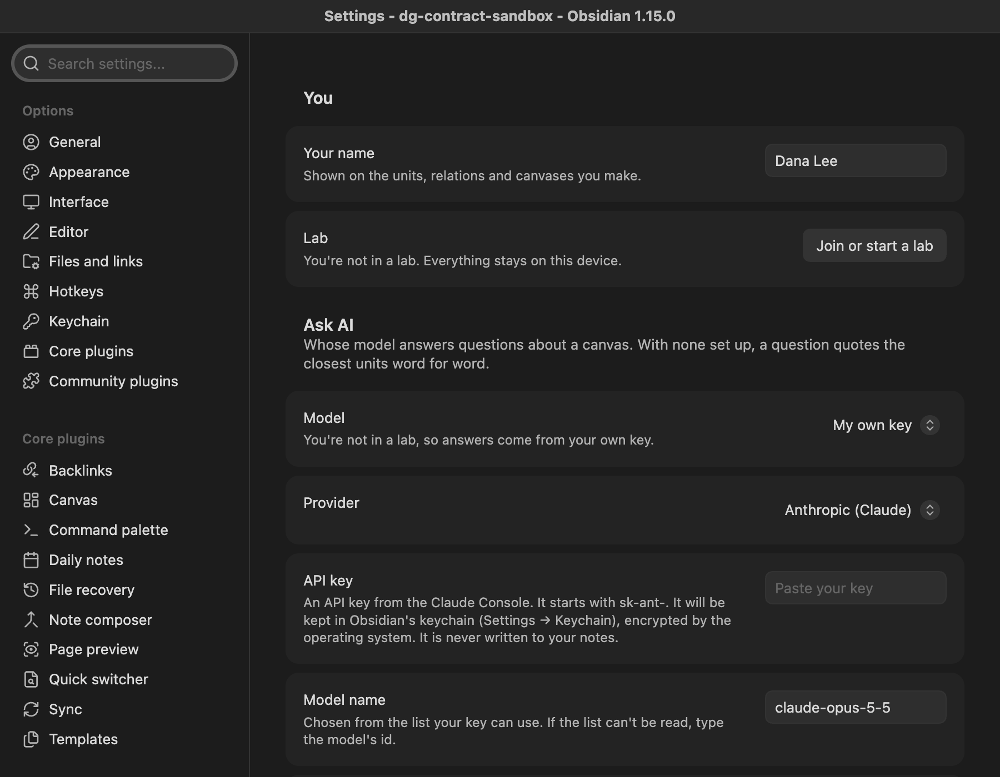

Obsidian → Settings → Discourse Graphs.

| Section | What you can set |
|---|---|
| You | Your name. Your lab, with a button to join or start one |
| Ask AI | Whose model answers, and the same fields as the form in the bar |
| In your notes | The key that makes a unit from selected text (empty turns it off). Type badges on links. A button to Obsidian's hotkeys, filtered to this plugin |
| Canvas | What Delete does on a link: ask, take it off this canvas, or withdraw the relation |
| Papers and notebooks | Whether reading a notebook also keeps printed text |
| Help and privacy | The walkthrough. The on-device usage log, with Clear. What leaves this device |

### Every command

Each has no default key. Give any of them a hotkey in Obsidian's Hotkeys settings.

| Command | Does |
|---|---|
| Open canvas, New canvas | Opens the last canvas, or makes one |
| Open the Library | The canvas list, papers, folders and lab |
| Open the overview, Open boundary | A lab, its questions and their claims laid out from the graph, and the Boundary panel |
| Open my profile | Your profile: your history, what your lab sees of it, and the counts anyone could see |
| Bring in from Zotero… | Finds a reference in your Zotero library and brings it in with the highlights you choose |
| Search units, Find a unit | The search panel, and the quick finder |
| Open context panel | The selected unit's context |
| Read a PDF…, Read this PDF | The reader's list, or the file in front |
| Extract graph from this PDF | Reads the whole PDF in front into a graph, from a saved extraction beside it or a server you pick |
| Import this research crate (RO-Crate or .eln) | Reads the crate in front into the graph. A crate made here is restored; another tool's becomes units |
| Upload a paper | The same, for a file that isn't in the vault yet |
| Open runs and notebooks, Read this notebook into the graph | Runs, and reading the notebook in front |
| Create unit from selection, Turn this note into a unit | Capture from a note |
| Toggle link badges | Type badges beside links in notes |
| Join or start a lab, Set my name | Identity |
| Start walkthrough, Remove walkthrough examples | The tour |

## What leaves your device

Nothing, until you choose it.

| You do this | This goes | To |
|---|---|---|
| Join a lab and share a canvas | That canvas, its units and their relations | Your lab's server |
| Ask AI with your own key | Your question and the units on that canvas | The model provider you chose. With a model on your own computer, nowhere |
| Ask AI with your lab's model | The same | Your lab's server |
| Extract graph, when no saved extraction sits beside the paper | The paper | The server you pick in the upload dialog |
| Extract graph, with a saved extraction | Nothing | Nowhere |
| Search or bring in from Zotero | Your search words, to the Zotero app on this computer | Nowhere else |
| Open a profile | Nothing | — |
| Read a PDF or a notebook | Nothing | — |
| Look a paper up | Its identifiers and title | doi.org, Crossref or DataCite, OpenAlex, PubMed, and the paper's own page |
| Open an identifier | Nothing from the app. Your browser opens the link | Wherever it resolves |
| Export or import a research crate | Nothing. The archive stays in your vault | — |
| Announce a unit, after reading what will be sent | Your name and id, the unit's address and the paper's DOI | The inbox the paper's page names |

There is no telemetry. The usage log stays on your device and holds action names only.

## Where things are kept

| Thing | Where |
|---|---|
| Your notes | Your vault, as Markdown, unchanged |
| The graph | `discourse-graph/records/` in your vault: one append-only file per device |
| Canvases | Also mirrored as `.canvas` files Obsidian's own Canvas can open |
| Dropped PDFs | `Paper files/` |
| A model key | Obsidian's keychain, outside the vault |
| Your signing key | The device. It can't yet be backed up |

## Words used here

- **Unit:** one question, claim, piece of evidence, source, protocol, experiment, run, code or output.
- **Card:** a unit shown on a canvas.
- **Staged:** a unit proposed by an extraction or an import that has no note yet.
- **Proposed:** a relation someone else asserted that you haven't accepted.
- **Pin:** a link to one version of something.
- **Drift:** a pin whose target has changed since.
- **Gap:** something a rule noticed. It never blocks you.
- **Scope:** mine, lab or everyone.
- **Release:** a canvas at one moment, with every unit pinned.

## Paper map

**Open paper map** (command, panel menu, or the Library's Paper map button) places every paper by how tied it is to the others. Two papers sit closer the more links people drew between their units, and when one cites the other. The line between them says what the links amount to: supports, opposes, both, other links, or a citation alone. A paper tied to nothing waits underneath with a dashed outline.

The tabs at the top choose whose work counts: one canvas, only you, your lab, or everyone. Pick a paper or a line to see the links behind it; double-click a paper to open its PDF canvas.

## Type colors

Green and red mean Supports and Opposes, on lines only. Types use other colors: Question violet, Claim amber, Evidence blue, Source grey. Each card has a colored left edge and a lettered chip, so the type never rests on color alone. `docs/color.md` has the reasoning and the measurements.

## The canvas sidebar

The icon left of the canvas title opens the sidebar. **Library** lists every workspace with its canvases and papers, marks the one you are on, and says where you are at the top. **Search units** finds a unit anywhere. **Units** lists what isn't on this canvas yet, to drag or place. Click the canvas and the sidebar goes; **Pin** keeps it open beside the canvas. The selected unit's own facts stay in the Context panel on the right.
