# User guide

This guide explains how a discourse graph is built, then covers every panel, dialog, command, key and setting of the Obsidian plugin. The pictures come from a test vault holding the MATSUlab issue-exchange analysis and one paper on lupus.

- New to the idea? Read [The schema in five minutes](#the-schema-in-five-minutes), then [A first session](#a-first-session).
- Every field and rule is in [schema.md](schema.md).
- Every word the interface uses is defined in [information-architecture.md](../information-architecture.md).
- What is sent off your device, and when, is in [what-leaves-the-device.md](../what-leaves-the-device.md).

**Contents**

1. [What it is](#what-it-is)
2. [The schema in five minutes](#the-schema-in-five-minutes)
3. [A first session](#a-first-session)
4. [Getting around](#getting-around)
5. [The canvas](#the-canvas)
6. [Context](#context)
7. [Boundary and the Overview](#boundary-and-the-overview)
8. [The Library](#the-library)
9. [Search and the finder](#search-and-the-finder)
10. [Capturing from notes](#capturing-from-notes)
11. [Papers](#papers)
12. [Zotero](#zotero)
13. [Runs, notebooks and pictures](#runs-notebooks-and-pictures)
14. [Sign-off, reactions and notes](#sign-off-reactions-and-notes)
15. [Ask AI](#ask-ai)
16. [Published work and research crates](#published-work-and-research-crates)
17. [People, profiles and labs](#people-profiles-and-labs)
18. [Types and relations](#types-and-relations)
19. [Removing things](#removing-things)
20. [Settings](#settings)
21. [Commands](#commands)
22. [Keys](#keys)
23. [Where things are kept](#where-things-are-kept)
24. [What leaves your device](#what-leaves-your-device)
25. [Limits](#limits)

## What it is

A discourse graph breaks research into small units (a question, a claim, a piece of evidence) and records how they relate: this evidence supports that claim, this claim addresses that question. It also records how each result was produced, so a claim can be traced back to the run, the protocol and the code behind it.

The plugin adds this to your notes. Your notes stay ordinary Markdown files. The graph lives beside them in your vault.

It also meets the tools around it. References and highlights come in from Zotero. A paper's identifiers and retractions come from the open registries. A canvas goes out as a research crate that repositories and lab notebooks read. Each of these happens only when you ask.

## The schema in five minutes

### Four units of argument

| Unit | Short | What it is | Example |
|---|---|---|---|
| Question | QUE | Something you want to know | How does a shared issue board shape idea exchange in a research lab? |
| Claim | CLM | An answer you are prepared to argue for | 29% of issues were claimed as experiments. |
| Evidence | EVD | One observation, stated so that it could be wrong | 29% of MATSUlab issues (n=445) were claimed as experiments |
| Source | SRC | A paper or document evidence was read from | Lu et al. 2016 |

Evidence says what was seen. A claim says what you take it to mean. Two people can accept the same evidence and still argue about the claim.

### Relations between them

| Relation | Read the other way | From | To | Reads as |
|---|---|---|---|---|
| Supports | Supported by | Evidence or Claim | Claim | This is a reason to believe it |
| Opposes | Opposed by | Evidence or Claim | Claim | This is a reason to doubt it |
| Addresses | Addressed by | Claim | Question | This is an answer to it |
| Informs | Informed by | Evidence | Question | This bears on it |
| Derived from | Has derivation | Evidence | Source | This was read from it |

A relation is a statement by a person. When a teammate asserts one about your units, it arrives as **Proposed**, and you accept or reject it.

### Five units of process

These record how a result was made. They differ by what they fix.

| Unit | Short | Fixes | Example |
|---|---|---|---|
| Protocol | PRO | **How** something is done, whoever does it and whenever | Immunostaining, version 2: fix, stain, image |
| Experiment | EXP | **What one investigation compares, and why** | Dose series: low against high, to answer "does dose drive staining?" |
| Run | RUN | **What happened on one occasion** | The run of 1 November, high dose, imaged a day late |
| Code | COD | A notebook or script at one version | `intensity.ipynb` |
| Output | OUT | One thing a run produced | Figure 2 of that notebook |

The three that are easy to confuse:

- **A protocol declares.** It lists steps, materials and the parameters it has. It says nothing about any one day.
- **An experiment chooses.** It names its question, the conditions it compares, and the protocols it uses. In the schema files its kind is called `study`. "Experiment" is the default label, and a lab can rename it.
- **A run records.** It names the condition it carried out, the values its parameters took, who did it and when, and where it departed from the protocol.

One experiment has many runs. One protocol serves many experiments. A run that departs from its protocol records a deviation. It does not change the protocol.

### How the two halves join

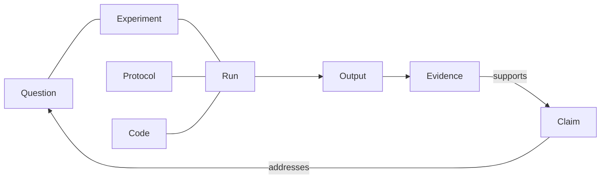

Evidence **rests on** outputs. So from any claim you can walk back: the evidence for it, the output that evidence rests on, the run that made the output, and the protocol and code that run used.

### Two kinds of link

- **Arguments** (supports, opposes, addresses, informs) are their own signed records, because other people can dispute them.
- **Provenance links** (this run followed that protocol, this output came from that run) are fields on the unit, because only its author can state them.

On a canvas, provenance links are drawn solid and arguments dashed.

### Identity, versions and drift

- **Every unit is credited** to the person who made it, and to their lab if they are in one. Only its author can rename it.
- **An output is identified by its bytes.** Its id is a hash of the file. Two runs that make the same figure make the same hash, and the graph can see that.
- **A link to a version is a pin.** A run pins the protocol and code versions it used. Evidence pins the output it cites.
- **Drift is a pin that no longer matches.** If a protocol is edited after a run followed it, the run still points at what it followed, and the interface says "edited since the run". Nothing is rewritten behind your back.

### Gaps

The software checks the graph against a set of rules and shows what it finds as gaps. Gaps never block you. Examples:

- A claim nothing supports yet.
- Evidence with nothing behind it: no output, run or source.
- A run that belongs to no experiment.
- A claim whose support all comes from one run ("single run").
- The code changed after this run.

The full list is in [schema.md](schema.md#rules).

### Workspaces and scopes

Everything is private until you share it. A unit, a canvas and a paper each live in one **workspace**: yours, which only you see, or your lab's. Views narrow by scope, each inside the next:

- **Mine** (shown as **Only you** or **Yours**): what you made.
- **Lab:** yours and your lab's.
- **Everyone:** everything this graph holds, including other labs' work.

A unit is a leaf. It opens as its text and its context, never as a graph of its own. A canvas can hold another canvas.

## A first session

1. **Open a canvas.** Click the Discourse Graphs icon in the left ribbon and choose **New canvas…**.
2. **Add a question.** Press **N** on the canvas, type the question, and choose Question.
3. **Capture a claim from a note.** In any note, select a sentence and press `\`. Choose Claim. The sentence becomes a unit and a link.
4. **Read a paper.** Right-click a PDF and choose **Read in Discourse Graphs**. Select a passage, choose Evidence, and choose your canvas. Or choose **Extract graph** to read the whole paper at once.
5. **Connect them.** Drag from the evidence card's edge to the claim, and choose Supports. Do the same from the claim to the question, with Addresses.
6. **Look at what stands behind it.** Select the claim and open **Context**. The Method section shows the chain and any gaps.

### The walkthrough

The walkthrough does the same on your own graph in about three minutes. It is offered once per device as a small card and never starts by itself. Start it from Settings → Discourse Graphs → Help and privacy → **Start**, or with the **Start walkthrough** command.

- It dims everything except the next thing to use, and each step waits for the real action. Every step has **Do it for me**. × or Escape leaves at any point.
- It asks for your name, because credit is shown on everything you make.
- It makes a note, four units and a canvas named "Walkthrough canvas". At the end you choose whether to keep them. **Remove walkthrough examples** takes them out later.

### The first time it loads

A welcome dialog asks whether you are joining a lab or working on your own. **Work on my own** keeps everything on this device. You can join or start a lab later.

## Getting around

Every kind of thing has one side of the window.

| Side | What is there |
|---|---|
| Left: the canvas sidebar | **Library**, **Search units**, and **Units** not on this canvas yet |
| Middle: the main view | The one thing being worked on: a canvas, a PDF, the paper map, a run, a profile, the Overview |
| Right: the panels | **Context** and **Boundary**, about the selected unit. **Search units** and the **Library** also open here as Obsidian side panels |

### The ribbon menu

One ribbon icon opens a menu of everything, in three groups:

| Group | Entries |
|---|---|
| Canvases | Open canvas, Library, Overview, Paper map, New canvas… |
| Panels | Search units, Context, Boundary, My profile, Put the side panels back |
| Find and read | Find a unit…, Read a PDF…, Upload a paper…, From Zotero…, Types and relations…, Runs and notebooks |

**Settings** is the last entry. Every panel's ⋯ menu lists the same entries under "Discourse Graphs", without the panel already open.

### Obsidian's own menus

| Where | Entry | Does |
|---|---|---|
| Right-click in a note, with text selected | Create unit from selection | Opens the list of unit types for the selected words |
| Right-click in a note | Link a unit… | Opens the finder. Enter inserts a link at the cursor |
| Right-click a PDF | Read in Discourse Graphs | Opens the file in the reader beside the canvas |
| Right-click a PDF | Extract graph | Reads the whole paper into a PDF canvas |
| Right-click an `.ipynb` file | Read into Discourse Graphs | Reads the notebook into code, a run and outputs |
| Right-click a `.crate.zip`, `.eln` or `ro-crate-metadata.json` file | Import this research crate | Reads the crate into the graph |

### Finding a canvas

Each canvas has a note named `Canvas - <title>`, which opens as the canvas. So a canvas is found in Obsidian's file list, quick switcher, search and links. Renaming the note renames the canvas. A paper and its PDF canvas go by one name: renaming the canvas's note renames the paper too.

## The canvas

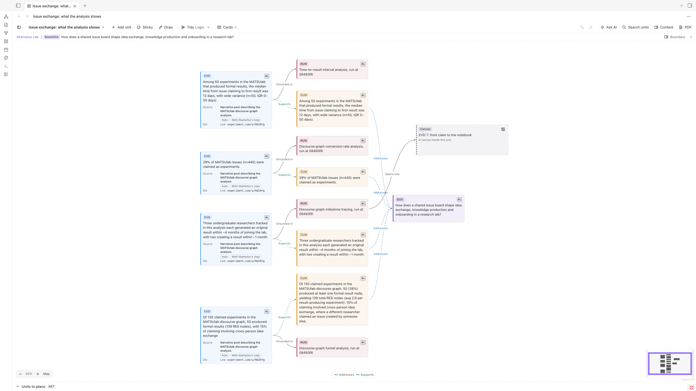

A canvas is where you build an argument. Cards are units. Lines are relations.

### The bar

| Group | Control | Key | Does |
|---|---|---|---|
| Sidebar | The icon left of the canvas's name | | Opens the canvas sidebar |
| Canvas | The canvas's name | | Opens the canvas menu |
| Add | Add unit | N | Finds a unit or makes a new one. On a PDF canvas it reads **Highlight** and opens the paper's PDF |
| | Sticky | T | A plain sticky note, not part of the graph |
| | Draw | D | Freehand strokes. Press D again to stop |
| Tidy | Tidy | L | Arranges the cards in the current mode. The arrow beside it chooses the mode |
| Cards | Cards | | Chooses what every card shows under its title |
| History | Undo, Redo | ⌘Z, ⇧⌘Z | Steps through every edit made in this canvas tab |
| Panels | Ask AI | | Asks a model about this canvas |
| | Search units | | Opens unit search in the sidebar |
| | Context | | Opens the selected unit's context |
| | PDF | | Opens the reader beside the canvas, at the PDF most of the cards came from |

The bar is one tab stop. Arrow keys, Home and End move along it. Tooltips give each control's name and key.

The bar measures its own width and steps down as room runs out:

1. Every label.
2. Only the words no icon can stand for: Tidy and its mode, Ask AI, Context.
3. Icons only. The status text floats under the bar.
4. Sticky, Draw, Ask AI and PDF fold into a **More** menu, with their keys shown.

The status text in the bar names the last step for a few seconds, says how many cards cover another after cards grow, and offers **Tidy** to make room.

### The canvas menu

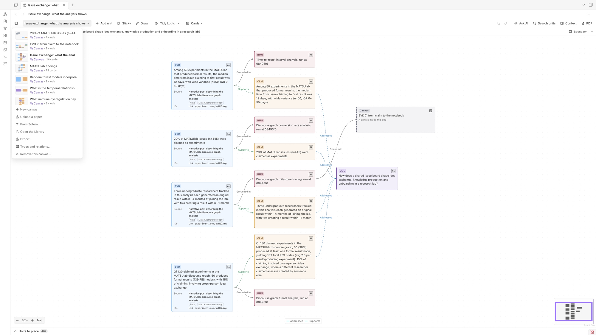

Click the canvas's name. Each canvas is drawn as a small picture of its real layout: every card where it sits, colored by type, with its kind and card count:

- **Canvas:** laid out by people to work out an argument, drawing on any papers.
- **PDF canvas:** one reading of one paper, as the model drew it.

Below the list: **New canvas**, **Upload a paper**, **From Zotero…**, **Open the Library**, **Export…**, **Types and relations…** and **Remove this canvas…**.

### The line under the bar

It says where the canvas sits: its workspace, and the question or claim it is about, if any. Each step is a link to that canvas. **Boundary** opens the Boundary panel. Its menu holds **Make this the canvas of a question or claim…** and **Stop being the canvas of this question or claim**.

### The canvas sidebar

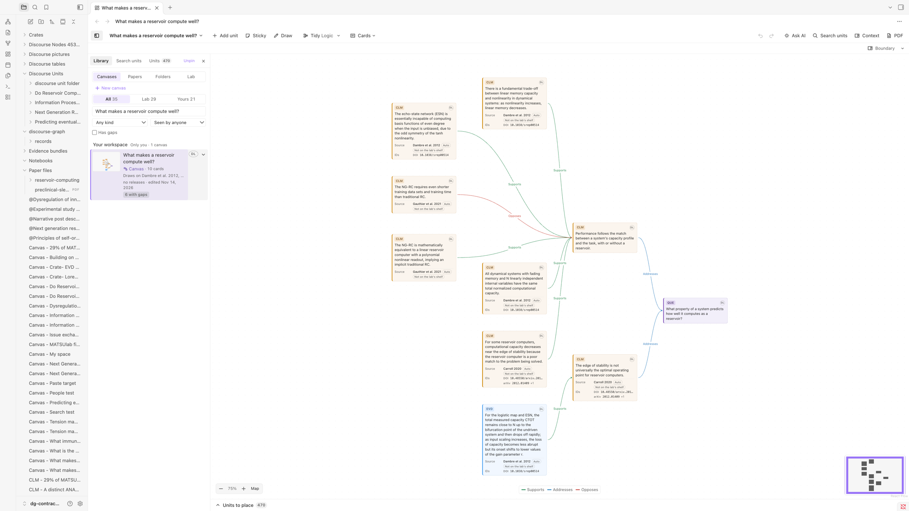

The icon left of the canvas's name opens the sidebar. Its first line says where you are: workspace, then canvas. It has three tabs, always in this order:

| Tab | Holds |
|---|---|
| **Library** | Every workspace with its canvases and papers, with the open one marked |
| **Search units** | The search panel, to find a unit anywhere |
| **Units** | The units not on this canvas yet, to drag or place. U opens it |

The sidebar floats over the canvas and goes when the canvas is clicked. **Pin** keeps it open and the canvas makes room. It reopens on the tab it was last on.

**Units** groups what is not on this canvas by where it is: a group for each other canvas that holds the units, then each folder, then units on no canvas or folder. A unit in two places is in both groups. In each group, units linked to cards already on this canvas come first, with a count of those links. It has a search box, a type filter, and a **List** or **Grid** view.

- Click selects a unit. **Place n together** puts the selection on the canvas in a clear spot, laid out with its links.
- Dragging puts a unit, or the selection, where it is dropped.
- **Place all** puts a whole group on.
- Relations come with the units, to each other and to cards already there. Undo takes them off.

### Cards

Cards are 240 px wide and grow with their title. Titles are never cut short. A canvas never opens below 70% zoom.

A card shows a lettered chip for its type (QUE, CLM, EVD) and a colored left edge. The colors are listed in [color.md](../color.md).

**Initials** in a card's corner say who it is credited to. A circle is a person. A square is another lab. Hover them for a small card about that person. Click them for their profile.

**A check mark** means someone has checked the unit. See [Sign-off](#sign-off-reactions-and-notes).

**A paper tag,** such as "Carroll 2020", shows on a card wherever units from different papers sit together. On a PDF canvas the tag is left off.

**A sticky** shows who wrote it and when, under its text. A sticky within 48 px of a card moves with it when you tidy.

#### What a card shows

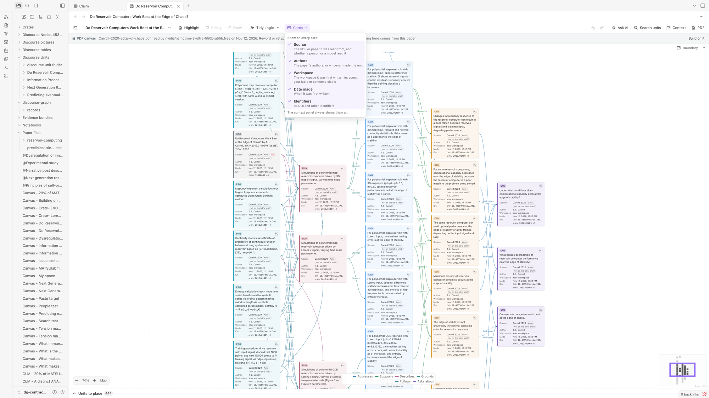

The **Cards** list switches five facts on or off for every card at once. The list stays open while you switch, and the choice is kept on this device.

| Fact | Shows |
|---|---|
| **Source** | The paper or PDF in a few words, then how the unit was read: **Auto** when a model read it, **Auto, reworded** when a person changed the model's words, **By hand** when a person highlighted or wrote it, **Imported** when it arrived in a file. A source a registry lists as retracted says **Retracted**. A small **Z** means the source is in your Zotero library |
| **Authors** | The paper's authors. A unit that was not read from a paper says **Made by** and names whoever made it |
| **Workspace** | Where it was written: yours, your lab's or another |
| **Date made** | The day and the time |
| **IDs** | Up to two identifiers, and how many more there are |

A click on a card selects it and nothing else. Once a card is selected, its source opens the passage in the reader, and an identifier opens where it resolves.

#### Gestures on cards and links

| Gesture | Result |
|---|---|
| Click a card | Selects it. Context follows |
| Double-click a card, Enter, or the open button | Opens its text beside the canvas |
| Double-click a card's title, or F2 | Renames it in place, if it is yours. Enter keeps the name, Escape leaves it. Its note is renamed with it. For someone else's unit, the bar says who can rename it |
| Drag from a card's edge to another card | Offers the relations the grammar allows between those two types |
| Drag from a card's edge to empty canvas | Finds or makes the next unit, then asks for the relation |
| Hover a link | Shows who made it |
| Delete on a card | Takes it off the canvas. The unit stays in the graph |
| Delete on a link | Asks: take the link off this canvas only, or withdraw the relation. **Remember my choice** makes it the default. Only its author can withdraw a relation |
| Copy, cut, paste | Cards go to another canvas with their layout and links, at the pointer. A unit already there is lit instead of doubled. Pasted into a note, the same copy is the titles |
| Drop or paste a picture | Makes an Output. See [Pictures as evidence](#pictures-as-evidence) |
| The link button at the top of a selected card | Lists everything the unit is related to |

**What a card is related to.** The link button lists every relation in the unit's own words ("Supported by", "Addresses"), with what is not on this canvas first. **Add** brings one in beside the card with its link drawn. **Add all** brings in every one that is not there.

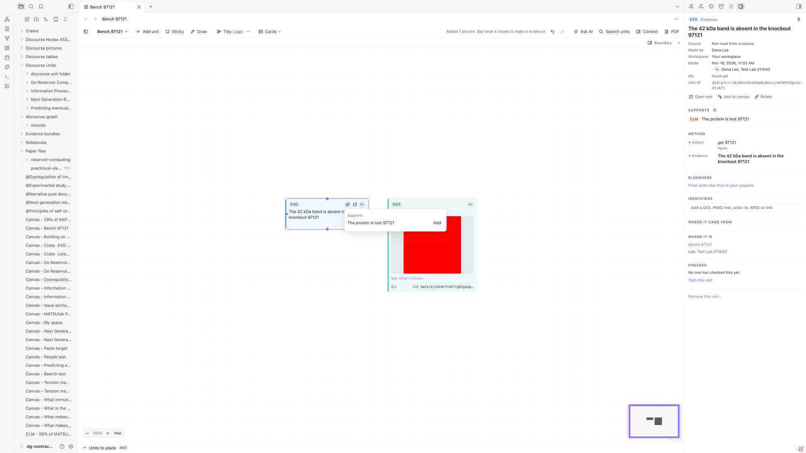

A relation you state in Context is drawn on every canvas of yours that holds both units.

### Tidy

Tidy arranges the cards. It has ten modes. The mode stays with the canvas, so teammates see the same arrangement.

| Mode | Answers | Layout |
|---|---|---|
| Logic | What rests on what? | What a card rests on sits to its left. Opposition sits left with support |
| For and against | What is the case each way? | Support on the left, opposition on the right |
| Timeline | What came when? | Columns of periods, oldest on the left. Empty periods are dropped, and the next heading says how long the silence was |
| Kinds | What do we have of each? | A labeled column per unit type, in the order the argument flows |
| People | Who did what? | A labeled column per contributor, or per lab for shared work |
| Papers | What came from where? | A column for each paper, and one for what was written here |
| Focus | What touches this card? | The selected card in the middle, two steps each way, and everything else set apart |
| Most connected | What is the hub? | Ranked by how many cards each touches, in three bands |
| Bridges | What holds parts together? | Ranked by betweenness, in three bands |
| Load-bearing | What would bring the most down? | Ranked by PageRank run backward along the logic, in three bands |

- Pressing Tidy again in the same mode moves nothing.
- Every tidy can be undone.
- Tidy stays left to right in narrow frames.
- Drawings stay where they are.
- The ranking modes show each card's score, and their links fade until hovered.

### View controls

At the canvas's corner: **Zoom in**, **Zoom out**, **Fit to view**, and a switch for the small **map of this canvas**, which frames the part in view. The map is on by default. A legend lists the relations on this canvas with their colors.

### PDF canvases

A PDF canvas is one reading of one paper. A line under its bar says which file it is, which model read it and when. Everything on it comes from that paper.

| On a PDF canvas | Allowed |
|---|---|
| Reword a card (F2 or double-click the title), or change its type | Yes. The card's source row then says "Auto, reworded". Context keeps the model's wording under the title, with **Put the model's words back** |
| Add a unit by highlighting in this paper's PDF (**Highlight** on the bar) | Yes. The card is marked "By hand" |
| Relate two of the paper's units | Yes |
| Take a card off, or put one of the paper's units back on | Yes |
| Move, resize, tidy | Yes |
| Type in a unit with no passage | No |
| Bring in a unit from another paper, or a highlight from another PDF | No |
| Stickies and drawings | No |

A refused change offers **Build on it**. That makes a canvas in your workspace with the same cards, pointing at the same units, which takes anything.

A PDF canvas cannot be removed from the canvas menu.

### Working across papers

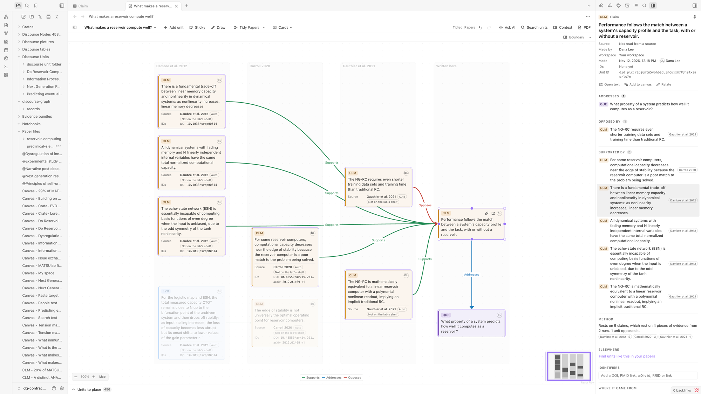

A canvas can hold units from any number of papers. Four things help you read across them:

- **The paper tag** on each card. Click it to open the passage in the reader.
- **Tidy → Papers** gives each paper a column, and one more for what you wrote yourself.
- **Rests on,** in a claim's Method section. When other claims support your claim, it follows them down: how many claims, how much evidence, how many runs, and how many units come from each paper. It says so when all of it comes from one paper.
- **Elsewhere,** at the foot of Context. It does nothing until you press **Find units like this in other papers**. Then it lists questions, claims and evidence from other papers that share this unit's rarer words, and says which words. The link button beside each one opens Relate on that pair. These are leads to read, matched on words alone. It never states a relation for you.

## Context

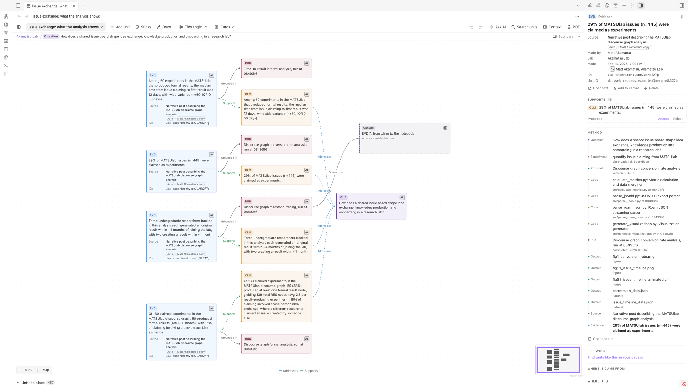

Select a card, or open a unit's note, and **Context** shows that unit. With nothing selected it says so. The pin at its head keeps one unit in view while you select others, and Back returns to the unit before.

From top to bottom:

| Section | Holds |
|---|---|
| Title and facts | The title, then the same five facts a card can show, in the same order. Here all five always show, with the unit's own id, which copies on a click. For a reworded unit, the model's wording and **Put the model's words back** |
| Relations | Each relation in the unit's own words. A relation a teammate asserted is **Proposed**, with **Accept** and **Reject**. A box finds a unit to relate, and **Relate these two** picks the relation |
| Text | The start of the unit's note |
| Method | How it was produced. See below |
| Published work | For a unit read from a paper. See [Published work](#published-work-and-research-crates) |
| Where it came from | The paper, DOI, model and passage, with **Open the passage in the PDF** |
| Where it is | Its note, its canvases and its folders, each a link |
| Reactions and Notes | On shared canvases. See [Sign-off, reactions and notes](#sign-off-reactions-and-notes) |
| Checked | Who has checked it |
| Elsewhere | Units like this one in other papers, when asked |
| Remove this unit… | For a unit you made |

A link to a canvas from Context opens it, brings the unit's card into view and rings it briefly.

### Method

**Method** shows how a unit was produced, in the order the work happened:

- For **evidence:** question, experiment, protocol, code, run, outputs, source. A run that a paper reports often names many methods. More than two fold into one line, such as "8 methods the run followed", which opens when clicked.
- For a **claim:** that chain for each piece of evidence, and what the checks make of them: replicated, single run, one method, method changed, output changed.
- For a **protocol, experiment or run** of yours: **Edit fields** opens the fields that unit has. Lists are typed one to a line.
- For an **output:** **Make evidence from this**.

A step marked **edited since the run** is drift. A step in grey is something a pin names that this graph does not hold. Click a step to walk to it, or a run to open its page.

The method chain shows even while an argument above it is still Proposed, because those links are the author's own.

## Boundary and the Overview

**Boundary** is a side panel about one question, claim or piece of evidence. Its head says which: **The selected unit**, or **This canvas is about** when nothing is selected and the canvas is tied to a question or claim. A path above the title links to the canvases above it.

It has six tabs:

| Tab | Shows |
|---|---|
| **Parts** | What it holds: the claims that address a question, the evidence for and against a claim, the outputs evidence rests on. Then **What stands behind it**: the run, experiment, protocol, code and source |
| **Gaps** | The rules as checks, each with the units it found. A gap can light its units on the canvas |
| **In and out** | What crosses in: units from another lab or workspace, evidence reported in a source, arguments proposed by others. What goes out: parts that also sit elsewhere, and parts in a release |
| **Privacy** | How many parts are seen only by you, by your lab, or published |
| **Whose records** | Which arguments count: **Mine**, **Lab** (the default) or **Everyone**. Other people's arguments become pending, not hidden. Flags and gaps follow this choice |
| **History** | Its records over time, newest first |

A unit picked in Boundary moves Context to it and lights its card. **Clear highlight** puts the lights out.

**The Overview** (**Open the overview**) is a main-area tab that lays one workspace out from the graph: its questions, the claims under them, down to evidence. It is read-only and laid out in Tidy's Logic mode. It shows the same Parts and **What stands behind it** lists, names a question's own canvas if it has one, and **Back to the workspace** returns to the top.

## The Library

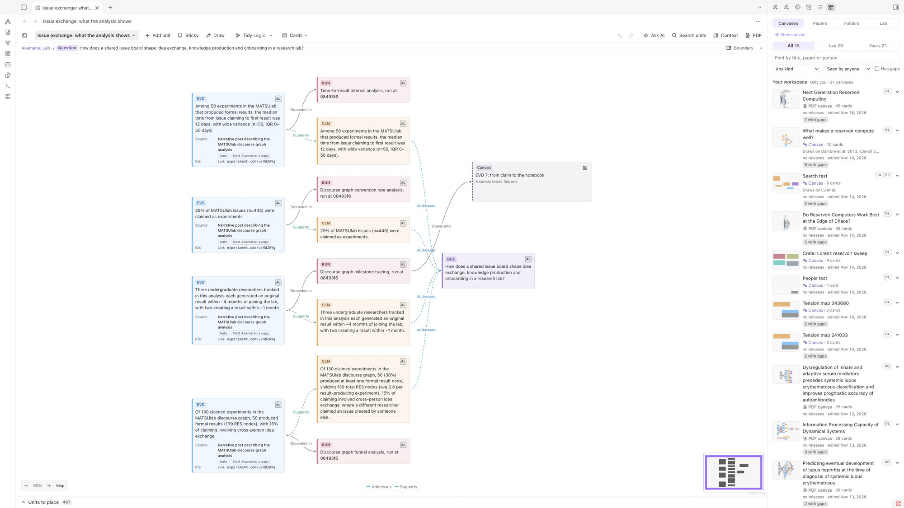

The Library is a side panel with four tabs: **Canvases**, **Papers**, **Folders** and **Lab**. The same Library is the first tab of the canvas sidebar.

### Canvases

- Canvases are grouped by the **workspace** they live in: yours, which only you see, then your lab's.
- A canvas row shows its picture, its kind, what it **draws on** (the papers most of its cards were read from), and the initials of **who did most on it**, most first.
- **All, Lab, Yours** narrows the list. The number beside each is how many canvases it holds.
- The search box finds by title, paper or person.
- **Any kind** filters to PDF canvases or to canvases. **Seen by anyone** filters to only you, your lab, or published. **Has gaps** keeps only canvases with something to look at.
- The arrow on a row opens who sees it, its **History**, **Releases** and forks.
  - **History** moves through the canvas's past, edit by edit.
  - **Cut a release** takes a name and an optional note, and pins every unit on the canvas at that moment, so it can be cited. **Compare** shows what was added, removed, changed and moved between a release and now, or between two releases. A release can be forked into a new canvas.
  - On a canvas in your workspace, **Work on it with others…** names your lab and its members, then moves the canvas to the lab's workspace.

### Papers

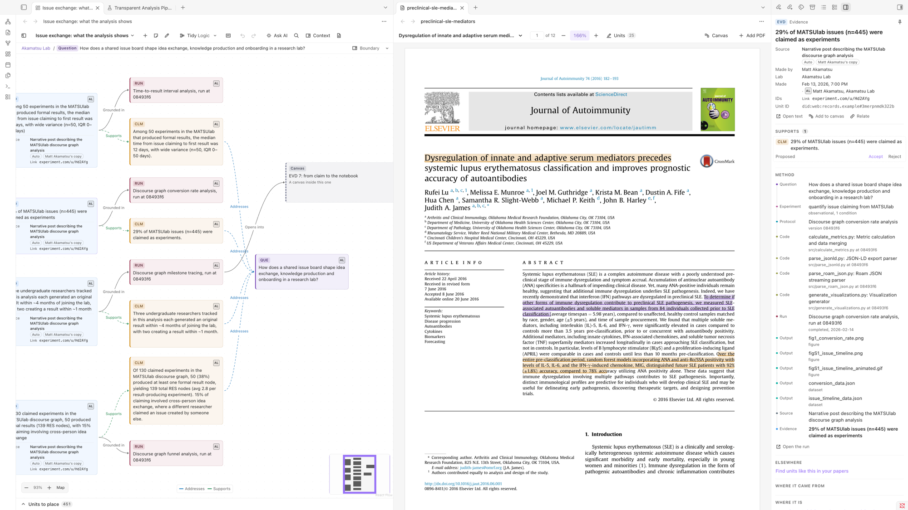

Every paper in the graph, each with its PDF canvas. **Load demo papers** adds the two demo papers with no server. In a lab, **Share** adds a paper to the lab's shelf, **Get the file** fetches a PDF a labmate shared, and **Paper map** opens the map below.

### Paper map

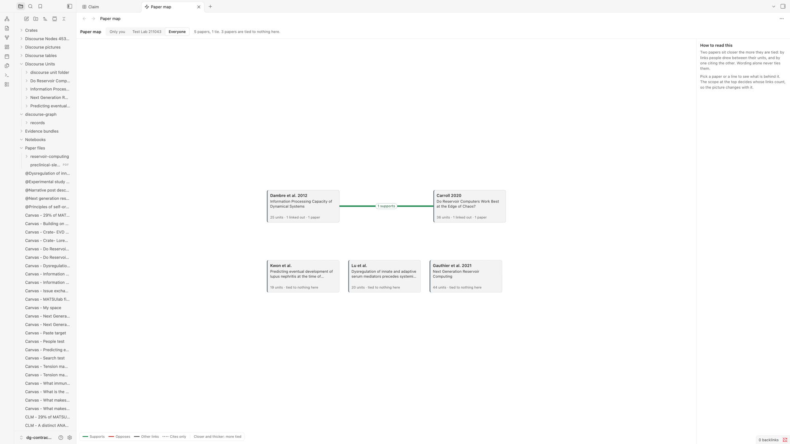

**Open paper map** (command, ribbon menu, or the Library's **Paper map** button) places every paper by how tied it is to the others. Two papers sit closer, with a thicker line, the more links people drew between their units, and when one cites the other. The line says what the links amount to: supports, opposes, both, other links, or a citation alone. Wording never counts as a tie. A paper tied to nothing waits underneath with a dashed outline.

The tabs at the top choose whose work counts: one canvas, only you, your lab, or everyone. Pick a paper or a line to see the links behind it. Double-click a paper, or press **Open its PDF canvas**, to open it.

### Folders

Folders keep units together. Type a name to make one. Exporting units from a paper fills one.

### Lab

See [Labs](#labs).

## Search and the finder

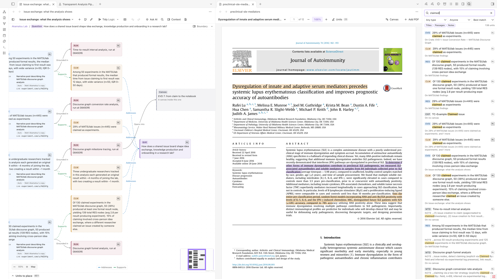

**Search units** is a panel that stays while you work. It opens in the right sidebar, and as the second tab of the canvas sidebar.

- Type in the box. Found words are marked in yellow, and in a heavier weight, in every result.
- **Titles, Passages, Notes** choose where the words are looked for: a unit's title, the passage it was cut from in a PDF, or the text of its note.
- Three menus filter by **type** and by who a unit is **credited to**, and set the **order**: best match, last edited, newest, or title. Each filter shows how many results it would keep.
- A result shows the type, the title, who it is credited to, its paper tag, a second line when the words were in the note or the passage, and the canvases that hold it.
- Click a result to preview it: the start of its note, its relations, and **Open**, **Insert link**, **Put on <canvas>** (the canvas in front) and **Context**.
- ⌘-click or Ctrl-click picks several. Any result can be dragged onto a canvas.
- Proposed relations waiting for you are listed here with **Accept** and **Turn down**.
- Lines tagged with a candidate tag are counted here. See [Candidates](#candidates).

**Find a unit** is the quick version, opened by its command or the ribbon menu. Type, then:

| Key | Does |
|---|---|
| Enter | Opens the unit |
| ⌘↵ or Ctrl+↵ | Puts it on the open canvas |
| Alt+↵ | Inserts a link at the cursor in your note |

Opened from a note's right-click menu as **Link a unit…**, Enter links and Alt+↵ opens.

**Add unit** on the canvas uses the same search, so it finds a unit by the words in its note too.

## Capturing from notes

- **Select text, then press `\`.** A small list of unit types opens. Press a type's letter, or use the arrow keys and Enter. The words become a unit, and a link takes their place. Escape cancels. The key is a setting, and can be turned off.
- **Create unit from selection** does the same from the command palette or the right-click menu.
- **Turn this note into a unit** makes the whole note a unit of a type you choose.

### Link badges

A badge follows every link to a unit in your notes: a dot in the type's color, then the count of its active relations. With no relations the dot stands alone. Hovering names the type and the count. Clicking a badge, or Enter on it, opens Context on that unit, and the note and the cursor stay put.

Badges show in Live Preview and Reading view. They stay out of Source mode, code and embeds. They never edit your text. **Toggle link badges** turns them off on this device.

### Relations in your notes

Every unit has a note. A unit read from a paper gets its note as soon as it is read, filed under `Discourse Units/<paper title>`. Each note carries the unit's relations as link properties, named by the relation's wording from that side: "Supports" on one note, "Supported by" on the other. So backlinks, the graph view and renames follow them.

These properties are written from the graph, one way. A hand edit to one is put back. A property of the same name that you filled with something other than links is left alone. A unit's note that you delete is not made again.

### Candidates

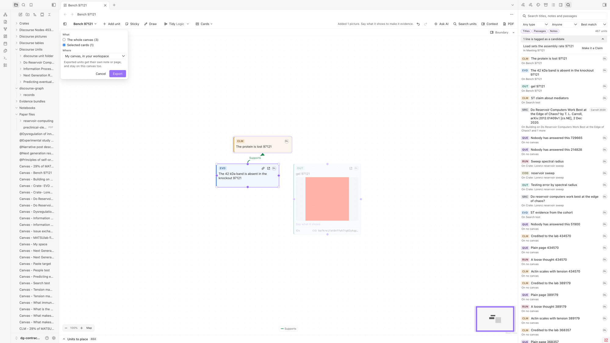

Give a type a **candidate tag** in Types and relations, such as `clm-candidate` for Claim. Then tag a line while you write:

`- Load sets the assembly rate #clm-candidate`

Search shows how many lines are tagged. Open that list and press **Make it a Claim**: the line becomes a unit with a note from the type's template, and the line is replaced by a link to it. Nothing becomes a unit until you press.

## Papers

### Reading a PDF

Obsidian's own PDF viewer stays the default. To read into the graph:

- **Read this PDF** (command), or right-click a PDF and choose **Read in Discourse Graphs**, opens that file beside the canvas.
- **Read a PDF…** (command, ribbon menu, or the PDF button on the canvas bar) opens the list of PDFs: papers first, then the rest, newest first. The box finds by title, file or folder.
- **Add PDF**, or dropping a PDF anywhere on the reader, keeps the file in the `Paper files` folder and opens it.

The reader's bar holds the file chooser, the page box, zoom in, zoom out, fit the page width, **Units** (the list of units read from this PDF), and **Extract graph**. Type a page number and press Enter to go there. Escape puts the number back.

**To make a unit,** select a passage. A small popup starts with the selected words as the unit's title, the last type used (Evidence the first time), and the canvas in front. Press a type's letter to change the type. **Save to** chooses another canvas, **New canvas…**, or **No canvas, the graph only**. Enter saves. The bar says where it went, with **Undo**.

- The unit keeps the exact words, the page and the file, so its highlight is found again even if the file is renamed, and stays lit at any zoom.
- Each unit read from the PDF is lit in its type's color, extracted ones included. Click a lit passage to select its unit: Context follows and the canvas lights its card.
- A passage whose words are not in the file's text is counted in the Units list, not hidden.
- The highlight's card lands in a clear spot in view on the canvas, and flashes once.
- The first highlight in a file makes a Source unit for it.

### Extract graph: a whole paper at once

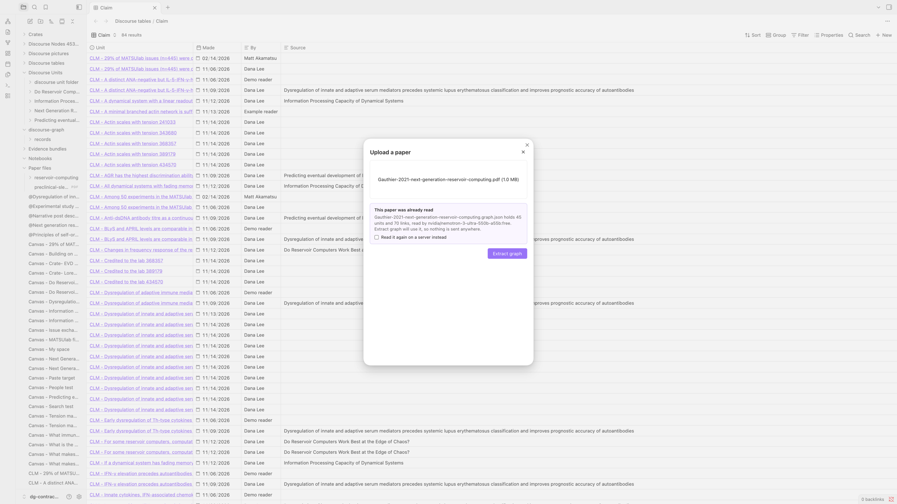

**Extract graph** reads a whole paper into questions, claims, evidence, the runs it reports and the methods they followed, on a PDF canvas. There are three ways in, and they do the same thing:

- In the reader, **Extract graph** on the bar.
- Right-click a PDF and choose **Extract graph**, or run **Extract graph from this PDF**.
- **Upload a paper**, for a file that is not in the vault yet. It takes PDF, Word, Markdown and text files. A PDF is kept in `Paper files`, so its units open at their passages.

**If the paper was already read somewhere else,** nothing is sent anywhere. A saved extraction is a file with the paper's name and `.graph.json`, or MIRA's `.mira.jsonld`, in place of `.pdf`. Put it beside the PDF, or pick both files together, and Extract graph uses it. The dialog says which file it found, how many units it holds and which model read it. Tick **Read it again on a server instead** to ignore it.

**With no saved extraction,** the dialog asks three things:

| Choice | Options |
|---|---|
| **Where it runs** (compute server) | This computer, a server on your network, or one in the cloud. **Add a compute server** takes a name and an address, and **Test** checks the address before it is saved |
| **Extraction model** | **Demo replay** replays the saved extraction for the two demo papers. **Sentence split** sorts sentences by simple rules. **MIRA (hosted)** sends the file to the MIRA extraction app |
| **Schema** | **MIRA** or **Discourse Graph** |

The dialog says what will be kept and where. In a lab, the lab's reach can refuse a server outside the lab.

Asking twice for the same paper opens the canvas you already have. Once a paper has a canvas, the reader's bar shows **Canvas** in place of Extract graph.

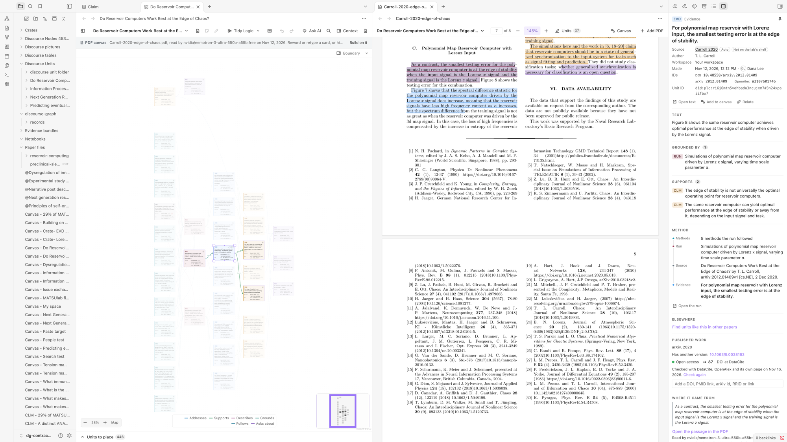

A PDF canvas lays itself out once, then stays where people put it. A run that a paper reports has no date, code or outputs of its own. Its page says which paper reports it and lists every method the paper says it followed.

### Exporting units

**Export…** in the canvas menu works on the selected cards, or on the whole canvas with nothing selected. Under **Where**:

| Destination | Does |
|---|---|
| My canvas, in your workspace | Puts the units on your own canvas |
| Your lab's canvas | Puts them on the lab's shared canvas. Shown when you are in a lab |
| A folder, or New folder | Files them in a Library folder |
| Another canvas | Puts them on that canvas |
| A research crate (RO-Crate) | Writes an archive. See [Research crates](#research-crates) |

## Zotero

Zotero has to be open, with "Allow other applications on this computer to communicate with Zotero" ticked under its Settings, Advanced. Your library is only read, never changed, and only when you ask.

### From Zotero

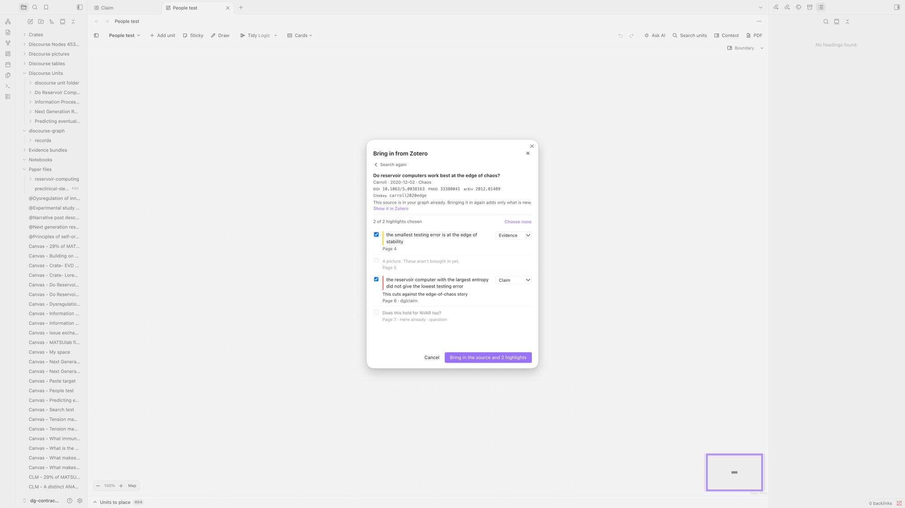

Open the canvas menu and choose **From Zotero…**, or run **Bring in from Zotero…**.

1. Search your library by title, author or year.
2. Pick a reference. It becomes a **Source**, with its DOI and other identifiers. If the paper is in your graph already, it joins that source and adds nothing twice. A reference that is here already says so.
3. Its highlights are listed in reading order. Tick the ones to bring. Each becomes a unit that quotes its passage and knows its page. A highlight is Evidence unless you say otherwise. One you tagged `dg/claim`, `claim` or `CLM` in Zotero (or the same for another type) keeps that type.
4. **Bring in** puts them on the canvas.

In Context, a highlight has **Open the passage in Zotero**, and a source has **Show it in Zotero**. A comment you wrote beside a highlight comes along. Pictures and drawings in Zotero are listed and cannot be brought in.

### Zotero as your PDF library

In Settings, under Papers and notebooks, **Use Zotero as your PDF library** makes Zotero the place your papers are.

- **Read a PDF…** lists Zotero's PDFs first, under **In Zotero**, each named for its reference, such as "Seoane 2019". What is only in this vault follows under its own heading.
- A paper opens from where Zotero keeps it. Nothing is copied into the vault, and nothing is written to Zotero.
- A highlight you make, or a whole paper you extract, belongs to that reference. Its source carries the DOI and other identifiers Zotero holds.
- If the vault holds its own copy of a paper Zotero has, the paper is listed once, as Zotero's.
- When Zotero is closed, the list says so and shows what the vault holds. The settings line says whether Zotero is answering and how many PDFs it has.
- The small **Z** beside a source means it is in your Zotero library. On a selected card, in Context and in the reader, pressing it shows the item in Zotero.
- In the reader, **N in Zotero** means you have highlights on this PDF in Zotero that are not units yet. It opens From Zotero at that reference with them ticked.

A PDF you add in the reader while Zotero is your library is kept in the vault only.

[zotero.md](../zotero.md) has the details of what is read and how.

## Runs, notebooks and pictures

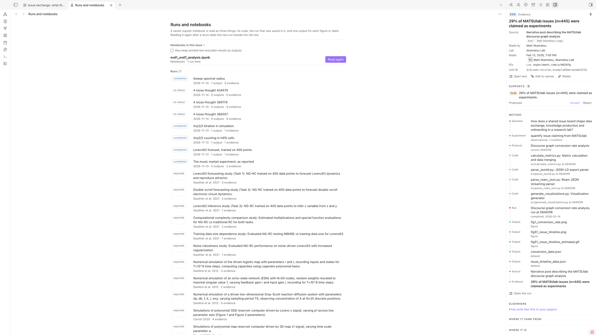

**Open runs and notebooks** (command, or the ribbon menu) lists the Jupyter notebooks in your vault and the runs already in the graph.

**Read into the graph** turns a saved notebook into three things: its **code**, the **run** that was saved in it, and one **output** for each figure and table. Reading it again after a rerun adds the new run beside the old one. Reading the same saved run twice adds nothing. Printed text and plain results are kept too only when the setting **Keep printed text from notebooks** is on.

You can also right-click an `.ipynb` file and choose **Read into Discourse Graphs**, or run **Read this notebook into the graph**.

### A run's page

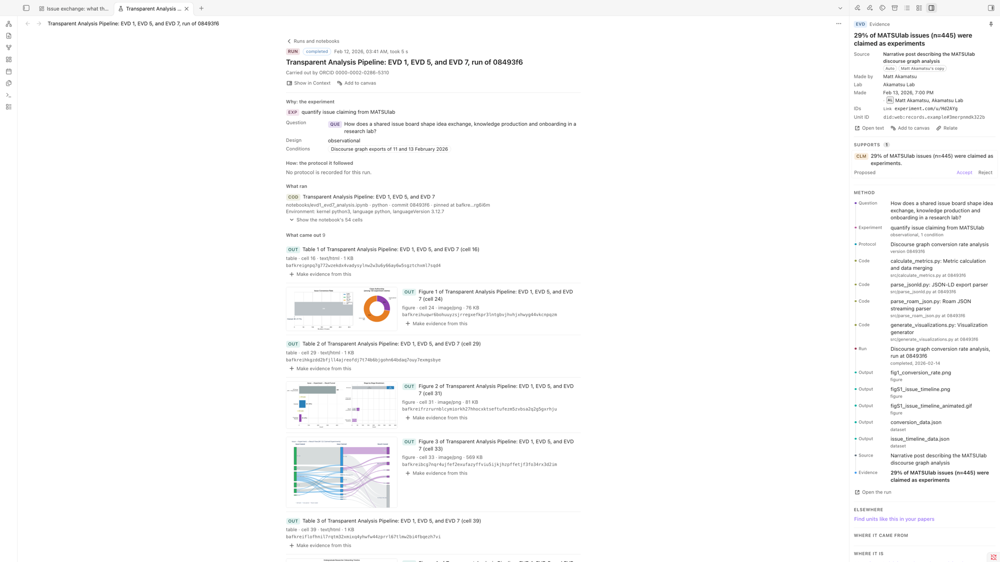

A run's page reads top to bottom in the order the work happened:

- **Why:** the experiment, its question, hypothesis, design and conditions, and which condition this run carried out.
- **How:** the protocol it followed, its steps, the parameters with their defaults and this run's values, and where this run departed from it.
- **What ran:** the code and its version, the environment, and the notebook's cells.
- **What came out:** each output, with the cell that made it and its hash.
- **What it is used to argue:** the evidence resting on it and the claims that rest on those.

A figure is shown only while the notebook on your device still holds the same bytes. If you rerun the notebook, the old run's page says the notebook has changed and stops showing the new figure as the old run's.

**Make evidence from this**, on an output, makes evidence pinned to those bytes and offers it to the open canvas. Rename it to say what the output shows.

### Pictures as evidence

Drop a picture on a canvas, or paste one. It is kept in the folder `Discourse pictures` under its own name, and becomes an Output with its card on the canvas.

- **Say what it shows**, on the card, takes a sentence and makes Evidence that rests on the picture. The evidence lands beside it.
- **The picture is pinned by a hash of its bytes.** The same picture added twice is one unit. If the file is changed later, its card says so and does not show the new file as the result.
- A crate exported from the canvas packs the picture, checked the same way.

PNG, JPEG, GIF, WebP, SVG and TIFF, up to 20 MB each.

## Sign-off, reactions and notes

### Sign-off

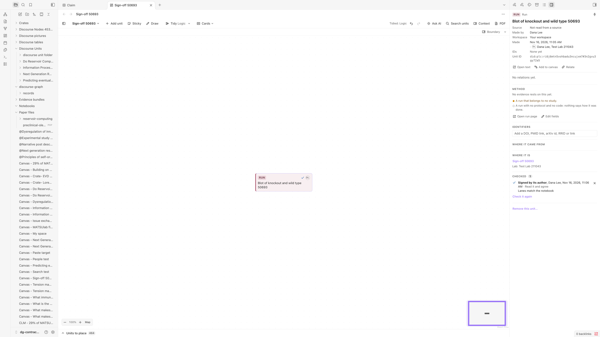

At the foot of Context, **Checked** shows who has checked a unit. **Sign this unit** on your own unit, or **Mark as checked** on someone else's, asks how you checked it and takes an optional note. **Needs work…** sends a teammate's unit back, and needs a reason.

The ways to check: **Read it and agree**, **Read the source**, **Checked the quote against the source**, **Reanalysed the data**, **Repeated it**.

- A checked unit shows a check mark on its card.
- A mark is made on one version of the unit. If the unit changes afterwards, the mark greys and the panel says it was made on an earlier version. **Check it again** marks the new one.
- A mark is yours to take back, with the × beside it.
- A table of a type has a **Checked** column, so a PI can list what is checked, changed or sent back.
- An exported crate names who checked each finding, and an `.eln` file carries a run's sign-offs as comments.

### Reactions and notes

Units on shared canvases can carry reactions and notes. They sit beside a unit and never change it.

- **Reactions** are interesting, agree and disagree. They show compactly on the card. A card with none shows nothing until it is hovered. Nothing notifies anyone, and a reaction never stands for approval.
- **Notes** live in their own thread in Context, and the card shows a count.

### Breadcrumbs

When you close a paper shared with your lab, you can leave a breadcrumb that says you read it. The Lab tab's **When I close a lab paper** sets this: ask each time, always leave one, or never leave one.

## Ask AI

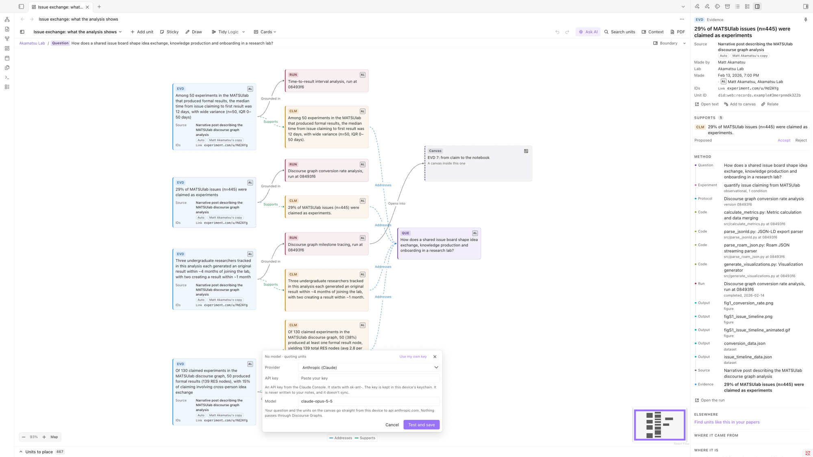

**Ask AI** on the canvas bar opens a bar over the canvas. Its first line says whose model will answer.

**With no model,** it says so and a question still works: it finds the closest units and quotes them word for word.

**To use your own key,** click **Use my own key**, or fill the same fields in Settings:

1. **Provider.** Anthropic (Claude), OpenAI-compatible, or Google Gemini. OpenAI-compatible covers OpenAI, OpenRouter, and a model on your own computer such as Ollama or LM Studio. For those, set the address, such as `http://localhost:11434/v1`.
2. **API key.** Paste it. It is kept in Obsidian's keychain (Settings → Keychain), which your operating system encrypts. It is never written to your notes, and once saved only its last four characters are shown. **Remove** deletes it.
3. **Model.** Chosen from the list your key can use. If the list cannot be read, type the model's id.
4. **Send questions** (only in a lab). Straight from this device, or through your lab's server, which uses the key for that one question and does not keep it.
5. **Test and save** sends one short message and tells you what came back.

In a lab that offers a model, **Whose model answers** chooses between **My lab's model** and **My own key**.

The line at the bottom of the form says where your question and the canvas's units will go.

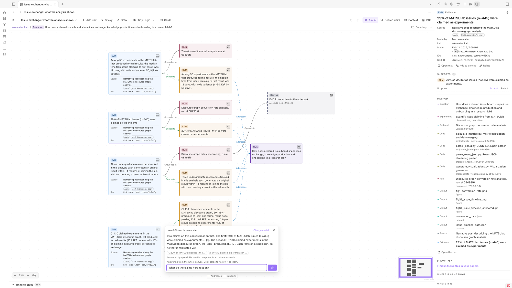

**To ask:** type a question and press Enter. By default the answer draws on the whole canvas. Click cards first to narrow it to them, and **Use the whole canvas** widens it again. Each number in the answer is a unit, and clicking it brings that card into view. **Stop** ends an answer early and keeps what arrived. Escape closes the bar.

An answer is a reading aid. It is not added to the graph.

[ai.md](../ai.md) has the full account of models and routes.

## Published work and research crates

### Published work, and identifiers

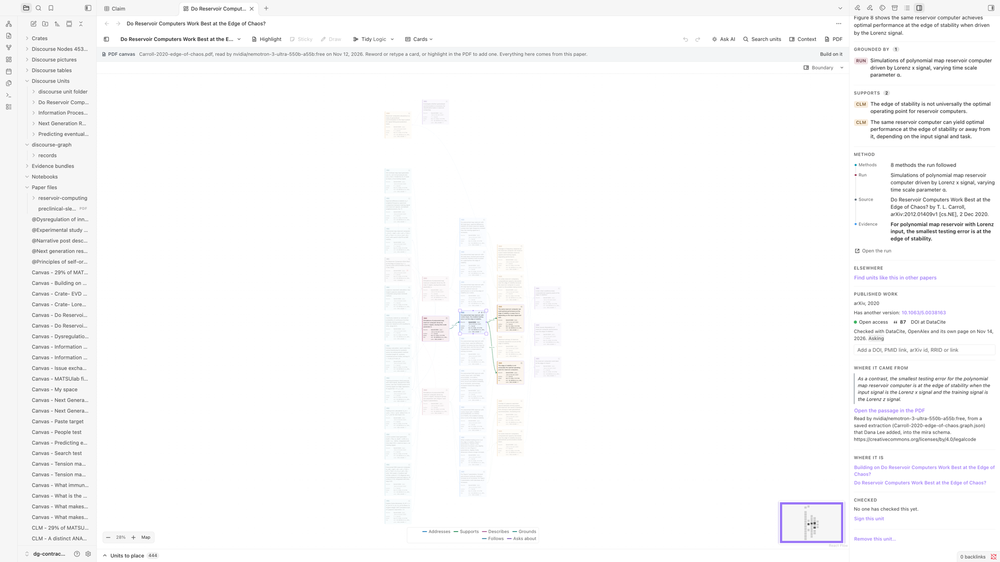

A unit read from a paper has a **Published work** section in Context. **Look it up** asks the open registries about the paper: Crossref or DataCite (whichever registered its DOI), OpenAlex, PubMed, and the paper's own page. Only the paper's identifiers are sent, or its title when it has none a registry knows. Nothing is asked until you click.

What comes back is kept with the paper and shows on every unit read from it:

- its other identifiers, such as a PMID, an arXiv id and an OpenAlex id
- where and when it was published
- whether it is open access, and how often it has been cited
- **whether it has been retracted or corrected**, which also shows on the card
- another version of the same work, such as the journal article behind a preprint

The line under them says which registries answered, and when. A registry that did not answer is listed with the reason.

**Add an identifier** takes whatever you paste for a unit of your own: a DOI, a PubMed link, an arXiv id, an ORCID iD, an RRID for an antibody or a cell line, or any link.

When a paper's page says it takes announcements, **Announce this unit to the paper's repository** shows you exactly what would be sent and where. It is sent only if you press **Send**. It needs a lab, because replies come back to your lab's server.

### Research crates

A research crate ([RO-Crate](https://www.researchobject.org/ro-crate/)) is one archive that describes itself: what is in it, who made it, what it was read from, and how each run was carried out. Repositories such as Zenodo and WorkflowHub read it, and so do lab notebooks.

**To make one:** open the canvas menu, choose **Export…**, and under Where pick **A research crate (RO-Crate)**.

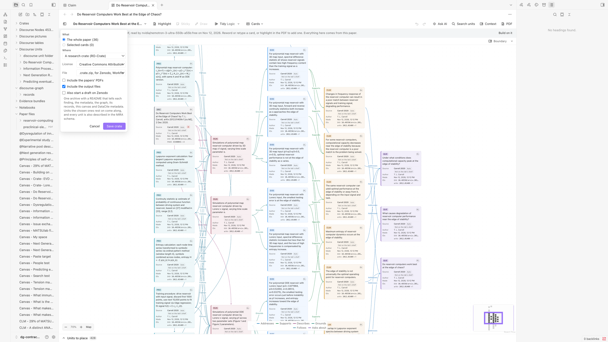

| Choice | What it means |
|---|---|
| License | How others may reuse the crate. Left unchosen, the crate says that none was chosen |
| File | `.crate.zip` for Zenodo, WorkflowHub and RO-Crate tools. `.eln` for eLabFTW, RSpace and other lab notebooks |
| Include the papers' PDFs | Off unless you tick it. Only include a paper you may pass on |
| Include the output files | Packs each output's file. A file that no longer matches its hash is left out |
| Also start a draft on Zenodo | For `.crate.zip`. Sends the crate and your Zenodo token to Zenodo and starts a draft there, with **Review it on Zenodo**. **Use Zenodo's sandbox** tries it out without a real deposit. The token is kept in the keychain, with **Remove it** |

The archive is saved in your vault under `Paper files`. It holds the description, a page to read it by, the graph, this canvas, and metadata for a repository that will give it a DOI. Units that the chosen ones rest on come along, so the crate explains itself.

**To read one:** put the `.crate.zip`, `.eln` or `ro-crate-metadata.json` in your vault, right-click it and choose **Import this research crate**. A crate made here comes back exactly as it was. Someone else's becomes sources, code, runs and outputs on a new canvas, each marked Imported, with each run keeping what it used and what it made. A unit that arrived from elsewhere keeps the name of who first made it.

[scholarly.md](../scholarly.md) covers the formats in full.

## People, profiles and labs

### Profiles

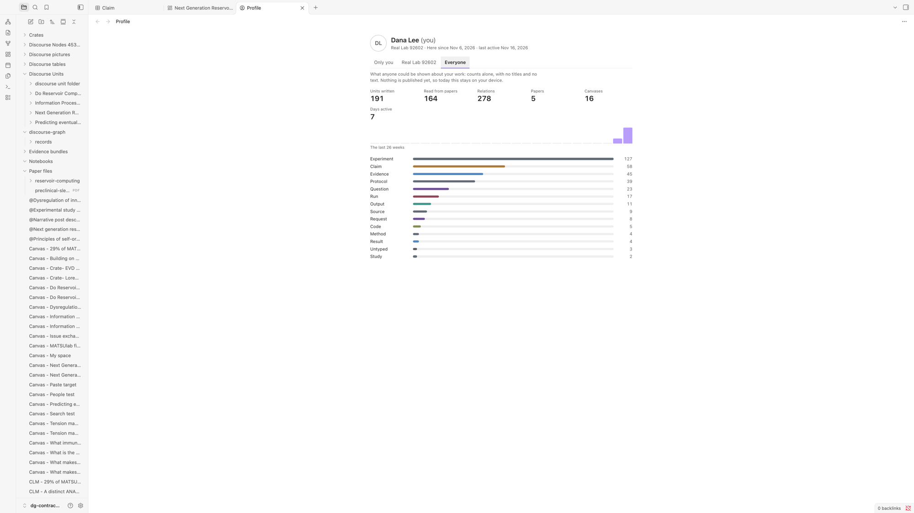

Everyone who has made something in your graph has a profile. Open your own from the ribbon menu or **Open my profile**. Open anyone's by clicking their initials, wherever they show.

A profile has up to three tabs, and each says who can see it:

| Tab | Who sees it | What it shows |
|---|---|---|
| **Only you** | You | Everything you did that is not on a shared canvas: a history by day, and counts |
| **Your lab** | Everyone in your lab | What you did on what the lab shares: the same history and counts, for that work alone |
| **Everyone** | Anyone | Counts alone: units written, units read from papers, relations, papers, canvases, days active, and a chart of the last 26 weeks. No titles and no text |

On someone else's profile you see only the tabs you are allowed: a labmate's lab work and counts, a stranger's counts.

The history is read from the record of what was done, so nothing extra is tracked to make it. A paper read with Extract graph is one line ("Read a paper into 36 units"). Units you wrote are counted apart from units a model read for you. Click a line to open the unit it is about.

### Labs

Library, then the **Lab** tab. **Join or start a lab** is also a command and a button in Settings.

- **Start a lab** and you are its PI.
- **Invite someone:** press **Make an invitation** and send them the line. It is shown only once, works once, and lasts a week. **Take back** cancels it. They paste it into **Join a lab** and are in at once. Someone with only the lab's identifier can ask to join, and the PI presses **Accept** or **Decline**.
- **What the lab sets for everyone** is the PI's to choose, and every member gets it:
  - **The lab's shelf of papers:** a Zotero group, or papers shared with the lab here.
  - **Model servers the lab offers:** each a name and an address. **Make first choice** sets the default.
  - **Where papers may be read by a model** (the lab's reach): this computer, the lab's own servers, or anywhere.
- **The lab's grammar** is the PI's. Members use it, and types a member adds sit beside it.
- **Members** lists everyone, with **Remove** for the PI. A removed member gets nothing more from the lab and keeps their own work.
- **Your devices:** open the vault on a second computer and it asks to sign as you. On a computer you already use, the Lab tab lists it under **Your devices**. Press **Let it in**. Until then the new one shares nothing. Remove a lost device from the same list.
- **If you are removed,** your own work and grammar stay. What the others shared is put away, and its notes go to the trash. It all comes back if you are invited again.
- **A paper's shelf** tells you who can open its PDF. "Lab shelf" means everyone in the lab. "Not on the lab's shelf" means only you. "Tomas's copy" means it is in Tomas's own library, and you can find it by its DOI.

Shared canvases sync with the lab's server by themselves every few seconds. Every record is signed by the device that wrote it. A record that says a labmate wrote it and does not carry a signature from one of their devices is refused, and the Lab tab says whose and how many. A labmate can add what is known about your unit, such as where its PDF is. They cannot reword it or remove it.

[labs-and-sync.md](../labs-and-sync.md) explains how sharing, signing and devices work.

## Types and relations

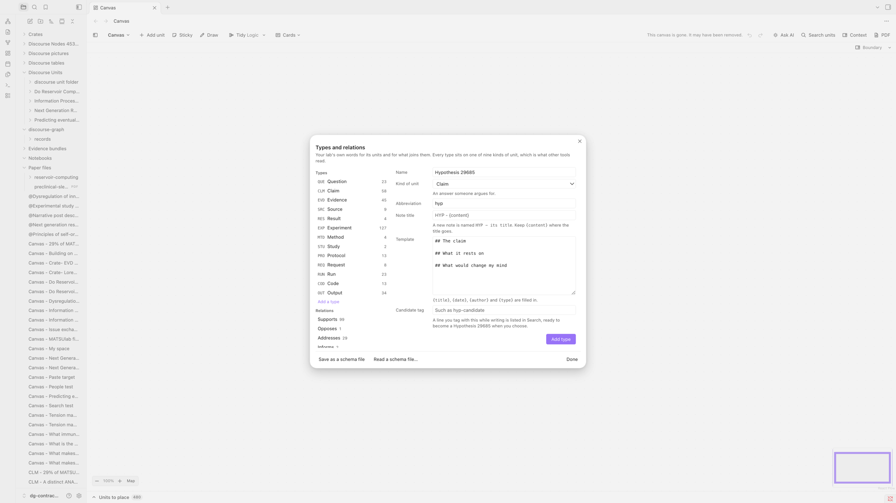

**Types and relations…** is in the command palette, the ribbon menu, the canvas menu and Settings. It is where a lab sets its own words.

- **A type** has a name, a kind of unit, an abbreviation, the pattern its note is titled by, a candidate tag and a template. The kind is one of nine: question, claim, evidence, source, study, protocol, run, code or output. The kind is what other tools read, so "Hypothesis" as a claim still travels as a claim. A lab can add as many types as it likes on those nine, and cannot add a tenth kind.
- **The note title** pattern has exactly one `{content}`, such as `CLM - {content}`. The dialog shows what a new note would be named.
- **A template** is what a new note of that type starts with. `{title}`, `{date}`, `{author}` and `{type}` are filled in. **Start from the usual headings** gives the headings a lab notebook would use for that kind: a run starts with what was done, departures from the protocol, observations, and files and images.
- **A relation** has its wording both ways, such as Supports and Supported by, and the pairs of types it may join. A relation is only offered between the pairs it lists. One with no pairs is never offered.
- **Remove…** takes a type or relation out of use. It is refused while units or links still have it, and it says how many.
- **Open its table** makes a table of every unit of that type, with Obsidian's own Bases, in the folder `Discourse tables`. Each unit's note carries its type, the day it was made, who made it, a run's status and its paper as properties (`dg-type`, `dg-made`, `dg-by`, `dg-status`, `dg-source`), so the table can sort and filter by them. A table you rearrange stays as you left it.

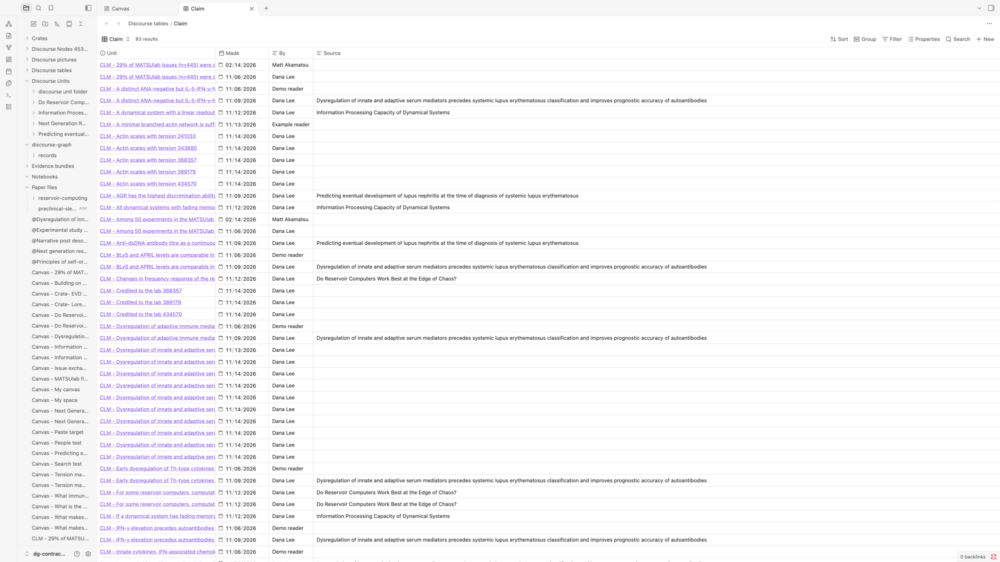

- **Save as a schema file** writes every type, relation, allowed pair and template to `discourse-graphs-schema.json`, by name. **Read a schema file…** adds what is missing from such a file and changes nothing that is already here. It also reads the schema file the official Discourse Graphs plugin for Obsidian exports.

A new vault starts with Question, Claim, Evidence and Source, and the five relations above. Protocol, Experiment, Run, Code and Output types are added the first time one is needed.

## Removing things

- **A card:** Delete takes it off the canvas. The unit stays.
- **A link:** Delete asks whether to take it off this canvas or withdraw the relation.
- **A canvas:** the canvas menu, then **Remove this canvas…**. Only its maker can, and a PDF canvas stays. The units on it and their links are untouched, and its note goes to Obsidian's trash.
- **A unit you made:** the foot of Context, then **Remove this unit…**. It leaves every canvas and its note goes to the trash.
- **A type or relation:** see above.

Undo brings back anything removed on a canvas in the same tab.

## Settings

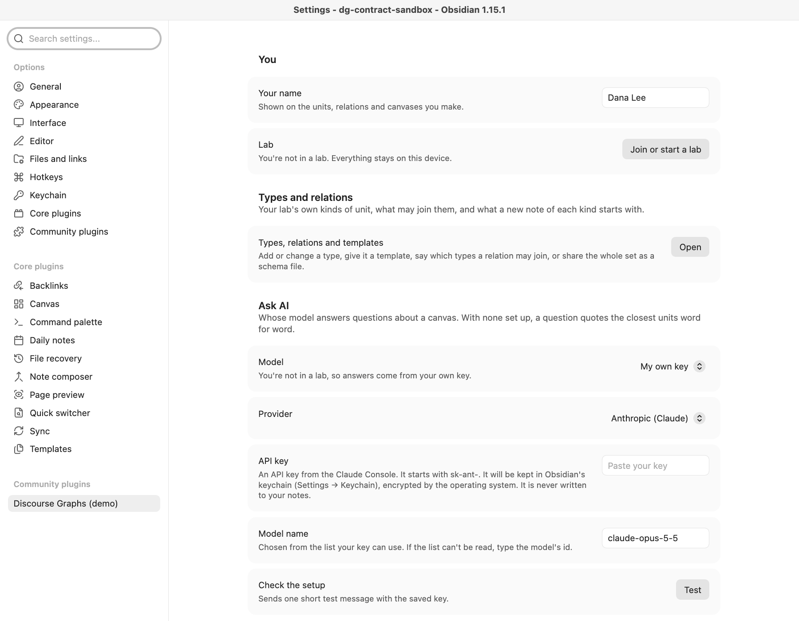

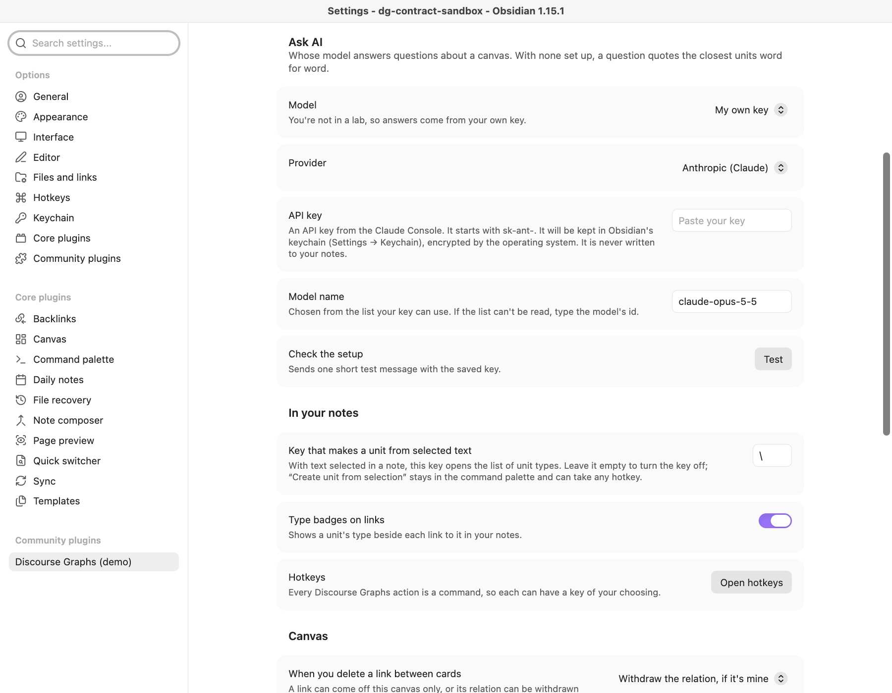

Obsidian → Settings → Discourse Graphs. Choices are kept per device.

| Section | Setting | Default | What it does |
|---|---|---|---|
| You | Your name | Empty | Shown on the units, relations and canvases you make |
| | Lab | Not in a lab | Says which lab you are in and its server. **Join or start a lab** opens the dialog |
| Types and relations | Types, relations and templates | | **Open** shows the Types and relations dialog |
| Ask AI | Model | My own key | In a lab that offers a model: my lab's model, or my own key |
| | Provider | Anthropic (Claude) | Anthropic, OpenAI-compatible, or Google Gemini |
| | Address | The provider's own | For OpenAI-compatible providers and local model servers |
| | API key | None | Kept in the keychain. **Remove** deletes it |
| | Model name | The provider's default | From the list your key can use, or typed |
| | Send questions | Straight from this device | In a lab: or through the lab's server |
| | Check the setup | | **Test** sends one short message with the saved key |
| In your notes | Key that makes a unit from selected text | `\` | Any one key. Empty turns the key off. The command stays |
| | Type badges on links | On | Shows a unit's type beside each link to it |
| | Hotkeys | | Opens Obsidian's hotkeys, filtered to this plugin |
| Canvas | When you delete a link between cards | Ask each time | Ask each time, take it off this canvas only, or withdraw the relation if it is mine |
| Papers and notebooks | PDFs | | Explains how PDFs open. Nothing to set |
| | Use Zotero as your PDF library | Off | Lists Zotero's PDFs as your papers. The line says whether Zotero is answering |
| | Keep printed text from notebooks | Off | Also keeps printed text and plain results as outputs |
| Help and privacy | Walkthrough | | **Start**, and **Remove examples** |
| | Usage log | | Counts entries in the on-device log. **Clear** empties it |
| | What leaves this device | | A plain statement. Nothing to set |

Four more choices are kept per device and set where they are used: what cards show (the **Cards** list), whether the canvas sidebar is pinned, whether the canvas map shows, and the breadcrumb default (the Lab tab).

## Commands

None has a default key. Give any of them a hotkey in Obsidian's Hotkeys settings.

| Command | Does |
|---|---|
| Open canvas | Opens the last canvas |
| New canvas | Makes a canvas |
| Open the Library | The Library panel |
| Open the overview | A workspace's questions and their claims, laid out from the graph |
| Open boundary | The Boundary panel |
| Open paper map | Papers placed by how tied they are |
| Open my profile | Your profile |
| Open context panel | The selected unit's context |
| Search units | The search panel |
| Find a unit | The quick finder |
| Put the side panels back | Reopens the side panels where they belong |
| Create unit from selection | Makes a unit from the selected words in a note |
| Turn this note into a unit | Makes the note in front a unit |
| Toggle link badges | Type badges beside links in notes |
| Read a PDF… | The reader's list of PDFs |
| Read this PDF | Opens the PDF in front in the reader |
| Extract graph from this PDF | Reads the whole PDF in front into a graph |
| Upload a paper | Extract graph for a file that is not in the vault yet |
| Bring in from Zotero… | Finds a reference in Zotero and brings it in with the highlights you choose |
| Import this research crate (RO-Crate or .eln) | Reads the crate in front into the graph |
| Open runs and notebooks | The list of notebooks and runs |
| Read this notebook into the graph | Reads the notebook in front |
| Types and relations… | The grammar dialog |
| Join or start a lab | The lab dialog |
| Set my name | Changes the name your work is credited to |
| Start walkthrough | Runs the tour |
| Remove walkthrough examples | Takes the tour's note, units and canvas out |

These are offered only while a canvas is in front:

| Command | Does |
|---|---|
| Canvas: add a unit | The Add unit box |
| Canvas: tidy | Tidies in the current mode |
| Canvas: fit to view | Fits the whole canvas in the frame |
| Canvas: choose what cards show | The Cards list |
| Canvas: ask AI | Opens the Ask AI bar |
| Canvas: export… | The Export dialog |
| Canvas: undo, Canvas: redo | Steps through the canvas's edits |

## Keys

These work on a canvas when no text field has the keyboard.

| Key | Does |
|---|---|
| N | Add unit |
| T | Add a sticky |
| D | Draw, on and off |
| L | Tidy in the current mode |
| U | The Units tab of the sidebar, open and closed |
| Enter | Opens the selected card's text |
| F2 | Renames the selected card, if it is yours |
| Delete | Takes the selection off the canvas. On a link, asks first |
| ⌘Z or Ctrl+Z | Undo |
| ⇧⌘Z, Ctrl+Shift+Z or Ctrl+Y | Redo |
| ⌘C, ⌘X, ⌘V | Copy, cut and paste cards with their links |
| Escape | Closes menus and Ask AI, and returns to selecting |
| Arrow keys, Home, End | Move along the bar when it has the keyboard |

Elsewhere:

| Where | Key | Does |
|---|---|---|
| A note, with text selected | `\`, then a type's letter | Makes a unit |
| The finder | Enter, ⌘↵, Alt+↵ | Open, put on the canvas, link at the cursor |
| The reader's highlight popup | A type's letter, Enter | Picks the type, saves |
| The reader's page box | Enter, Escape | Goes to the page, puts the number back |
| Any dialog | Escape | Closes it |
| Ask AI | Enter, Escape | Asks, closes |

## Where things are kept

| Thing | Where |
|---|---|
| Your notes | Your vault, as Markdown |
| The graph | `discourse-graph/records/` in your vault: one append-only file per device |
| Canvases | Notes named `Canvas - <title>`, also mirrored as `.canvas` files Obsidian's own Canvas can open |
| Notes of units read from a paper | `Discourse Units/<paper title>/` |
| PDFs you add, and exported crates | `Paper files/` |
| Pictures dropped on a canvas | `Discourse pictures/` |
| Tables of a type | `Discourse tables/` |
| A schema file | `discourse-graphs-schema.json` |
| A model key and a Zenodo token | Obsidian's keychain, outside the vault |
| Your signing key | The device. It cannot be copied or backed up. Each further device makes its own, and a device you already use lets it in |
| This device's id | The device, not the vault, so two devices never write one log |
| Your link to a lab | The device |
| Settings and the usage log | The device |

## What leaves your device

With no lab joined, no model set up and no server chosen, nothing leaves. [what-leaves-the-device.md](../what-leaves-the-device.md) is the full account: one row for each destination, with what is sent, when, and whether it can be turned off. In short:

- **In a lab,** the canvases shared with it and what is on them go to your lab's server, and from there to your labmates, by themselves every few seconds.
- **Adding a paper to the lab's shelf** sends its graph and details. The file goes only if you tick it.
- **Ask AI** sends your question and the canvas's units to the provider you chose, or to your lab's server. With a model on your own computer, they go nowhere.
- **Extract graph** sends the paper to the server you pick, unless a saved extraction sits beside it.
- **Look it up**, a Zenodo draft and an announcement each send only when you press the button.
- **Zotero** is asked only on this computer.
- **Reading a PDF or a notebook, and opening a profile,** send nothing.

There is no telemetry. The usage log stays on your device. It holds each action's name, whether it worked, how long it took and when, and never what you wrote.

## Limits

- This guide describes the Obsidian plugin. The Roam adapter and the local browser app share the canvas and panels and do not carry every feature here: tables, link properties in notes, and Obsidian commands and modals are Obsidian's alone.
- A person is in one lab at most. Shared workspaces with invited members outside a lab are not built.
- A profile's **Everyone** tab is not published anywhere. It stays on your device.
- Elsewhere and search match on words, not meaning.
- Zotero pictures and drawings are not brought in. Zotero is never written to.
- Dropping a PDF on a canvas does nothing. Drop it on the reader.
- Closing the upload dialog during an extraction loses the result.
- A workspace that is not yours or your lab's has no name and reads "Someone else's workspace".
- What was already sent to a lab cannot be unsent when you leave it.

Planned work is in [ROADMAP.md](../../ROADMAP.md).
